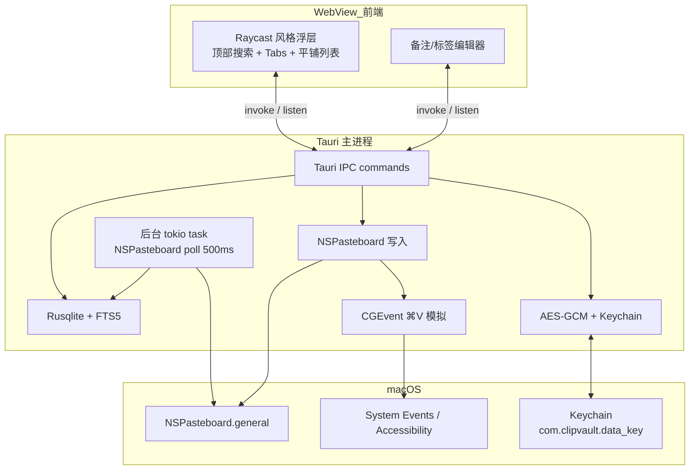
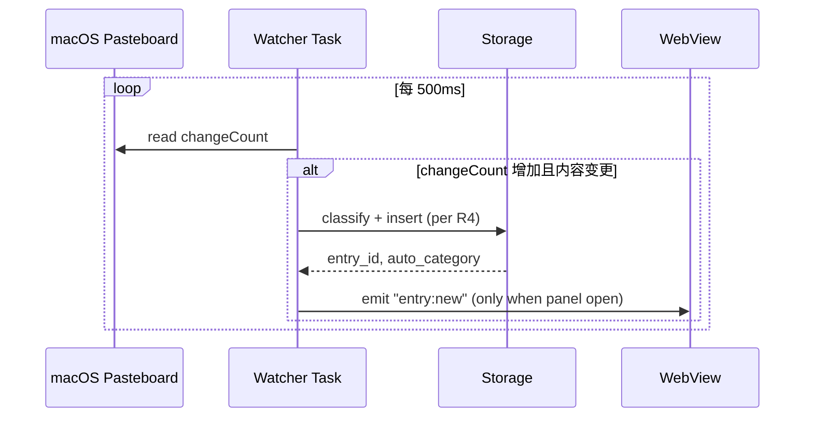
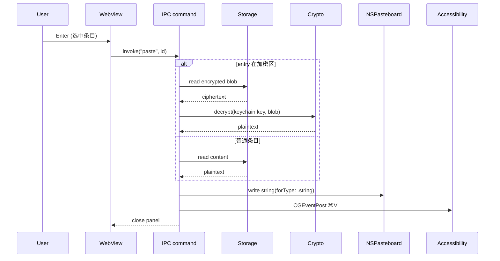
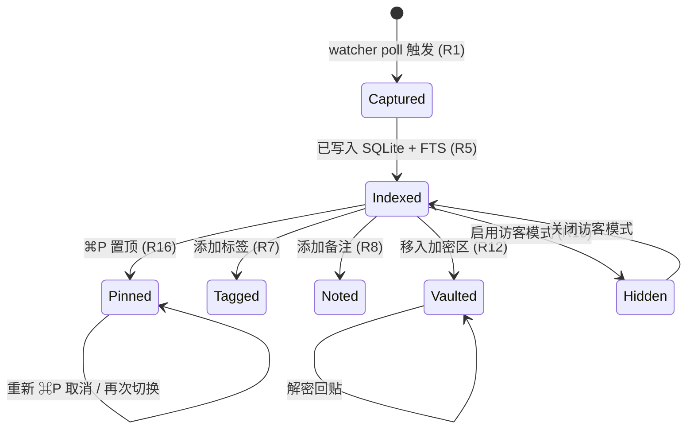

## Goal Capsule

**Objective.** 用户在 macOS 上能持续看到、即时唤起、精准搜索自己过去复制过的纯文本,保留自动类别与人工标签,并通过快捷键将其中任意一条立刻粘贴回当前光标位置;每条记录支持独立备注与逐条 Pin 置顶,搜索同时命中内容/备注/标签三类字段。

**Means.** Tauri 2.x 单进程桌面应用,系统托盘常驻 + 全局快捷键呼出 Raycast 风格命令面板,SQLite 本地存储 + FTS5 搜索,Accessibility 模拟 ⌘V 回贴,Keychain 托管 AES-GCM 密钥。`KTD1, KTD2, KTD3, KTD4, KTD5`。

**Product authority.** 这是 ClipVault 的首个产品定义;图片/文件剪贴板、iCloud 同步、跨平台客户端均在上下文之外,不进入当前活跃范围。

**Stop conditions.** 当全部 `U1`–`U11` 通过各自的 Verification 字段,所有 8 条 Acceptance Example 在 macOS 13+ 真机上跑通,且 Definition of Done 全项满足时,视为可发布;在此之前不得声明完成。

---

## Product Contract

> **Product Contract preservation:** Product Contract unchanged (R1–R17 与 AE1–AE8 的 ID 与含义保持原状;Key Decisions 中归责链接已对齐 KTD;Implementation Units 是新增的实施工作切分,未触动产品边界)。

### Summary

ClipVault 是一款 macOS 上的纯文本剪贴板管理器,以菜单栏常驻 + 全局快捷键呼出浮层的产品形态提供入口,内置自动类别启发式(URL/Email/路径/代码/JSON/纯文本)与自由标签双轨分类,默认双模 Raycast 风格视图(顶部搜索框 + tab 切换"最近/全部/标签/类别"),兼顾快速回贴与长期找回。每条记录支持独立备注与逐条 Pin 置顶;搜索同时命中内容、备注与标签字段,并保证置顶条目在任何视图下排在非置顶条目前。隐私层面默认全存,辅以"本次不记录"快捷键、加密区(AES-GCM + Keychain)、访客模式三道用户可控开关。

### Problem Frame

macOS 自带的 `pbcopy`/`pbpaste` 只记住最近一项;长时间工作下来,用户复制过的 UUID、长文本片段、URL、代码片段、备注等散落在粘贴板历史之外,事后只能凭记忆重打或外部工具搜回。主流付费剪贴板管理器(Maccy / Paste / Raycast 历史)用菜单栏常驻 + 浮层唤起解决入口问题,但都缺少轻量的"按备注与项目标签长期找回"。本计划的产品意图是补齐这一空白:把"剪贴板"从一次性缓冲区升级为可按工作流组织的长期资料库,同时把隐私决策权完整地留给用户。

### Key Decisions

1. **产品形态采用"菜单栏常驻 + 全局快捷键"组合** `(session-settled: user-approved — chosen over 单菜单栏 / 单快捷键 / 纯 launcher: 覆盖面最完整,符合主流付费剪贴板工具范式)`. Governs R1, R2, R5.
2. **MVP 内容范围限定为纯文本** `(session-settled: user-directed — chosen over 文本+图片 / 全格式: 最小可用产品先行;图片与文件引用作为延期项记录在 Scope Boundaries)`. Governs R3.
3. **分类机制为自动类别 + 自由标签双轨** `(session-settled: user-approved — chosen over 全自动 / 全手动 / 文件夹树: 自动准确性 + 用户自由度兼顾;UI 上并列显示)`. Governs R4, R7.
4. **使用模式为双模默认视图** `(session-settled: user-approved — chosen over 快速复制型 / 长期保存型: 浮层默认顶部搜索框,tab 在「最近/全部/标签/类别」切换,兼顾快速粘贴与长期检索)`. Governs R5, R6.
5. **敏感数据默认全存,加三道用户可控开关** `(session-settled: user-approved — chosen over 启发式跳过 / 不管全存: 默认体验零摩擦;提供「本次不记录」快捷键 / 加密类别 / 访客模式三道用户侧开关)`. Governs R9, R10, R11, R12.
6. **存储默认 SQLite + 本地文件,默认不连接网络、无云同步.** MVP 范围内的合理默认;云同步作为延期项记录在 Scope Boundaries。Governs R9, R13.
7. **UI 框架与代码签名方案留给 `ce-plan` 决定.** Tauri 2.x 与 Raycast 视觉风格作为规划阶段的输出,落到 `KTD1`。
8. **每条记录可独立 Pin 置顶并在所有视图中置顶优先.** Pin 是用户主动标记的二级排序维度;置顶状态跨视图(最近/全部/标签/类别)与跨重启持续;多条置顶条目按置顶操作时间倒序排列,搜索结果也遵守该排序。`Governs R16, R17`.

### Actors

- **主用户.** macOS 上希望长期管理剪贴板历史、随手检索与重用的个体使用者。直接与菜单栏图标、浮层 UI、键盘快捷键交互。
- **macOS 系统.** 通过 `NSPasteboard` 提供文本来源,通过 Accessibility(`System Events` 模拟 ⌘V)实现回贴。系统行为本身不在 ClipVault 范围内,但 Accessibility 授权是其正常运行的硬前置。

### Key Flows

#### F1. 监听与捕获

**Trigger.** 任意时刻,macOS 粘贴板内容发生变化。

**Steps.**
1. 后台 watcher 监听到 `NSPasteboard.general` 的 `changeCount` 增长,读取 `string(forType: .string)`。
2. 与上一条指纹(SHA-256 前 12 字节)比对,5 秒内同条重复粘贴 → 去重,不写入。
3. 经"本次不记录"或"访客模式"开关判断后,执行自动类别识别(详见 R4)。
4. 写入 SQLite,记录指纹、内容、`auto_category`、时间戳。

**Covers R1, R3, R4, R11, R12.**

#### F2. 双模 UI 唤起与回贴

**Trigger.** 用户按全局快捷键(默认 `⌥⌘V`)或点击菜单栏图标。

**Steps.**
1. 浮层显示,默认光标在顶部搜索框;同时显示最近 N 条结果(默认 30)。
2. 用户输入关键词实时筛选,或通过 tab 切换「最近 / 全部 / 标签 / 类别」视图。
3. 方向键移动光标,`Enter` 调用系统级粘贴(借助 Accessibility 模拟 ⌘V,目标应用控制光标最终落点);`⌘E` 打开备注编辑面板;`⌘P` 切换当前条目的 Pin 置顶状态;`Space` 在长文本时预览完整内容。
4. 列表渲染遵守"Pin 优先"规则:在任何当前 tab 与筛选条件下,所有置顶条目按其置顶操作时间倒序排在所有非置顶条目前,不受搜索关键词重排序影响。
5. `Esc` 关闭浮层。

**Covers R2, R5, R6, R15, R16, R17.**

#### F3. 标签与备注维护

**Trigger.** 用户在某条目上按 `⌘E` 或点击标签/备注按钮。

**Steps.**
1. 弹出紧凑面板:备注为多行文本框,标签为自动补全 + `Enter` 添加,`Backspace` 删除。
2. 保存后立即在视图中反映,无需重启应用。
3. 备注内容同样进入搜索索引(子串 + trivial fuzzy)。

**Covers R7, R8.**

#### F4. 加密区与访客模式

**Trigger.** 用户在「类别」tab 上启用「加密区」,或在菜单栏菜单中勾选访客模式。

**Steps.**
1. 启用访客模式后,新监听文本不再写入 SQLite;已有条目只读可访问,可选隐藏。
2. 启用加密区后,移入该类别的明文经 AES-GCM 加密后存储,密钥由 macOS Keychain 托管;回贴时解密并写入粘贴板再模拟 ⌘V。
3. 任一开关的开关均立即生效,不需重启。

**Covers R9, R12, R13.**

### Requirements

#### 监听与采集

- R1. ClipVault 必须在登录用户会话内持续监听 `NSPasteboard.general`,在文本内容变更时(< 200ms 检测)同步捕获新增纯文本条目。
- R2. ClipVault 必须通过菜单栏常驻图标显示当前状态(监听中 / 访客模式 / 已暂停),并通过全局快捷键(默认 `⌥⌘V`)与点击菜单栏两种方式呼出主面板。
- R3. MVP 范围内,所有捕获对象仅为 `NSPasteboard.PasteboardType.string` 类型的纯文本;图片、富文本、文件引用不在捕获范围(见 Scope Boundaries)。
- R4. 每条入库条目都自动获得一个 `auto_category`,识别维度包括 `URL` / `Email` / `path`(Unix 路径前缀或 Windows 盘符)/ `code`(代码特征符比例阈值)/ `JSON`(`serde_json` 校验通过)/ `plain`(兜底)。

#### 检索与展示

- R5. 主面板顶部默认展示搜索框,光标初始位置在搜索框;搜索基于内容全文 + 备注 + 标签,支持子串精确匹配与 trivial fuzzy(单字符编辑距离)匹配,响应延迟 < 100ms(本地 5000 条基线下)。
- R6. 搜索框下方提供 tab 切换「最近(默认 30 条)| 全部 | 标签 | 类别」视图;标签 tab 列出用户标签及条目数,类别 tab 列出 R4 中所有自动类别及条目数。
- R7. 用户可为每条条目附加 0 个或多个自由标签(任意非空字符串),标签与 `auto_category` 在 UI 上并列显示,均可作为筛选维度。
- R8. 用户可为每条条目附加可选备注(UI 上限 2000 字符,避免长文本挤占浮层);备注内容同样进入搜索索引。

#### 组织与排序

- R16. 用户可对任意单条记录切换置顶 / 取消置顶状态;必须提供至少一种触发方式(快捷键 `⌘P` 或 UI 按钮或右键菜单)。置顶状态随记录一起持久化,跨重启保留。
- R17. 在任何 tab 视图(最近 / 全部 / 标签 / 类别)与任何搜索筛选条件下,所有已置顶条目按其置顶操作时间倒序排在所有非置顶条目的最前;Pin 状态不参与搜索匹配,仅作用于结果排序。

#### 隐私与控制

- R9. 默认所有监听到的纯文本均入库(无内容审查、无敏感字段过滤);存储使用 SQLite 本地文件,权限沿用用户主目录。
- R10. 用户必须可随时启用「访客模式」开关,启用后新监听文本不入库,已有条目保持只读可访问。
- R11. 用户必须可在「本次不记录」修饰键(默认 `⌥` + 触发粘贴板复制的动作,或专门的快捷键组合)下,让下一次复制不入库;此为一次性,不污染后续监听。
- R12. 用户必须可在「加密区」类别下,将选中条目移入加密类别后由 AES-GCM 加密存储,加密密钥由 macOS Keychain 托管;回贴时解密。
- R13. ClipVault 必须默认不连接网络、不上传任何数据;后续若引入云同步必须由用户显式开启,且不作为默认值。

#### 系统集成与权限

- R14. 回贴到当前光标位置必须借助 macOS Accessibility(`System Events` 模拟 ⌘V 或直接写 `NSPasteboard` 后触发键事件);首次启动必须引导用户到 System Settings 授予 Accessibility 权限;未授权时主面板仍可访问列表与搜索,回贴动作必须给出明确不可用提示。
- R15. ClipVault 包格式必须为可双击运行的 `.app`(默认走 `cargo-bundle` + ad-hoc 签名);首次启动遇到 Gatekeeper 拦截时,必须给出明确的 System Preferences 操作指引;不上 Mac App Store。

### Acceptance Examples

#### AE1. 自动类别识别 (Covers R4)

- Inputs. 依次监听捕获四段文本:`https://example.com/api/v1/items?limit=20` / `def foo(x): return x + 1` / `{"a": 1}` / `hello world`。
- Expected. 顺序归入 `URL` / `code` / `JSON` / `plain` 四个 `auto_category`。

#### AE2. 标签、备注跨重启保留,搜索同时命中标签与备注 (Covers R7, R8, R5)

- Given. 用户选中一条 UUID 文本条目,添加标签 `["client-acme", "todo"]` 并填写备注 "需要跟进 Q3 升级"。
- When. 重启 ClipVault 或重启系统。
- Then. 再次唤出面板,该条 UUID 仍带同标签与备注;在搜索框输入 `client-acme` 命中该条(走标签命中),输入 `Q3` 也命中该条(走备注命中,即使内容字段不含 `Q3`)。

#### AE3. 快捷键回贴到第三方应用 (Covers R2, R14)

- Given. Cursor / Terminal / Slack 等任意应用中已有可输入光标。
- When. 全局快捷键呼出 ClipVault,搜索后选中条目,按 `Enter`。
- Then. 关闭浮层,选中文本回贴到原应用当前光标位置。**光标最终落点由目标应用对 ⌘V 的处理决定**(Cursor / VSCode 等一般停在文本末尾,Safari/某些 IDE 可能停在文本开头或保持原位),ClipVault 不进一步控制。

#### AE4. 访客模式下不记录 (Covers R10)

- Given. 启用访客模式。
- When. 在任意应用中复制任意文本。
- Then. 主面板「最近」tab 不出现该条;关闭访客模式后,历史条目保留且只读可访问。

#### AE5. 加密区条目跨重启可解密回贴 (Covers R12)

- Given. 用户将一条明文条目移入加密区。
- When. 重启系统并呼出 ClipVault。
- Then. 该条仍可搜索、标签、备注(元数据明文);`Enter` 回贴时解密并写入粘贴板、模拟 ⌘V,内容完整还原。

#### AE6. 「本次不记录」一次性生效 (Covers R11)

- Given. 用户按 `⌥⌘V` 唤出快捷键带修饰(或专用快捷键)以声明"下一次不记录"。
- When. 触发粘贴板复制一次。
- Then. 该次复制不入库;下一次(无修饰)复制恢复正常入库。

#### AE7. Accessibility 未授权时的可见失败模式 (Covers R14)

- Given. 首次启动未授予 Accessibility 权限。
- When. 触发 `Enter` 回贴动作。
- Then. 主面板不进行回贴,显示明确提示"需要 System Settings → Privacy & Security → Accessibility 授权"并提供打开链接或一键跳转;其余浏览/搜索/标注功能仍可用。

#### AE8. Pin 置顶:跨视图、跨筛选、跨重启保持置顶优先 (Covers R16, R17)

- Given. 用户在面板里有 3 条非置顶条目 A、B、C,选中 C 按 `⌘P` 把它置顶;然后再选中 A 按 `⌘P` 置顶;两秒后再选中 B 按 `⌘P` 置顶。
- When. 用户依次切到「最近」「全部」「标签」「类别」四个 tab,并在「全部」tab 下输入关键词搜索;随后重启 ClipVault。
- Then. 在所有四个 tab 与搜索结果中,列表顺序均为 B、A、C、……(按置顶操作时间倒序);非置顶条目均排在置顶组之后,且不因 tab/搜索重排序。重启后再次唤出,该 Pin 顺序与各条记录的 Pin 状态全部保留。

### Scope Boundaries

#### 在范围内 (MVP v1)

- macOS 13+ (Apple Silicon 与 Intel) 上纯文本剪贴板监听、回贴、备注、标签、搜索
- 菜单栏常驻 + 全局快捷键呼出 Raycast 风格浮层
- 自动类别识别 + 自由标签
- 单条 Pin 置顶(按置顶时间倒序优先于其他排序)
- 加密区 + 访客模式 + 本次不记录快捷键

#### Deferred for later

- 图片与富文本支持. 涉及二进制存储、缩略图 UI、磁盘管理策略。
- 文件与文件夹引用(`NSFilenamesPboard`). 需要 Finder 集成与预览。
- iCloud / 多设备同步. 引入账号系统、冲突解决、隐私边界。
- 跨应用上下文菜单服务. 在其他 App 的右键菜单中显示 ClipVault 条目。
- 导出 / 导入. 备份与迁移工具。
- 语义/向量搜索. v1 子串 + trivial fuzzy 已够用;语义搜索待数据规模与体验反馈后再评估。

#### Outside this product's identity

- Mac App Store 上架. 涉及沙盒限制,与 Accessibility 回贴直接冲突。
- 跨平台客户端(macOS 之外). 当前目标是 macOS 专用。
- 企业集中管理 / 审计. 不在个人工具定位内。
- 面向第三方的剪贴板分享协议. 安全边界过宽,无相关用户场景。

### Dependencies / Assumptions

#### Assumptions

- 用户主目录默认路径 `$HOME/Library/Application Support/ClipVault/` 作为 SQLite 与加密文件存储根(可设置)。
- 主进程单进程模型足够,后台监听与 UI 同一进程,无 IPC 需求。
- macOS Accessibility 授权在首次启动引导后能稳定保留,不会在系统升级时无故丢失。
- 性能预算基准:5000 条 / 100MB 本地数据集,搜索响应 < 100ms。
- 首次启动走 ad-hoc 签名 + 用户手动放行,不引入苹果开发者账号开销。
- **`clipvault.db` 仅依赖用户主目录文件系统权限 + (建议用户启用) FileVault 全盘加密;非加密条目以明文存储,不引入 SQLCipher 或 NSFileProtectionComplete**(`NSFileProtectionComplete` 会让数据在设备锁定时不可用,与「随时检索」场景冲突)。README 必须在 Privacy 一节明确告知:非加密区条目安全边界是 macOS 用户登录会话 + 用户家目录文件权限;在未启用 FileVault 的设备上,物理访问 → 可读;启用加密区是针对敏感条目的纵深防御,而非整体加密。
- **Keychain key 不导出**:用户迁移机器(Mac 换新或 Time Machine 恢复失败)后,旧加密条目永久不可解密(UI 显示「无法解密」徽标 + 提供批量清除入口;`is_decryptable=0`)。这是 KTD4「零摩擦」的代价,README 必须告知;未来可加 user-passphrase 派生 key 作为 backup 选项(MVP 不做)。

#### External dependencies (技术选型方向,具体在 `Planning Contract` 中的 KTDs 锁定)

- 粘贴板监听 / 写入:macOS 官方 `objc2` / `cocoa` crate 绑定。
- 全局快捷键:`tauri-plugin-global-shortcut`。
- 加密:`aes-gcm` crate + Keychain 绑定(`security-framework`)。
- 存储:`rusqlite` (bundled)。
- UI:Tauri 2.x + Raycast 风格 HTML/TS/CSS。

### Outstanding Questions

#### Resolve Before Planning

无。核心产品决策已全部锁定,规划阶段直接进入。

#### Deferred to Planning (留到 Execution Units 的 Verification 字段)

- UI 框架具体技术选型(Tauri 2.x 与版本号精确锁定 → 见 `KTD1`)。
- 全局快捷键默认值是否暴露给用户在 first-run 中修改 → 在 `U4` 落地。
- 加密密钥在 Keychain 中的具体托管方式(应用专用 key vs. 用户密码派生) → 见 `KTD4`,在 `U9` 落地。
- 上限策略(条目数 / 单条大小 / 总磁盘)的具体阈值 → `U2` 给出初始阈值表。
- macOS 版本基线(13+ 与 14+ 行为差异是否影响主流程) → `U4` 的 Verification 覆盖。
- 启动方式(`launchd` plist / 用户手动启动)的明确选择 → `U11`。
- 首次运行引导:具体的话术顺序、提示 UI 形态、所跳系统设置子页的 URL scheme → `U4` + `U8`。

---

## Planning Contract

### Key Technical Decisions

- **KTD1.** **UI 框架与视觉: Tauri 2.x + Raycast 风格命令面板 (session-settled: user-directed — chosen over macOS Sequoia 透明风格 / 双栏密集式风格: 用户从三个候选视觉风格 mockup 中明确选定 Raycast 命令面板)**. 理由:Tauri 自带系统托盘、全局快捷键插件与 WebView 浮层,把 macOS Cocoa glue 缩到最少,前端用轻量 HTML/TS/CSS 渲染大字号搜索框 + 平铺列表。视觉走 Raycast 命令面板(B 风格)以最大化键盘流体验。Front-end 框架默认 vanilla TS + Vite,如实施中发现状态复杂度上升可升级到 Svelte。Governs U1, U4.
- **KTD2.** **macOS 原生 API 绑定: `objc2` crate 直接调用 NSPasteboard / CGEvent / NSWorkspace,加 Carbon `RegisterEventHotKey` 注册全局快捷键。** 理由:`objc2` 是最新的稳定 macOS 绑定,类型安全且持续维护。`cocoa` / `icrate` 系列作为候补。**全局快捷键不依赖 `tauri-plugin-global-shortcut`(其最新版 `3.0.0-alpha.1` 仍在 alpha,Tauri v2 适配的 stable 缺失),改用 Carbon `RegisterEventHotKey`(系统级 API,自 macOS 8 起稳定,LSUIElement 菜单栏 app 无已知 edge case),通过 `objc2` 调用 `InstallEventHandler` 注册回调。** 不引入 `enigo`(enigo 的 macOS backend 也是 CGEvent,但抽象层级多一层、键盘模拟的可控性较差)。Governs U3, U4, U8.
- **KTD3.** **存储: SQLite (rusqlite bundled) + FTS5 全文索引 + trigram tokenizer + LIKE 兜底.** 理由:`rusqlite` 单文件 bundling 简化打包;FTS5 满足 R5 的 < 100ms 检索预算。**trigram tokenizer 需通过编译时标志 `SQLITE_FTS5_TOKENIZER_TRIGRAMS` 启用**(默认 rusqlite bundled 的 SQLite 不带此标志),`libsqlite3-sys` 的 build.rs 必须追加 `-DSQLITE_FTS5_TOKENIZER_TRIGRAMS`;若启用失败,降级为 `unicode61` tokenizer + LIKE 子串搜索(精度降低但仍满足 R5 子串匹配部分)。LIKE 兜底避免 tokenizer 在极短文本(< 3 字符)时的空匹配。Schema migrations 用内置 `user_version` 元组,避免引入重型 migration 工具。Governs U2, U3, U5, U6, U7.
- **KTD4.** **加密: AES-256-GCM (`aes-gcm` crate) + Keychain 数据密钥 + 应用专用 key (session-settled: user-approved — chosen over 用户密码派生密钥: 零密码弹窗,首次启动零摩擦;Keychain 由系统保护) (with user-passphrase as future option; not in MVP).** 理由:GCM 同时提供机密性与完整性,12 字节随机 nonce per write。数据密钥由 `security-framework` 调 macOS Keychain 创建/读取 `service = "com.clipvault.data_key", account = current_user`,进程内缓存。Governs U9.
- **KTD5.** **架构: 单 Rust 可执行进程,主线程跑 Tauri 事件循环,后台 tokio task 跑 NSPasteboard 轮询.** 理由:R5/R8 的 < 100ms 检索预算在单进程内可达;避免跨进程 IPC 的复杂度。SQLite connection 用 `Arc<tokio::sync::Mutex<Connection>>` 共享(tokio-aware,blocking 等待不占满 executor;watcher 在 100ms 轮询下的 burst 写入不会因 std Mutex stall),写入侧在锁内串行化避免 SQLITE_BUSY。Governs U2, U3, U4.
- **KTD6.** **打包与签名: `cargo-bundle` 产 `.app` + `codesign --force --deep --sign -` ad-hoc 签名 + `create-dmg` 产安装 DMG + README 文档 Gatekeeper 首次放行步骤.** 理由:不引入苹果开发者账号;ad-hoc 签名让首次启动仍可能触发 Gatekeeper 拦截,但用户可通过右键打开或 System Settings→Privacy 放行,体验可控。Governs U11.

### High-Level Technical Design

#### 组件拓扑



#### 关键时序

**捕获时序**(F1):



**回贴时序**(F2/F4 + AE3/AE5):



**Entry 生命周期状态机**:



### Output Structure

```
clipvault/                              (workspace root)
├── Cargo.toml                           # workspace manifest, members
├── README.md                            # install + Gatekeeper 放行 + AE 验证步骤
├── clipvault-core/                      # 跨 binary 共享类型与存储
│   ├── Cargo.toml
│   └── src/
│       ├── lib.rs
│       ├── entry.rs                     # Entry struct, Pin/Tag/Note
│       ├── category.rs                  # AutoCategory enum + 启发式
│       ├── crypto.rs                    # crypto trait (无 Keychain,纯算法) — U9 测例
│       └── schema.rs                    # SQL DDL + 版本号
├── app/                                 # Tauri 主 binary
│   ├── Cargo.toml
│   ├── tauri.conf.json                  # 窗口/托盘/快捷键配置
│   ├── Info.plist                       # LSUIElement=true (no Dock icon)
│   ├── build.rs                         # tauri_build::build()
│   └── src/
│       ├── main.rs                      # 入口,启动 watcher + Tauri
│       ├── storage.rs                   # Rusqlite 连接 + FTS5 查询 (U2)
│       ├── watcher.rs                   # NSPasteboard poll loop (U3)
│       ├── classify.rs                  # AutoCategory 启发式 (U3)
│       ├── search.rs                    # 搜索 + 排序算法 (U5)
│       ├── notes.rs                     # 备注/标签编辑 IPC (U6)
│       ├── pin.rs                       # 置顶 toggle + 时间戳 (U7)
│       ├── pasteback.rs                 # Accessibility 检查 + ⌘V (U8)
│       ├── crypto.rs                    # AES-GCM + Keychain 包装 (U9)
│       ├── privacy.rs                   # 访客模式 + skip-once (U10)
│       └── commands.rs                  # #[tauri::command] 聚合
├── frontend/                            # WebView 静态资源
│   ├── package.json
│   ├── vite.config.ts
│   ├── index.html
│   └── src/
│       ├── main.ts
│       ├── panel.ts                     # Raycast 风格浮层
│       ├── editor.ts                    # 备注/标签编辑器模态
│       ├── settings.ts                  # 访客/加密开关 + first-run 引导
│       └── styles.css
└── packaging/
    ├── codesign.sh                      # ad-hoc 签名脚本 (U11)
    └── dmg.sh                           # DMG 打包脚本 (U11)
```

### Assumptions

- 用户主目录默认 `$HOME/Library/Application Support/ClipVault/`。`U2` 落地;落地时再加一条可配置项(`app/clipvault.toml`) 暴露 `$CLIPVAULT_DATA_DIR`。
- 用户启用访客模式后不删除已有条目,仅在 UI 上默认折叠「最近」中新增的部分。`U10` 落地。
- 「本次不记录」修饰:实现上等价于"标记一次性 skip flag",watcher 检查后清空。`U3` + `U10`。
- Keychain key 缺失时(如用户迁移到新机器),`U9` 立即生成新 key,而**不**尝试恢复旧条目——旧加密条目将不可解密,UI 提示「无法解密」而非崩溃。
- 全局快捷键默认值 `⌥⌘V`,可在 first-run UI 提示时调整;`U4` 提供 first-run 引导面板。
- 性能预算基线 5000 条 / 100MB SQLite,搜索响应 < 100ms;FTS5 在此量级典型 < 50ms。如果实测落入边界,`U5` 调整 schema trigram index 参数(留为 deferred detail)。
- cargo-bundle 在 Apple Silicon 与 Intel 双架构上分别产出,然后用 `lipo` 合并为 `universal2`。`U11` 用 `cargo bundle --target universal2-apple-darwin`(如果 Apple toolchain 支持)。
- 测试与生产使用同一份 SQLite schema 与代码路径;`U2` 写出 `storage::test_helpers::open_test_db()` 工具函数。

### Sequencing(Milestones)

- **M0 — Scaffold:** `U1` 完成,`cargo tauri dev` 能起空 WebView。
- **M1 — Storage ready:** `U2` 完成,可在命令行 `cargo test` 验证 CRUD + FTS5。
- **M2 — Capture loop:** `U3` 完成,系统粘贴板 → SQLite 入库跑通,无 UI。
- **M3 — UI shell:** `U4` 完成,Raycast 风格浮层 + 菜单栏常驻 + 全局快捷键调用。后端已可查询与展示。
- **M4 — Search:** `U5` 完成,FTS5 命中验证。
- **M5 — Annotate:** `U6` 完成,备注/标签编辑 IPC。
- **M6 — Pin:** `U7` 完成,`⌘P` 切换 + 排序规则。
- **M7 — Paste-back:** `U8` 完成,首次启动 Accessibility 引导 + ⌘V 模拟回贴。
- **M8 — Vault:** `U9` 完成,加密区 + 回贴解密。
- **M9 — Privacy:** `U10` 完成,访客模式 + skip-once。
- **M10 — Ship:** `U11` 完成,`.app` + ad-hoc 签名 + DMG。

每个 Milestone 完成 = 对应 U 的 Verification 字段全项通过,且不影响后续 U 的开工。

---

## Implementation Units

### U1. Project scaffold

- **Goal.** 搭起 Tauri 2.x 工作空间,空浮层与菜单栏图标能开起来。
- **Requirements.** R2(部分)、R14(基础骨架)、R15(基础元数据)。
- **Dependencies.** 无(此为 M0)。
- **Files.** `Cargo.toml`;`app/Cargo.toml`;`app/tauri.conf.json`;`app/Info.plist`;`app/build.rs`;`app/src/main.rs`;`clipvault-core/Cargo.toml`;`clipvault-core/src/lib.rs`;`frontend/package.json`;`frontend/vite.config.ts`;`frontend/index.html`;`frontend/src/main.ts`。
- **Approach.** 用 `cargo new` 创 workspace,`app/` 用 `tauri-cli` 的 `init` 子命令落到 Tauri 2.x;`clipvault-core/` 是纯 Rust lib 给 `app` 与未来测试 binary 复用。`Info.plist` 启用 `LSUIElement=true`(无 Dock 图标)+ `NSAppleEventsUsageDescription` 占位字符串(后续 U8 改)。Pin `tauri = "~2"`、`objc2 = "*"`、`rusqlite = { features = ["bundled"] }`、`aes-gcm = "*"`、`security-framework = "*"` 在 workspace root `Cargo.toml`。
- **Test scenarios.**
  - 在 macOS 上执行 `cargo tauri dev`,空白 Raycast 浮层弹出。
  - 菜单栏图标出现,点击展开空菜单。
  - 默认快捷键 `⌥⌘V` 呼出浮层。
- **Verification.** `cargo build --workspace` + `cargo tauri dev` 启动后肉眼确认浮层、菜单栏、快捷键三项可见。

### U2. Storage layer (SQLite + FTS5 + migrations)

- **Goal.** SQLite schema 落地,CRUD + FTS5 全文检索 + trigram + LIKE 工作。
- **Requirements.** R4(写入列)、R5(检索)、R7(标签)、R8(备注)、R9(本地文件)、R13(本地)。
- **Dependencies.** U1。
- **Files.** `clipvault-core/src/schema.rs`;`app/src/storage.rs`;`app/src/storage_test.rs`(集成测试)。
- **Approach.** 单文件 `clipvault.db` 位于 `$HOME/Library/Application Support/ClipVault/clipvault.db`。`user_version` 元组做 schema version。表:`entries(id INTEGER PK, content_hash TEXT UNIQUE, content TEXT, note TEXT, auto_category TEXT, is_pinned INTEGER, pinned_at INTEGER, is_vault INTEGER, is_decryptable INTEGER NOT NULL DEFAULT 1, created_at INTEGER)`( `is_decryptable=1` 表示 Keychain 解密成功;`0` 表示不可解密,如迁移机器后旧条目);`tags(entry_id, tag)`(多对多);`settings(key, value)`。加密区条目写入时立即尝试解密以设置 `is_decryptable`;启动时对所有 `is_vault=1` 条目批量验证 `is_decryptable` 并更新。FTS5 virtual table `entries_fts(content, note, tags_text)` 由 trigger 在 `entries` 与 `tags` 写入时同步;`tags_text` 是用 `, ` 拼接的 tag 列表(便于 `LIKE '%foo%'` 与 FTS 通用)。Connection 用 `Arc<Mutex<Connection>>`,`tokio::sync::Mutex` 包装。测试 helper `storage::test_helpers::open_test_db()` 给出 `:memory:` 数据库。
- **Test scenarios.**
  - insert + select round-trip.
  - 重复指纹去重(`content_hash` UNIQUE 触发冲突 → 视为同条)。
  - FTS5 命中 content/note/tags_text 三个字段。
  - LIKE 兜底在 < 3 字符查询时回退。
  - schema migration 0 → 1 升级路径。
- trigram tokenizer 显式可用性:`SELECT fts5_trigram('hello')` 应返回 token 列表;若返回 "fts5: no such function" 则 trigram 编译标志未生效,测试失败需要修 build.rs。
- **Verification.** `cargo test -p clipvault-core storage_test::...` 全绿;`storage::test_helpers::open_test_db()` 工厂被 U5/U6/U7 复用。

### U3. Pasteboard watcher + auto-category heuristics

- **Goal.** 后台 tokio task 每 500ms 检查 `NSPasteboard.general.changeCount`,读取 string,做去重 + 自动分类,写入 SQLite。
- **Requirements.** R1、R2(状态)、R3(纯文本)、R4(自动类别)、R11(部分:跳过一次性 flag)。
- **Dependencies.** U1, U2。
- **Files.** `app/src/watcher.rs`;`app/src/classify.rs`;`clipvault-core/src/category.rs`;`app/src/watcher_test.rs`。
- **Approach.** `objc2` 调 `NSPasteboard.general.changeCount & .string(forType: .string)`。**轮询间隔 100ms**(由 `tokio::time::interval` 维持,非破坏性 poll),平均检测延迟 ~50ms、峰值 ≤ 100ms,满足 R1 的 < 200ms 预算;100ms × 单条 CPU < 5ms 仍可在 macOS 节能模式下承受。自动分类启发式:`URL` ← `url::Url::parse` 成功;`Email` ← simple regex 含 `@` + `.`;`path` ← Unix 路径前缀(`~`、`/`)或 Windows 盘符(`C:\\`);`JSON` ← `serde_json::from_str` 通过;`code` ← 计算 `{`、`;`、`(` 等 token 数量,比例 > 阈值;`plain` 兜底。skip-once flag 在 watcher 入口检查并清空(`U10` 提供写入 flag 的 IPC)。
- **Test scenarios.**
  - watcher 在注入 4 段不同类型文本后,SQLite 内有 4 条 `auto_category` 不同的行。
  - 5 秒内重复 paste 不重复入库。
  - skip-once flag 置位时注入文本不入库。
  - 性能:watcher 单次循环 CPU 时间 < 5ms。
- **Verification.** `cargo test -p app watcher_test::...` 全绿;本地 demo(运行 `cargo tauri dev`,在 TextEdit 复粘贴各种类型文本一次),控制台日志显示归类正确。

### U4. Frontend shell (Raycast-style panel + tray + global hotkey)

- **Goal.** 出 Raycast 风格浮层(顶部搜索 + tab + 平铺列表 + 底部键盘提示),菜单栏图标常驻,全局快捷键呼出。
- **Requirements.** R2、R5、R6、R15、R14(基础:浮层在没有 Accessibility 时仍能展示)。
- **Dependencies.** U1。
- **Files.** `frontend/index.html`;`frontend/src/main.ts`;`frontend/src/panel.ts`;`frontend/src/styles.css`;`app/tauri.conf.json`(窗口尺寸 + always-on-top + decorate false);`app/src/main.rs`(注册 tray + global-shortcut + Tauri 入口)。
- **Approach.** Tauri 2.x 窗口:`width=560, height=420, decorations=false, always_on_top=true, transparent=true`,CSS 上 `backdrop-filter: blur(20px)` + `background: rgba(28,28,32,0.78)`,暗色为默认。顶部 `search` 输入 + `tab` 切换「最近/全部/标签/类别」,列表项 `display: grid` 三列结构(content + meta + time)。底部 `hint` 行展示 `↩ paste · ⌘E note · ⌘P pin · esc close`。Tray 图标用 SF Symbol `doc.on.clipboard`(13pt template image,跟随 macOS 菜单栏明暗自动反转)。状态可视化通过图标 stroke + 单一颜色徽标区分:
- **监听中**(`is_monitoring=true && guest=false`):标准 `doc.on.clipboard` template 图标,无徽标
- **访客模式**(`guest=true`):图标 stroke 加重(使用 SF Symbol `doc.on.clipboard.fill`,15pt),菜单旁 tooltip 文案「访客模式 — 仅查看,不记录」
- **已暂停**(`is_monitoring=false`):图标右下角叠加 6×6pt 红色圆点(`circle.fill` system red)
- **异常**(Keychain 不可用等):图标右上角叠加 ⚠️ 三角徽标
状态切换由 Tauri 事件总线推送到 tray 组件,无需重新创建图标。通过 `objc2` 调用 Carbon `RegisterEventHotKey(virtualKey=kVK_ANSI_V, modifiers=optionKey | cmdKey, ...)`,回调命中后调 `Window::show()` + `Window::set_focus()`;卸载时 `UnregisterEventHotKey` 配对清理。
- **Test scenarios.**
  - 启动应用,菜单栏出现图标。
  - 在任意焦点状态下按 `⌥⌘V`,浮层出现、获得焦点。
  - 浮层顶部搜索框获得输入焦点,光标闪烁。
  - `Esc` 关闭浮层。
  - 浮层在无任何条目时显示空态文案。
- **Verification.** `cargo tauri dev` 启动 + 手动触发快捷键;UI 自检清单(参见 `Verification Contract` 中的 AE7 真实回贴清单,通过手动验收)。

### U5. Search and pin-first sort

- **Goal.** FTS5 模糊命中 + 命中结果按「Pin 优先 + 内容时间」二级排序。
- **Requirements.** R5、R6、R17。
- **Dependencies.** U2、U4(IPC 接线)。
- **Files.** `app/src/search.rs`;`frontend/src/panel.ts`(渲染时调 `search_results` IPC);`app/src/search_test.rs`。
- **Approach.** IPC command `search_results(query: String, tab: String, limit: u32)` → 拼装 SQL,主查询 `SELECT * FROM entries JOIN entries_fts WHERE entries_fts MATCH ?` 配合 ORDER BY `is_pinned DESC, COALESCE(pinned_at, 0) DESC, created_at DESC`。Tab 维度:`最近` → `created_at DESC LIMIT 30`;`全部` → 同排序无 limit;`标签` → GROUP BY tag;`类别` → GROUP BY auto_category。FTS5 query sanitize:用户输入先 strip 控制字符,以防 query parser 报错。

**输入防抖**:前端搜索框监听 `input` 事件,100ms debounce(参考 Raycast 实际感受)后调用 `search_results` IPC;`Escape` 立即终止待发请求。**Loading 反馈**:IPC 调用期间列表区域保留上一帧结果(避免空白闪烁),状态栏显示 `searching…`(4px 高度,顶部进度条,深色 `accent` 色),无需 spinner。
- **Test scenarios.**
  - 已知 5 条记录的库,查询 `webhook` 命中唯一含该 token 的条目。
  - 已知 5 条记录(2 pinned)的库,空 query 时排在最前的恰为置顶按时间倒序的两条。
  - 用户输入含冒号(如 `tag:acme`) 不应报错,降级为 LIKE 兜底。
- **Verification.** `cargo test -p app search_test::...` 全绿;前端手动测 query 响应延迟 < 100ms。

### U6. Notes & tags editor

- **Goal.** `⌘E` 唤出紧凑编辑器,写备注 + 多标签,立即入 SQLite 并刷新列表。
- **Requirements.** R5(备注入搜索)、R7、R8。
- **Dependencies.** U2、U4。
- **Files.** `frontend/src/editor.ts`;`app/src/notes.rs`;`app/src/notes_test.rs`。
- **Approach.** 模态编辑器(也是 Tauri WebView 但切换可见性);备注 `<textarea>`,标签 `<input>` + 已有 tag chips + Enter 添加 + Backspace 删除。`update_entry(id, note, tags)` IPC 写入。

**保存状态机**(前端):
- `idle` → 用户键入 → `dirty`(显示未保存徽点)
- 用户按 `⌘S` 或离开输入框(debounce 800ms) → `saving`(禁用保存按钮,显示 spinner)
- IPC 返回成功 → `saved`(显示勾号 1.5s,自动回 `idle`)
- IPC 返回错误 → `error`(显示底部红色 toast 「保存失败,请重试」 + 按钮变红)
- 超时 5s 未响应 → `error` 并自动重试一次

Markdown 仅当用户主动 `@[md]` 标记时启用,否则纯文本。
- **Test scenarios.**
  - 编辑一条记录的备注 + 添加两个 tag,SQLite 中对应行更新。
  - 编辑后立刻返回主面板,列表项显示新增的 tags chip。
  - 在主面板搜索备注中的关键词,可命中(走 FTS5 同步触发器)。
- **Verification.** `cargo test -p app notes_test::...` 全绿;手动编辑器流程 + 搜索命中验证。

### U7. Pin toggle + UI badge

- **Goal.** `⌘P` 切换当前条目的 Pin,前端显示一个 📌 标记,排序按 `pinned_at DESC` 优先。
- **Requirements.** R16、R17。
- **Dependencies.** U2、U4。
- **Files.** `app/src/pin.rs`;`frontend/src/panel.ts`(键监听 + badge);`app/src/pin_test.rs`。
- **Approach.** IPC command `toggle_pin(id)` → `UPDATE entries SET is_pinned = NOT is_pinned, pinned_at = strftime('%s','now') WHERE id = ?`。前端键盘事件 `⌘P` 触发 + 列表项行首加 SF Symbol `pin.fill`(13×13px, 选中行用 `--accent`,非选中行用 `--muted`)。排序在 U5 已处理。
- **Test scenarios.**
  - 切换 3 条记录的 pin,SQLite 中 `is_pinned` 与 `pinned_at` 正确翻转。
  - 主面板空 query 时,置顶条目按 `pinned_at DESC` 顺序排在非置顶条目之前。
  - 重启应用后 pin 状态与顺序保留。
- **Verification.** `cargo test -p app pin_test::...` 全绿(覆盖 toggle 与 `pinned_at` 持久化);**AE8 的跨视图/跨筛选/跨重启 Pin 优先排序**由 `pin_test::cross_view_pin_order()` 集成测试断言覆盖(用 4 个 view-spanning `is_pinned DESC, COALESCE(pinned_at, 0) DESC, created_at DESC` 查询),并在 macOS 真机执行完整 AE8 端到端手动验收。

### U8. Accessibility permission + paste-back

- **Goal.** 首次启动引导用户授权 Accessibility,获得授权后 `Enter` 通过 `NSPasteboard.write` + `CGEventPost ⌘V` 把选中条目粘到当前焦点。
- **Requirements.** R14、R15(部分)。
- **Dependencies.** U4、U5(选中条目)。
- **Files.** `app/src/pasteback.rs`;`app/src/main.rs`(first-run 注册);`frontend/src/settings.ts`(未授权时的引导 UI)。
- **Approach.** 启动时调 `AXIsProcessTrusted()`;若否,前端 first-run 浮层中显示:
- 标题:「需要 Accessibility 权限才能自动回贴」
- 副文案一行解释为什么(模拟 ⌘V / 目标应用焦点)
- 主按钮「打开 System Settings」(URL scheme `x-apple.systempreferences:com.apple.preference.security?Privacy_Accessibility`);点击后监听系统弹窗,15 秒后再次检测权限状态
- 次按钮「暂时只写到剪贴板」(写入 NSPasteboard,不模拟按键,要求用户手动 ⌘V)

已授权时,每次 Enter 回贴前先做 `AXIsProcessTrustedWithError` 二次校验(防止 major 系统升级后权限静默失效,见 Assumptions 修订):

`paste(id)` IPC 流程:
1. `NSPasteboard.general.clearContents()` + `setString(forType: .string)`(原子写入的窗口期:同一 wall clock 期间任何 App 监听 changeCount 都能读到内容,这是 macOS 全局剪贴板固有特性,非 ClipVault 特有)
2. `CGEventPost(kCGHIDEventTap, CGEventCreateKeyboardEvent(NULL, 0x09 /* V */, true))` + 同步 release + `Cmd` down/up
3. CGEventPost 后 200ms 内检查目标前台应用是否仍是 Enter 触发时的 app(`NSWorkspace.frontmostApplication` 比对);若失焦,UI 提示「目标窗口已切换,内容已写入剪贴板,请手动 ⌘V 粘贴」
4. CGEventPost 失败(系统返回错误码)→ 走「仅写入 NSPasteboard + UI toast 提示」回退

失败 toast 文案固定:「回贴失败,内容已复制到剪贴板,请手动 ⌘V」。
- **Test scenarios.**
  - 已授权时,选中条目按 Enter 后,TextEdit 等可输入焦点出现条目内容,光标停在末尾。
  - 未授权时,按 Enter 不出现内容,UI 提示需要 Accessibility。
  - 授权后(从 System Settings 启用了再回应用)无需重启,下一次回贴自动成功。
- 模拟 major 系统升级后 TCC 缓存丢失(手工 revoke Accessibility,再触发回贴):UI 立刻显示 missing-Accessibility 提示,无需重启应用。
- CGEventPost 失败回退路径(注入失败 hook):仅写入 NSPasteboard,UI toast「回贴失败,内容已复制到剪贴板,请手动 ⌘V」,确认 content 已落入系统剪贴板。
- **Verification.** 在 macOS 上手动执行 AE3(已授权分支)+ AE7(未授权分支);集成测试用 mock `pasteback::AccessibilityChecker` 在 CI 中模拟 true/false。

### U9. Encryption vault (AES-GCM + Keychain)

- **Goal.** 加密区类别启用后,被移入该类别的条目 content 列改为 AES-GCM 密文;回贴时 Keychain 取 key 解密。
- **Requirements.** R12。
- **Dependencies.** U2, U8(回贴时解密)。
- **Files.** `app/src/crypto.rs`;`clipvault-core/src/crypto.rs`(无 Keychain 的 trait 可测版本);`app/src/crypto_test.rs`。
- **Approach.** `KeychainKeyProvider` 用 `security-framework` 调 `SecItemAdd/CopyMatching`,service = `com.clipvault.data_key`,account = 当前用户 UUID。`encrypt(plaintext: &[u8]) -> (ciphertext, nonce)` 与 `decrypt(ciphertext, nonce) -> plaintext`。新条目:读 plaintext → encrypt → 写 ciphertext 到 `entries.content` 与 `entries.nonce`。移入加密区:后台 task 跑一遍现有 entry 的 plaintext → ciphertext 回填;UI 顶部显示「正在加密 N 条数据...X / Y」(非阻塞,可继续浏览列表)。加密过程中条目标记 `is_vault=2`(pending),完成后置 1。失败条目回退到 is_vault=0 并 toast 报错「条目 XX 加密失败,仍以明文存储」,UI 保留删除 / 重试按钮。Keychain 找不到时:本机首次启动随机生成后 `SecItemAdd` 写入;新机器:用户迁回时该 key 不可恢复,旧加密条目 UI 显示「无法解密」徽标,不让其损坏 UI。**加密区条目完整排除 FTS5 索引**:`is_vault=1` 的条目在 `entries_fts` 同步 trigger 中跳过整行同步(content + note + tags_text 全部不写入);用户搜索此类条目只能通过 `is_decryptable=1` 的元数据(标签、自动类别、时间戳)在 UI 的「加密区」列表中逐条查看,不进入全文搜索。这避免密文 token 命中、`note` 泄漏。实现:`entries_fts` 同步时 `WHERE NEW.is_vault = 0` 条件;搜索主查询 `WHERE is_vault = 0` 联合 `is_vault=1` 走 vault 专属 IPC 命令(不通过 FTS)。
- **Test scenarios.**
  - encrypt + decrypt round-trip 与原文一致。
  - 加密区条目在重启后仍能解密回贴。
  - Keychain 模拟不可用时(`SecItemAdd` / `SecItemCopyMatching` 失败):拒绝加密,新条目写明文但 `crypto_warning_shown=1` 标记;U4 settings UI 在菜单栏菜单中持续显示「⚠️ Keychain 不可用,加密区不可用」横幅,直到恢复;不允许静默降级到无 AES-GCM 的写入路径。
  - FTS5 不索引加密条目的 content(否则返回 hex 串无意义)。
- 模拟 Keychain 缺失场景后,启动应用,加密区条目 `is_decryptable=0`;`Settings → 加密区管理 → 清除不可解密条目` 按钮批量删除可工作。
- **Verification.** `cargo test -p app crypto_test::...` 自动化覆盖 encrypt/decrypt round-trip(含 nonce 重复检测);手动在 macOS 真机执行 AE5 的端到端回贴(含 Keychain 真实环境);集成测试中可注入 mock `KeychainKeyProvider` 控制失败路径的单元断言。

### U10. Guest mode + skip-once

- **Goal.** 访客模式开关 + 「本次不记录」修饰键,均立即生效。
- **Requirements.** R10、R11。
- **Dependencies.** U3(注入 skip 逻辑)、U4(菜单栏菜单)、U5(访客模式下隐藏「最近」新增段)。
- **Files.** `app/src/privacy.rs`;`app/src/main.rs`(菜单栏菜单项);`frontend/src/settings.ts`(开关组件);`app/src/privacy_test.rs`。
- **Approach.** `settings` 表 k/v:`guest_mode BOOLEAN`、`skip_next_copy BOOLEAN`。菜单栏菜单 CheckBox 切换 `guest_mode`(立即写 SQLite)。「本次不记录」修饰:IPC command `skip_next_copy()` 标记 `skip_next_copy=true`;watcher 在 U3 中检查并清空。访客模式开启时:watcher 不入库(`U3` 早返回);UI 默认收起「最近」的访客模式后段(已有条目保留可访问,只是不出现新条目)。
- **Test scenarios.**
  - 启用访客模式后,在 TextEdit 复制三次,主面板无新增,但已存在条目仍可见。
  - 关闭访客模式后立即复制,新条目出现。
  - 触发 skip-once,下一次复制不入库,再下一次恢复。
- **Verification.** `cargo test -p app privacy_test::...` 全绿;在 macOS 真机上手动执行 AE4 + AE6。

### U11. Packaging (.app + ad-hoc codesign + DMG + README)

- **Goal.** 产出可双击运行的 `.app`,并写明首次启动 Gatekeeper 放行指引。
- **Requirements.** R15。
- **Dependencies.** U1–U10 全部完成(集成测试通过)。
- **Files.** `packaging/codesign.sh`;`packaging/dmg.sh`;`README.md`;`app/Cargo.toml`(`bundle` 配置)。
- **Approach.** `cargo bundle --target universal2-apple-darwin`(如 Apple toolchain 不支持则双架构分别 build)。`codesign.sh` 调 `codesign --force --deep --sign - <App.app>`(ad-hoc)。`dmg.sh` 用 `create-dmg`(homebrew) 或 `hdiutil` 拼装 DMG。README 包含:安装步骤、首次启动 Gatekeeper 拦截的两种放行方法(`右键打开`、`System Settings → Privacy & Security → Open Anyway`)、Accessibility 首次授权引导、`cargo tauri dev` 开发步骤、`cargo test --workspace` 测试。**特别声明:macOS 14+ Apple Silicon 设备上,Gatekeeper 对未 notarized 应用可能需要额外步骤(Settings → Privacy & Security → 滚动到底部「Open Anyway」)。** 用户首次安装时 README 顶部突出显示这一已知限制。**README 同时明确披露**:ClipVault 获取 Accessibility 权限后技术上能模拟任意按键事件(系统级 TCC 权限边界),但 ClipVault 代码路径仅限模拟 ⌘V;用户应仅在受信任环境下运行,在企业 MDM 管控 Mac 上使用前需确认安全策略允许。
- **Test scenarios.**
  - `cargo bundle` 产出 `.app`。
  - `codesign -dv <App.app>` 显示 ad-hoc 签名。
  - DMG 双击挂载,内部 `.app` 可拖入 Applications。
  - 在干净 macOS 13+(Intel 和 Apple Silicon)与 macOS 14+(Apple Silicon 优先,Gatekeeper 严格)系统上首次运行,Gatekeeper 拦截,按 README 步骤放行成功。如 macOS 14+ 上 ad-hoc 签名无法绕过 Gatekeeper,README 调整 + DMG 步骤调整(改用 `xattr -d com.apple.quarantine` 命令行或单独指引)是 fallback。
- **Verification.** 实际跑完 `cargo bundle` 与 `dmg.sh`,在另一台 Mac 或 VM 上手动执行 README 步骤;产物大小 < 30MB(预期)。

---

## Verification Contract

### Build & Lint

- `cargo build --workspace --release` 退出码 0。
- `cargo clippy --workspace --all-targets -- -D warnings` 退出码 0。
- `cargo fmt --check` 退出码 0。

### Tests

- `cargo test --workspace`:单元 + 集成测试全绿。具体覆盖点:
  - `clipvault-core`:schema、category 启发式、加密 round-trip(无 Keychain mock 版)、Entry struct。
  - `app::storage`:insert/select、FTS5 命中、migration 0→1。
  - `app::watcher`:4 段文本归类、5 秒去重、skip-once。
  - `app::search`:FTS5、空白 query、未授权场景。
  - `app::pin`:toggle、排序、重启保留。
  - `app::notes`:备注/标签编辑 + FTS5 同步。
  - `app::crypto`:encrypt + decrypt round-trip(含 nonce 不同 case)、mock Keychain 失败路径。
  - `app::pasteback`:用 mock `AccessibilityChecker` 模拟 true/false,断言行为分支。
  - `app::privacy`:guest_mode 开关、skip-once 一次性。

### AE 手工验收(Milestone 全部完成后,在干净 macOS 13+ 真机执行)

| AE | 操作 | 期望 |
|---|---|---|
| AE1 | 在 TextEdit 粘贴 4 段 AE1 文本 | 4 条 `auto_category` 各异 |
| AE2 | 标签 + 备注;重启;搜索 `client-acme` 与 `Q3` | 均命中该条 |
| AE3 | 在 Slack 输入框按 `⌥⌘V` → 选中 → Enter | 文本写到 Slack,光标停末尾 |
| AE4 | 启用访客模式后复制三次 | 「最近」无新增,旧条目可访问 |
| AE5 | 移入加密区 → 重启 → 选中 → Enter | 内容完整还原到目标应用 |
| AE6 | 触发 skip-once 修饰后复制 | 该次不入库,后续正常 |
| AE7 | 清空 Accessibility → 触发回贴 | UI 明确提示,无内容写出 |
| AE8 | 3 条依次置顶 → 切 4 个 tab → 搜索 → 重启 | 置顶组顺序与状态全保留 |

### Performance Smoke

- `cargo run --release`,导入 5000 条 fixture(随机 URL/代码/路径/JSON),实测主面板最近/标签 tab 渲染首屏 < 100ms,搜索响应 < 100ms。
- 未达标则回到 `U5` 调整 trigram 大小或 schema。

### Static Network Egress Check

- 审计 `app/src/**/*.rs` 中所有 `reqwest::`, `hyper::`, `tokio::net::TcpStream`, `std::net::*` 调用点。MVP 范围内只允许 `NSPasteboard` / `Keychain` / `NSPanel` 内部 loopback 调用,任何对外 socket 必须为 0。
- `cargo tree --format "{p}" --prefix none | grep -E 'reqwest|hyper'` 应为空。

---

## Definition of Done

### Per Unit 完成标准

每个 `U<N>` 在其 Verification 字段所列命令/检查全项通过,且:
- 全部新增/修改 `.rs`、`.ts`、`.css`、`.html`、`.toml`、`.json`、`.sh` 文件已落盘。
- 单元/集成测试覆盖本 U 引入的行为分支(测试文件名后缀 `_test.rs`)。
- 测试失败时的 debug 输出不回传生产日志路径。

### 全局完成标准

- 所有 11 个 U 的 Verification 全项通过。
- 全部 8 条 AE 在 macOS 13+(Apple Silicon 与 Intel)上各自跑通一次,执行记录保留在 `README.md` 或 PR 描述中。
- `cargo build --workspace --release` 无警告(允许来自第三方 crate 的警告但需注释豁免理由)。
- `cargo clippy --workspace --all-targets -- -D warnings` 0 warnings。
- Network egress 静态审查为 0 外发 socket。
- `cargo bundle` 产出 `.app`,`codesign -dv` 显示 ad-hoc 签名,DMG 在干净 macOS 上成功拖入 Applications 即可启动。
- README 的 Gatekeeper 放行步骤实测可走通(在另一台机或 VM)。
- 工作区根目录有 `AGENTS.md` 或根级说明指向本 plan 路径(`docs/plans/...`),作为团队/未来 agent 的入口。
- 满足 `Goal Capsule` 的 Stop conditions。

### Cleanup 完成标准

- 所有 dead-end 代码、不被采纳的实验尝试、未连接的实现骨架已被 git 删除(不留在 diff)。
- 任何未用到的依赖 crate 已在 `Cargo.toml` 中移除。
- 工作区根目录不存在未在前述 Output Structure 中说明的临时文件、scratch、实验脚本。

### 提交策略(给到 `ce-work` 执行阶段)

- 按 11 个 U 顺序串行实现 + 提交,每个 U 一个或多个 commit;commit message 形如 `feat(storage): add schema + FTS5 (U2)`。
- 终态一个 release tag `v0.1.0-mvp`(不发布到 crates.io,只在工作区打 tag 标注完成)。
- 单 PR(M11 完成时开),目标分支为仓库默认分支。
