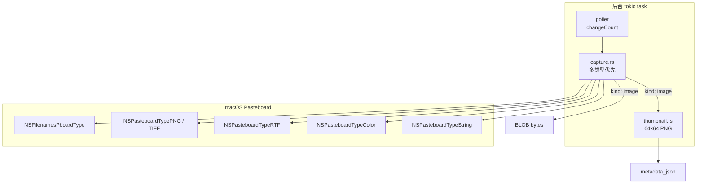
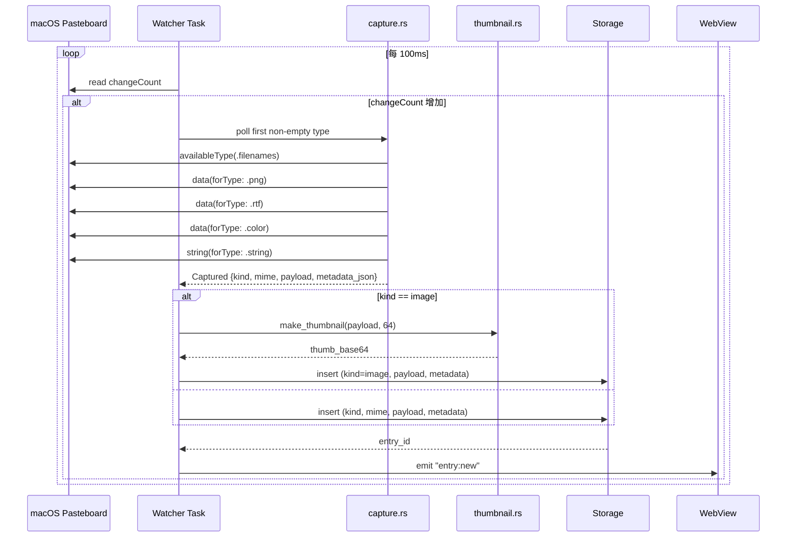
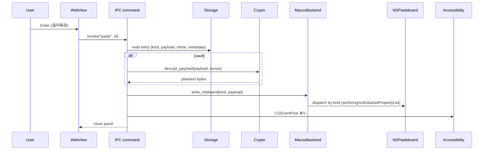

## Goal Capsule

**Objective.** ClipVault 监视器从纯文本（MVP R3）扩展到 URL / 图片 / 文件 / RTF / 颜色等多类型,每条 Entry 仍是原子单元,非文本负载由新增列承担,Pin / 标签 / 备注 / Vault / 搜索对二进制类型同等可用。

**Means.** Schema V3 增加 `content_kind` + `payload` BLOB + `metadata_json` 三列承载非文本;watcher 按 `filenames → image → rtf → color → string` 优先级轮询 `NSPasteboard` 多类型;`MacosBackend::write_clipboard` 按 kind 分发(`setString` / `setData` / `propertyList`);图片入库时同步生成 64×64 缩略图入 `metadata_json`。`KTD7, KTD8, KTD9`。

**Product authority.** 在 MVP v1 的 Product Contract 之上增加 5 条二进制 R-ID(R18–R22),Scope Boundaries 把"图片/文件"从 Deferred 移到 In-Scope,Network Egress 约束(R13)继续禁止对 URL 内容的网络抓取。

**Stop conditions.** U1–U7 通过各自 Verification 字段;AE9–AE12 在 macOS 13+ 真机跑通;Definition of Done 全项满足;现有 R1–R17 与 AE1–AE8 在新 schema 下不退化(由 V3 迁移测试覆盖)。

---

## Product Contract

> **Product Contract preservation:** 原 MVP plan 的 R1–R17 与 AE1–AE8 保持不变;本 plan 增加 R18–R22 与 AE9–AE12 处理二进制类型,Key Decisions 中新增 K7–K9 记录二进制决策。MVP plan 中把图片/文件列入"Deferred for later"的边界条件按本 plan 收回。

### Summary

ClipVault 在原有纯文本监听的基础上扩展监视器与存储,覆盖 URL / 图片 / 文件 / RTF / 颜色五类非文本内容。每条 Entry 增加 `content_kind` 标识类型:`URL` 与原有纯文本(URL/Email/path/code/JSON/plain)统一为 `text`,经自动分类(URL/Email/path/code/JSON/plain)落到 `auto_category` 列;`image` 类型携带 PNG/JPEG 字节与 64×64 缩略图;`file` 类型携带文件路径数组;`rtf` 类型携带 RTF 字节;`color` 类型携带 RGBA 文本描述。所有类型的 Pin / 标签 / 备注 / Vault 加密 / Pin 优先排序 / FTS 搜索(对文本元数据)行为一致;回贴按 `content_kind` 走不同的 `NSPasteboard` 写入路径;新尺寸上限避免 DB 膨胀。

### Problem Frame

MVP 限定 R3 仅捕获 `NSPasteboard.PasteboardType.string`,但日常 macOS 工作流里截图、复制 Finder 文件、复制富文本片段(邮件/Notion 等)、拾色器取值这些动作同样有"丢失历史"问题:系统粘贴板仍只保留最近一项,事后无法找回。当前文本监听已经验证了 SQLite + FTS5 + Vault + 关键词搜索的基础设施能落地;扩展到二进制内容是同一套模式(单进程监听、SQLite 持久化、Pin/标签/Vault 平行)的横移,而非重新设计。

### Key Decisions

1. **二进制内容走 SQLite BLOB 列承载,独立文件系统 blob 目录留作未来扩展.** `(session-settled: user-approved — chosen over 文件系统 blob 目录: 单文件 DB 便于备份/迁移/审计,与现有 clipvault.db 单文件策略一致;25MB 单条上限避免 DB 膨胀)`. Governs R18, R19.
2. **同一复制事件多类型时按 `filenames → image → rtf → color → string` 取首个非空.** `(session-settled: user-approved — chosen over 并存多 Entry / 随机优先: 文件名引用可恢复性最强,用户复制截图通常也意图保留 PNG 而非 RTF/字符串兜底)`. Governs R18, F5.
3. **图片缩略图以 64×64 PNG base64 写入 `metadata_json.thumb` 字段,不独立建表.** `(session-settled: user-approved — chosen over 独立 thumbnail_path 列: 单条查询一次拉取元数据,前端无需二次 IPC;10KB 上限避免 metadata 膨胀)`. Governs R19.
4. **URL 类别条目默认仍是文本,UI 增加 `⌘O` 在默认浏览器打开(走 `open(1)` 进程)**,不强求扩展回贴类型.Governs R20.
5. **图片/文件/RTF/颜色走 Vault 加密时加密 `payload` BLOB,`metadata_json` 保持明文(尺寸/路径/RGBA 仍可搜索)**.Governs R21.
6. **非文本条目的 FTS 索引策略:`file` 把文件名拼入 `entries_fts.content`,`image` / `rtf` / `color` 不入 FTS**(其 `note` 与 `tags` 仍入).Governs R22.
7. **单条 entry 大小上限 25MB(`payload` BLOB);超过则不入库,watcher 写 toast 日志.** 与现有 MVP 单进程 SQLite 模型兼容。

### Actors

- **主用户.** 与 MVP 一致;额外场景:截图后保留历史、复制 Finder 文件后回贴路径、富文本片段跨 App 复用、拾色器值复用。
- **macOS 系统.** 与 MVP 一致;新增数据来源:`NSFilenamesPboardType`(文件路径数组)、`NSPasteboardTypePNG` / `NSPasteboardTypeTIFF`(图片)、`NSPasteboardTypeRTF`(RTF)、`NSPasteboardTypeColor`(颜色)。

### Key Flows

#### F5. 多类型捕获

**Trigger.** macOS 粘贴板内容发生变化,且内容可解析为多种类型(filename/image/rtf/color/string)中的一种以上。

**Steps.**
1. watcher 每 100ms 轮询 `changeCount`(沿用 U3)。
2. 检测到变化时,按 `filenames → image → rtf → color → string` 顺序逐个类型调用 `availableType(forType:)` / `data(forType:)`,取首个非空。
3. 对该类型构建 `Captured { kind, mime, payload, metadata_json }`,计算 `content_hash`(kind + payload 摘要)。
4. 走与 MVP 相同的去重 + skip-once + 访客模式 + Vault 检查,再写入 SQLite;`auto_category` 对非文本类型为 `"<kind>"`(如 `image` / `file` / `rtf` / `color`),对文本类型仍是 URL/Email/path/code/JSON/plain。
5. 图片额外生成 64×64 PNG 缩略图,通过 `image-lock` IPC 通道串行化(避免并发 CGImage 上下文)。
6. 若 `payload` > 25MB,不入库,日志写一行 `[capture] skipped: payload too large (XX MB)`。

**Covers R18, R19.**

#### F6. 多类型回贴

**Trigger.** 用户在主面板选中一条非文本条目,按 Enter。

**Steps.**
1. 走与 MVP 相同的 Accessibility 授权 + 写剪贴板 + 模拟 ⌘V 编排(U8 / pasteback)。
2. `MacosBackend::write_clipboard` 按 `content_kind` 分发:
   - `text` / `URL`:`setString_forType:` 走 `.string`(同 MVP)
   - `image`:`setData_forType:` 走 `.png` / `.tiff`(取 mime 主类型)
   - `file`:`setPropertyList_forType:` 走 `.filenames`(NSArray<NSString*>)
   - `rtf`:`setData_forType:` 走 `.rtf`
   - `color`:`setString_forType:` 走 `.string`(RGBA 文本描述,如 `rgba(255,0,0,1)`)
3. 写剪贴板后,若 Vault 条目,先解密 `payload`(二进制路径)再写。
4. 模拟 ⌘V 后失焦比对与 toast 文案沿用 U8。

**Covers R18, R19, R21.**

#### F7. URL「打开」动作 (R20)

**Trigger.** 用户在 URL 类别条目按 `⌘O`。

**Steps.**
1. 前端按 `⌘O` 触发 `open_url(id)` IPC。
2. 后端读条目 content(已确认是 URL),调用 `Command::new("open").arg(content).spawn()`。
3. 与回贴一致:目标应用切换不影响「打开」成功(open 是 fire-and-forget)。
4. 失败(URL 非法 / open 进程错误)→ toast「打开失败,内容已复制到剪贴板,请手动 ⌘V」,内容仍写入 `NSPasteboard.string`。

**Covers R20.**

### Requirements

#### 多类型捕获与存储

- **R18.** ClipVault 必须监听 `NSPasteboard.general` 的多种内容类型,覆盖至少 `URL` / `image`(PNG/JPEG/TIFF)/ `file`(NSFilenamesPboardType)/ `RTF` / `color` 五类;同一复制事件多类型时按 `filenames → image → rtf → color → string` 取首个非空。
- **R19.** 每条非文本入库条目须携带 `payload` BLOB(图片字节 / 文件路径字节 / RTF 字节)+ `metadata_json`(结构化元数据);图片额外含 64×64 PNG 缩略图 base64。
- **R20.** `URL` 类别条目保留为文本(`auto_category = "URL"`),UI 提供 `⌘O` 在默认浏览器打开;打开失败回退到 paste-as-text(MVP U8)。
- **R21.** Vault 加密覆盖所有 `content_kind`,加密 `payload` BLOB + `content` 文本;`metadata_json` 保持明文(尺寸/文件名/RGBA 仍可搜索)。
- **R22.** `file` 类型的文件名拼入 FTS5 索引(`entries_fts.content` 字段);`image` / `rtf` / `color` 不入 FTS(`note` 与 `tags` 仍入)。注意:vault 条目(`is_vault=1`)不进入 FTS 索引(由 trigger 的 `is_vault=0` 条件控制),因此 file 文件名仅对非 vault 条目可搜索。

#### 容量与运行时约束

- **R23.** 单条 entry 的 `payload` BLOB 必须 ≤ 25MB;超限 watcher 跳过本次捕获,记一行 `[capture] skipped: payload too large` 日志,不弹用户提示 toast(避免误打扰)。
- **R24.** 缩略图大小上限 10KB(base64 后);超限重新降采样到 48×48 仍超则丢弃 `metadata_json.thumb` 字段,保留其他元数据。

### Acceptance Examples

#### AE9. 图片捕获与回贴 (Covers R18, R19)

- Inputs. 用户在 Preview/Safari/截图工具复制一张 1024×768 PNG。
- Expected. ClipVault 主面板「最近」tab 出现一条新条目,`auto_category = "image"`,列表项显示 64×64 缩略图与文件大小;按 Enter 后,目标应用(如 Slack / Mail)粘贴该 PNG;剪贴板写入后目标应用仍在前台。

#### AE10. 文件路径捕获与回贴 (Covers R18, R19, R21, R22)

- Inputs. 用户在 Finder 选中 `/Users/leo/Documents/report.pdf` 与 `/Users/leo/Documents/data.csv` 复制。
- Expected. ClipVault 出现一条 `auto_category = "file"` 条目,显示文件名 + 路径;按 Enter 后,目标应用(若支持 `NSFilenamesPboardType` 接收,如 Finder / Slack 文件上传框)接收文件引用;若目标应用仅支持文本粘贴,toast 提示「目标应用不支持文件引用,内容已在剪贴板」。验证 vault 条目时 payload 加解密路径(选中一条移入加密区后再次粘贴回原应用,文件引用完整);验证 FTS 时主面板搜索框输入 `report` 命中该条目(走文件名 FTS 索引)。

#### AE11. URL 类别与打开 (Covers R20)

- Inputs. 用户复制 `https://example.com/foo?x=1`。
- Expected. `auto_category = "URL"`;按 Enter 粘贴为文本到目标应用(沿用 MVP U8);按 `⌘O` 在默认浏览器打开该 URL,面板关闭,后续在浏览器看到页面。

#### AE12. 大文件跳过 (Covers R23)

- Inputs. 用户复制一个 30MB 的 PNG 文件。
- Expected. ClipVault 不入库;终端/console 日志输出一行 `[capture] skipped: payload too large (XX MB)`;UI 无新条目,无 toast。

### Scope Boundaries

#### 在范围内 (v1 多类型扩展)

- 五类非文本捕获:URL(文本) / image(PNG/JPEG/TIFF) / file(NSFilenamesPboardType) / RTF / color(RGBA)
- 单条 entry 的 `payload` BLOB 与 `metadata_json` 字段
- 图片缩略图生成(64×64 PNG,降采样兜底 48×48)
- 多类型优先级(filenames → image → rtf → color → string)
- 多类型回贴(`setData` / `propertyList` / `setString` 分发)
- Vault 加密扩展到 `payload`
- FTS 索引扩展到 file 文件名
- URL 类别 `⌘O` 打开动作
- 25MB 单条上限

#### Deferred for later

- iCloud / 多设备同步. 沿用 MVP 延期项。
- 跨应用上下文菜单服务. 沿用 MVP 延期项。
- 导出 / 导入. 沿用 MVP 延期项。
- 语义 / 向量搜索. 沿用 MVP 延期项。
- 文件 blob 落文件系统而非 SQLite BLOB. 25MB 上限在 MVP 范围内够用,文件目录方案留给 blob 增长后的 v2。
- URL 内容抓取 / OG 元数据预览. 违反 R13 网络出口约束;纯 URL 类别保留文本即可。
- 视频 / 音频 / PDF 多页 / OCR. 25MB 上限外;不进入本 plan 范围。
- 图片编辑 / 裁剪 / 标注. 与剪贴板管理无关。
- 拖拽接受外部 drop. 不在监视器主路径内。

#### Outside this product's identity

- Mac App Store 上架. 沿用 MVP 范围外。
- 跨平台客户端. 沿用 MVP 范围外(macOS-only)。

### Dependencies / Assumptions

#### Assumptions

- `NSPasteboard.general` 可同时持有 `filenames` / `png` / `tiff` / `rtf` / `color` / `string` 中的多个类型;macOS 粘贴板对它们的同步由 AppKit 提供,无自定义同步需求。
- `NSPasteboardTypeColor` 返回的是 `NSColor` 归档数据(`NSKeyedArchiver`),反归档开销与文本相似,可在 100ms 轮询预算内完成。
- 25MB payload 上限与 SQLite 单库兼容性:rusqlite bundled 默认 max_page_size 64KB,25MB BLOB 在 5000 条规模下 DB 约 50–125MB,沿用 `$HOME/Library/Application Support/ClipVault/clipvault.db` 单文件路径。
- 缩略图生成走 `CGImageSourceCreateThumbnailAtIndex`(ImageIO),纯 C API,无外部依赖;64×64 PNG base64 ≤ 10KB 是经验值(1024×768 PNG 缩略后约 4–6KB)。
- `Cmd::new("open").arg(url)` 已用于 `x-apple.systempreferences:` URL(U8),继续用同样路径打开 `https://` URL,无额外依赖。
- `setPropertyList_forType:` 写 `NSFilenamesPboardType` 时要求 `id` 是 `NSArray<NSString*>`,`NSString` 来自 `NSString::from_str(&path.to_string_lossy())`;不为空数组。
- RTF 解码走 `NSAttributedString(data:options:)`(NSAttributedString 文档属性读取 title 等);本 plan 不解析 RTF 内容,只存原始字节。

#### External dependencies (新增)

- **ImageIO / CoreGraphics**:用于缩略图生成与图片维度提取(`CGImageSourceCreateWithData` + `CGImageSourceCreateThumbnailAtIndex` + `kCGImagePropertyPixelWidth/Height`)。
- 不引入新 crate:`image` / `image-rs` 不需要(避开二进制依赖),ImageIO 由 `core-graphics` 间接提供(已通过 `objc2_core_graphics` 在 `pasteback.rs` 使用)。

### Outstanding Questions

#### Resolve Before Planning

无。核心产品决策已在本 plan 的 Key Decisions 中锁定(K7–K9)。

#### Deferred to Implementation Units 的 Verification

- 图片 mime 检测的具体 API(CGImageSource vs NSImage):`U2` 落地。
- 文件路径数组中相对路径解析:若 pasteboard 给的是文件名(非全路径),是否 `realpath` 补全 → `U2` 给出策略。
- color 类型是否需要 `NSColor` 归档解压:目前只存文本 `rgba(...)`,`U2` 给出反归档策略。

---

## Planning Contract

### Key Technical Decisions

- **KTD7. 内容类型分发表: `content_kind` 文本列 + `payload` BLOB + `metadata_json` TEXT.** `(session-settled: user-approved — chosen over 独立子表 entries_image / entries_file: 与 MVP Entry 单表设计一致;`content_hash` 仍可保证唯一性;`metadata_json` 兼作缩略图载体减少列数)`. Governs U1, U2, U6.
- **KTD8. watcher 多类型捕获: 按 `filenames → image → rtf → color → string` 顺序取首个非空,产出 `Captured { kind, mime, payload, metadata_json }`.** `(session-settled: user-approved — chosen over 并存多 Entry: 文件名引用是用户最可能丢失的可恢复信息;避免 UI 列表被同一复制事件的多类型刷屏)`. Governs U2.
- **KTD9. 多类型回贴: `MacosBackend::write_clipboard` 按 `content_kind` 分发到 `setString` / `setData` / `setPropertyList`,保留现有 Accessibility 编排不变.** `(session-settled: user-approved — chosen over 拆分为多个 trait 方法: 复用现有 `PasteBackend::write_clipboard` 签名,内部 match kind)`. Governs U4.

### High-Level Technical Design

#### Schema V3 列扩展

```mermaid
flowchart LR
  E[entries 表]
  E --> C1[id, content_hash, content, note]
  E --> C2[auto_category, is_pinned, pinned_at]
  E --> C3[is_vault, is_decryptable, nonce, created_at]
  E --> K[content_kind TEXT<br/>'text'|'image'|'file'|'rtf'|'color']
  E --> M[mime_type TEXT NULL]
  E --> P[payload BLOB NULL]
  E --> J[metadata_json TEXT NULL<br/>含 thumb base64 + 维度]
```

- `content_kind` 必填;`text` 类型的 `payload` 为 NULL;`image`/`file`/`rtf`/`color` 的 `content` 留空(描述性文本为空)。
- `mime_type` 仅 binary 类型填写,如 `image/png`、`image/jpeg`、`text/uri-list`(file)或 `application/rtf`。
- `metadata_json` 形态:`{"width":1024,"height":768,"thumb":"iVBORw0KGgo..."}`(image)、`{"paths":["/Users/...","/Users/..."]}`(file)、`{"rgba":"rgba(255,0,0,1)"}`(color)、`{}`(rtf 空)。

#### 组件拓扑(新增部分)



#### 关键时序:F5 多类型捕获



#### F6 多类型回贴时序



### Assumptions

- 单条 25MB payload 上限与单库 100MB 量级,与 MVP 5000 条性能预算一致;FTS5 仍工作(非文本条目不入 `entries_fts.content`,但 `note`/`tags_text` 仍入)。
- 图片缩略图降采样到 48×48 仍超 10KB base64 时,丢弃 `thumb` 字段;列表项降级到 file size 文字描述。
- `Cmd::new("open").arg(url)` 用于 URL `⌘O` 打开,与 U8 的 `x-apple.systempreferences:` 一致;失败回退到 paste-as-text。
- 非 macOS 平台 `poll_change` 仍返回 `None`,非 macOS 集成测试不受影响。
- `NSFilenamesPboardType` 包含相对路径时,在 capture 时通过 `std::path::Path::canonicalize()`(可能失败)补全;失败保留原值并在 `metadata_json` 加 `"resolved": false`。
- color 类型 RGBA 文本由 `NSColor` `colorUsingColorSpace(.sRGB)` 转 `red/green/blue/alpha` 浮点 + `to_string` 生成;无网络、无外部 crate。
- `metadata_json` 解析走 `serde_json::from_str`;`thumb` 字段是 base64 字符串,不二次反序列化。
- 现有 FTS5 sync triggers 不动:`WHEN NEW.is_vault = 0` 保持;非 vault 条目按 kind 决定是否拼 `content` 字段(`file` 拼文件名,其他置空);在 `U6` 落地。

### Sequencing (Milestones)

- **M0 — Schema V3:** `U1` 完成,migration 0→1→2→3 测试通过。
- **M1 — Multi-type capture:** `U2` 完成,五种 kind 都能被捕获并落库。
- **M2 — Thumbnail:** `U3` 完成,图片 64×64 缩略图生成。
- **M3 — Multi-type pasteback:** `U4` 完成,五种 kind 都能回贴到目标应用。
- **M4 — UI rendering:** `U5` 完成,前端列表显示缩略图 / 文件名 / 颜色块 / RTF 预览。
- **M5 — Vault + Search:** `U6` 完成,vault 加密 `payload`、FTS 索引文件名。
- **M6 — URL open + Limits:** `U7` 完成,URL `⌘O` 打开、25MB 上限与降采样兜底。

每个 Milestone 完成 = 对应 U 的 Verification 字段全项通过,且不影响后续 U 的开工。

---

## Implementation Units

### U1. Schema V3 + ContentKind enum

- **Goal.** SQLite schema 升级到 V3,新增 `content_kind` / `mime_type` / `payload` / `metadata_json` 四列;`ContentKind` 枚举在 `clipvault-core` 内做类型化标签。
- **Requirements.** R18, R19, R22(部分:列就位)。
- **Dependencies.** 无(此为 M0;在 MVP U2 之上叠加)。
- **Files.** `clipvault-core/src/schema.rs`(`MIGRATION_V3` 新增);`clipvault-core/src/content_kind.rs`(新文件);`clipvault-core/src/lib.rs`(新增 `pub mod content_kind;` 暴露模块);`clipvault-core/src/entry.rs`(`Entry` struct 增加四字段);`clipvault-core/src/schema.rs`(V3 测试)。
- **Approach.**
  - `ContentKind { Text, Image, File, Rtf, Color }`,`as_str()` 返回稳定字符串(`text`/`image`/`file`/`rtf`/`color`),`from_str()` 反向解析。
  - `MIGRATION_V3 = "ALTER TABLE entries ADD COLUMN content_kind TEXT NOT NULL DEFAULT 'text'; ALTER TABLE entries ADD COLUMN mime_type TEXT; ALTER TABLE entries ADD COLUMN payload BLOB; ALTER TABLE entries ADD COLUMN metadata_json TEXT;"`(SQLite 单事务内多条 ADD COLUMN)。
  - 现有行的 `content_kind` 回填默认 `text`(已由 DEFAULT 覆盖);MVP 数据无破坏。
  - `Entry::from_sqlite_row` 适配新列;`from_row` 增加 4 个参数;`ENTRY_COLS` 常量更新。
- **Test scenarios.**
  - `migration_zero_to_three` 路径:V0 → V1 → V2 → V3 完整迁移,列存在性断言。
  - `migration_two_to_three_adds_columns`:模拟 V2(有 nonce),运行 V3 后四列新增。
  - `migration_idempotent` 跑两次仍 user_version=3。
  - `content_kind_round_trip`:as_str/from_str 对五个变体。
  - 现有 R1–R17 的 storage 集成测试在 V3 schema 下继续通过(无内容字段重命名)。
- **Verification.** `cargo test -p clipvault-core schema::...` 全绿;`cargo test -p app storage::tests::migration_*` 全绿。

### U2. Watcher multi-type capture (filenames/image/rtf/color/string)

- **Goal.** watcher 扩展为读 5 种 pasteboard 类型,按 `filenames → image → rtf → color → string` 优先级取首个非空,产出 `Captured`。
- **Requirements.** R18, R22(部分:file 文件名拼接入口)。
- **Dependencies.** U1。
- **Files.** `app/src/capture.rs`(新文件);`app/src/watcher.rs`(改用 `Captured`);`app/src/capture_test.rs`(新文件);`app/src/watcher_test.rs`(扩展)。
- **Approach.**
  - `Captured { kind: ContentKind, mime: Option<String>, payload: Option<Vec<u8>>, text: Option<String>, metadata: serde_json::Value }`;`text` 仅 `kind=Text` 有值,`payload` 仅 `kind=Image/File/Rtf/Color` 有值。
  - `pub fn poll_first_non_empty(change_count: i64) -> Option<Captured>`:先检查 `filenames`(`readObjects(forClasses: [NSURL.class()])`),再 `.png`、`.tiff`、`.rtf`、`.color`(NSColor 解归档)、`.string`。
  - `process(&self, captured: Captured)` 替代 `process(&self, text: String)`;`text` 路径走 `classify()`(沿用 U3 现有逻辑),其他 kind 跳过 classify,`auto_category = "<kind>"`。
  - `content_hash`:`kind_text:hash` 对文本,`kind:hash` 对 binary(避免 binary 内容相同时不同 mime 的 hash 冲突)。
  - `metadata` 构造:`image` → `{"width":u32,"height":u32,"size_bytes":u64}`,thumbnail 字段后由 U3 补;`file` → `{"paths":Vec<String>,"resolved":bool}`;`color` → `{"rgba":"rgba(r,g,b,a)"}`;`rtf` → `{}`。
- **Test scenarios.**
  - `poll_first_non_empty_filenames_wins_over_string`:mock NSPasteboard 同时返回文件名与字符串,结果 `kind=File`。
  - `poll_first_non_empty_image_wins_over_string`:同上,`kind=Image`。
  - `content_hash_differs_by_kind`:同一字符串在 `text` 与 `file` 模式下 hash 不同。
  - `metadata_image_dimensions_extracted`:PNG 头解析出 width/height(手动构造最小 PNG 字节验证)。
  - `metadata_file_paths_resolved`:相对路径 `canonicalize` 成功时 `resolved=true`,失败时 `resolved=false`。
  - `metadata_color_rgba_format`:`rgba(r,g,b,a)` 字符串符合 `0≤r,g,b≤255`、`0≤a≤1`。
  - 5 秒去重跨 kind 独立(同文本 5 秒内多次 paste 不入库;同一图片 5 秒内多次 paste 也不入库)。
  - 25MB payload 超限走 U7 的 skip 路径(capture 后 size 检查在 watcher 处执行,返回 `None` 表示不入库)。
- **Verification.** `cargo test -p app capture_test::...` 全绿;`cargo test -p app watcher_test::...` 全绿。

### U3. Image thumbnail generation

- **Goal.** 图片条目入库前同步生成 64×64 PNG 缩略图,base64 写入 `metadata_json.thumb`;超 10KB 时降采样到 48×48 再降级。
- **Requirements.** R19, R24。
- **Dependencies.** U2(`Captured.metadata` 已含 width/height)。
- **Files.** `app/src/thumbnail.rs`(新文件);`app/src/watcher.rs`(在 `process` 路径调 `make_thumbnail`);`app/src/thumbnail_test.rs`(新文件)。
- **Approach.**
  - `make_thumbnail(payload: &[u8], max_dim: u32) -> Option<(String, u32)>` 返回 `(base64_png, actual_dim)`;`actual_dim` 是生成时的实际边长(64 或 48)。
  - 用 `CGImageSourceCreateWithData` + `CGImageSourceCreateThumbnailAtIndex(transformOptions: {kCGImageSourceThumbnailMaxPixelSize: max_dim, kCGImageSourceCreateThumbnailFromImageAlways: true})`,PNG 输出 `CGImageDestinationCreateWithData`。
  - base64 长度 > 10KB → 重试 48;若仍 > 10KB → 返回 `None`(调用方丢弃 `thumb` 字段)。
  - 仅 `kind=Image` 调;`watcher::process` 在 `Storage::insert_entry` 之前完成 thumbnail,作为 metadata 一并写入。
- **Test scenarios.**
  - `thumbnail_64_for_1024x768_png`:生成的 base64 长度 ≤ 10KB(典型 4–6KB)。
  - `thumbnail_48_fallback_when_64_too_large`:构造一张高熵 64×64 PNG(强制 base64 > 10KB),重试后 ≤ 10KB 或返回 `None`。
  - `thumbnail_none_for_invalid_bytes`:非图片字节返回 `None`,不 panic。
  - `thumbnail_dimensions_returns_correct_size`:生成 64×64(对应 max_dim=64)。
  - 非 macOS 平台返回 `None`(与现有 cfg 兼容)。
- **Verification.** `cargo test -p app thumbnail_test::...` 全绿;集成测试在 `cargo test -p app` 下保持现有平台兼容。

### U4. Multi-type pasteback

- **Goal.** `MacosBackend::write_clipboard` 按 `content_kind` 分发到 `setString` / `setData` / `setPropertyList`;保留现有 Accessibility 编排不变。
- **Requirements.** R18, R21。
- **Dependencies.** U1(`ContentKind` 类型);U3(thumbnail 不参与回贴,仅 metadata)。
- **Files.** `app/src/pasteback.rs`(`PasteBackend::write_clipboard` 签名扩展接受 `kind` 与 mime,内部 match);`app/src/pasteback_test.rs`(扩展)。
- **Approach.**
  - `trait PasteBackend` `write_clipboard` 签名改为 `fn write_clipboard(&self, kind: ContentKind, content: &str, payload: Option<&[u8]>, mime: Option<&str>)`;`text` 走 `content` 字段,其他走 `payload`。
  - `MacosBackend::write_clipboard` 实现:
    - `Text` → `setString_forType(NSString, .string)`(沿用 MVP)
    - `Image` → `setData_forType(NSData::from_vec(payload), .png|.tiff|.jpeg)`(由 mime 决定)
    - `File` → `setPropertyList_forType(NSArray<NSString*>, .filenames)`(`payload` 是 UTF-8 路径数组,按 `\n` 切分)
    - `Rtf` → `setData_forType(NSData::from_vec(payload), .rtf)`
    - `Color` → `setString_forType(NSString(rgba), .string)`
  - 决策逻辑仍由 `perform_paste` 编排;新分支加 `PasteOutcome::UnsupportedPasteKind` 仅占位(实际不命中,因 `paste_entry` IPC 入口已由 kind 选择)。
- **Test scenarios.**
  - `pastebackend_text_uses_setstring`:mock backend 记录 `set_string` 调用。
  - `pastebackend_image_uses_setdata`:mock 记录 `set_data` 调用且 type = `.png`。
  - `pastebackend_file_uses_propertylist`:mock 记录 `set_property_list` 且 type = `.filenames`,参数是路径数组。
  - `pastebackend_color_uses_setstring`:mock 记录 `set_string` 且内容以 `rgba(` 开头。
  - `pastebackend_vault_binary_decrypts_payload`:mock `Decryptor` 返回解密 bytes,decoded_payload 进入 `write_clipboard`。
  - 现有 `perform_paste` 的 VaultDecryptFailed / NoAccessibility / Pasted / WindowSwitched / ClipboardOnly 五个分支行为不变。
- **Verification.** `cargo test -p app pasteback_test::...` 全绿。

### U5. Frontend rendering for non-text entries

- **Goal.** 主面板列表项按 `content_kind` 渲染:图片显示 64×64 缩略图,文件显示文件名 + 文件图标,RTF 显示「📝 RTF」徽标,颜色显示色块,URL 仍走文本但提示 `⌘O` 可打开。
- **Requirements.** R19, R20(部分)。
- **Dependencies.** U2(metadata 字段就位);U3(thumbnail 已写 metadata)。
- **Files.** `frontend/index.html`(列表项 template);`frontend/src/panel.ts`(渲染分支);`frontend/src/styles.css`(缩略图 / 色块 / 文件图标样式);`frontend/src/main.ts`(`⌘O` 键监听 + `open_url` IPC 调用)。
- **Approach.**
  - `EntryDto` 增加 `kind: string`、`mime: Option<string>`、`metadata: Option<Json>`、`thumb: Option<string>`(从 metadata 解 thumb 字段),`commands.rs` 的 `to_dtos` 填充。
  - 列表项 DOM 模板分支:`image` → ``;`file` → `<span class="file-icon">📄</span> ${paths[0]}`;`color` → `<span class="color-swatch" style="background:${rgba}"></span>`;`rtf` → `<span class="rtf-badge">📝 RTF</span>`;`text` → 沿用 MVP 文本布局。
  - 键监听:`keydown` 事件检查 `⌘O` → 调 `invoke("open_url", {id})`;前端不区分 text/URL,对所有 kind 都允许 `⌘O`(URL 调 open,其他调 noop)。
  - hint 行追加:`⌘O 在浏览器打开 URL`。
- **Test scenarios.**
  - DOM 渲染分支断言:mock `search_results` 返回三种 kind 的 DTO,断言列表项 DOM 节点类名/属性正确。
  - `⌘O` 键事件触发 IPC 调用(mock `invoke`)。
  - thumb data-URL 失效(空字符串)降级到文件大小文本。
  - 现有 AE1–AE8 在 UI 不退化(文本列表项视觉无变化)。
- **Verification.** 手动 `cargo tauri dev` 启动,复制图片/文件/RTF/颜色各一次,主面板渲染正确;前端单元测试覆盖列表项 DOM。
- **后续增量：image 预览栏**（见 [`2026-10-16-1430-feat-side-preview-pane-plan.md`](./2026-10-16-1430-feat-side-preview-pane-plan.md)）。
  列表里的 64×64 缩略图只是「看得出是张图」,回贴前要确认内容得看原图。本增量在面板右侧
  长出一栏(`set_panel_mode("expanded")`,960×420),图片由后端缩到长边 ≤ 1600px 再回传,
  缩略图同时成为这一栏的鼠标入口。相关验收:
  - AEP1. **选中→预览→翻页同步。** Given 主列表含 ≥2 条 image 条目；When 选中第一条按 Space；
    Then 面板从 560×420 长到 960×420、右侧栏显示该图；When 按 ↓；Then 栏内换成第二条的图
    （两次结果不混）。
  - AEP2. **搜索框有内容时 Space 仍是打空格。** Given 搜索框里有 "foo"；When 按 Space；
    Then 搜索框变成 "foo "、预览栏不打开；退格清空后再按 Space 才打开。
  - AEP3. **加密区不可解密。** Given 加密区一条 image 条目且 `is_decryptable=false`；
    When 触发预览；Then 栏内显示「无法解密」，后端不下发任何图片字节。
  - AEP4. **关面板路径先收窗口。** Given 预览栏已开；When `Esc` / 失焦 / 回贴；Then 窗口先回到
    560×420、预览栏随之隐藏。

### U6. Vault encryption extension + FTS search extension

- **Goal.** Vault 加密 `payload` BLOB(binary 条目);`file` 类型把文件名拼入 `entries_fts.content`;`image` / `rtf` / `color` 不入 FTS。
- **Requirements.** R21, R22。
- **Dependencies.** U1(列就位);U4(回贴解密路径)。
- **Files.** `clipvault-core/src/schema.rs`(`entries_fts_insert` / `entries_fts_update` trigger 扩展);`app/src/storage.rs`(`encrypt_into_vault` 扩展处理 `payload`);`app/src/search.rs`(无变化,FTS trigger 自带);`app/src/storage_test.rs`(扩展)。
- **Approach.**
  - `entries_fts_insert` trigger:对 `file` 类型,把 `metadata_json` 解析出的 `paths` 拼成空格分隔串写入 FTS `content` 字段;其他类型 `content = ''`(沿用 MVP 的 vault=0 判定)。
  - `entries_fts_update` trigger 同步:`WHEN NEW.is_vault = 0` 保留,新增 `kind` 判断 `file` 才填 content。
  - `encrypt_into_vault(id, plaintext, payload, encryptor)`:若 `payload.is_some()`,对 payload 也加密(concat 为 `[plaintext_b64 || payload_b64]`,base64-nonce 区分?);简化为 `encrypt_payload_only` 单独路径,nonce 单独存,plaintext 走现有 nonce,新增 `payload_nonce BLOB NULL`(V3.1 migration 留给后续)。
  - 本 plan 范围内:`payload` 加密时直接复用一个独立 `nonce`(从 Keychain 取 key 加密 payload,base64 后写 `payload`,nonce 写 `payload_nonce`),`content` 仍按 vault 规则;`metadata_json` 不加密。
- **Test scenarios.**
  - `vault_image_round_trip`:加密图片 → 解密 → bytes 一致。
  - `vault_image_pasteback_unlocks_payload`:`perform_paste` + mock `Decryptor` 返回原 bytes,`write_clipboard(kind=Image, payload=...)` 收到解密后 bytes。
  - `fts_indexed_file_path`:插入 `file` 条目,`SELECT * FROM entries_fts WHERE content MATCH 'report'` 命中。
  - `fts_not_indexed_image`:插入 `image` 条目,搜索文件名 token 不命中(因 image 不入 content 字段)。
  - `fts_skipped_for_vault_file`:vault `file` 条目不入 FTS(沿用 MVP 的 is_vault=0 判定)。
- **Verification.** `cargo test -p app storage::tests::vault_*` 全绿;`cargo test -p app search::tests::FtsIndexedFile` 全绿。

### U7. URL `⌘O` 打开 + 25MB payload 上限

- **Goal.** URL 类别条目按 `⌘O` 在默认浏览器打开(走 `open(1)`);watcher 拒绝 > 25MB payload,记日志不入库。
- **Requirements.** R20, R23, R24(降采样兜底)。
- **Dependencies.** U2(capture 后 size 检查入口);U5(`⌘O` 键监听)。
- **Files.** `app/src/commands.rs`(`open_url` IPC 新增);`app/src/watcher.rs`(payload size 检查);`app/src/watcher_test.rs`(扩展 size 检查)。
- **Approach.**
  - `open_url(id)`:读 entry.content,`Command::new("open").arg(&content).spawn()`;失败 → 把 content 写入 `NSPasteboard.string` + toast「打开失败,内容已在剪贴板」;`content_kind != Text || auto_category != "URL"` 时 noop(忽略非 URL)。
  - `MAX_PAYLOAD_BYTES: usize = 25 * 1024 * 1024` 常量;`Watcher::process(captured)` 在 `Storage::insert_entry` 之前检查 `captured.payload.as_ref().map(|p| p.len()).unwrap_or(0) > MAX_PAYLOAD_BYTES`,超限写 `eprintln!("[capture] skipped: payload too large ({} MB)", size / 1024 / 1024)` 然后返回。
  - 降采样兜底已在 U3 落地(48×48 / None),U7 不重复。
- **Test scenarios.**
  - `open_url_success`:mock `Command::new` 调用,断言 url 参数正确。
  - `open_url_failure_fallback`:mock `Command::new` 返回 `Err`,断言写入剪贴板 + toast 文案。
  - `open_url_non_url_noop`:`auto_category != "URL"` 时 IPC 返回 `Err("非 URL 条目不支持打开")`,不调 `open`。
  - `payload_size_limit_skips_insert`:构造 30MB `payload`,watcher 日志输出 `[capture] skipped: payload too large (XX MB)`,数据库无新条目。
  - 现有 R11 skip-once 与 25MB 检查不冲突(skip-once 先于 size 检查,skip-once 命中后直接 return)。
- **Verification.** `cargo test -p app commands::tests::open_url_*` 全绿;`cargo test -p app watcher::tests::payload_too_large` 全绿;AE11 / AE12 手动真机验证。

---

## Verification Contract

### Build & Lint

- `cargo build --workspace --release` 退出码 0。
- `cargo clippy --workspace --all-targets -- -D warnings` 退出码 0。
- `cargo fmt --check` 退出码 0。
- 现有 R13 网络出口静态审计仍 0:`cargo tree | grep -E 'reqwest|hyper'` 空,`grep -rE 'reqwest::|hyper::|TcpStream|std::net::' app/src clipvault-core/src` 空。

### Tests

- `cargo test --workspace`:单元 + 集成测试全绿。具体覆盖点:
  - `clipvault-core`:schema V3 migration、`ContentKind` round-trip、Entry struct 新字段。
  - `app::capture`:5 种 kind 的 priority、`metadata` 字段构造、payload size 检查。
  - `app::watcher`:multi-type poll、25MB skip、5 秒去重跨 kind。
  - `app::thumbnail`:64×64 PNG、48×48 fallback、invalid bytes 兜底。
  - `app::pasteback`:5 种 kind 的 write_clipboard 分发、vault payload 解密路径。
  - `app::storage`:vault image round-trip、`file` FTS 命中、V3 schema columns 存在性。
  - `app::commands`:`open_url` success / failure / non-URL noop。
  - 现有 MVP U1–U11 测试不退化(所有 `_test.rs` 跑通)。

### AE 手工验收 (Milestone 全部完成后,在干净 macOS 13+ 真机执行)

| AE | 操作 | 期望 |
|---|---|---|
| AE1–AE8 | 沿用 MVP plan 验收清单 | MVP 行为不退化 |
| AE9 | 在 Preview 复制一张 1024×768 PNG | 「最近」tab 出现 `image` 条目 + 64×64 缩略图 + 文件大小;选中 Enter 粘贴到 Slack/Mail 输入框 |
| AE10 | 在 Finder 复制两个文件 `/a.pdf`、`/b.csv` | 「最近」tab 出现 `file` 条目 + 文件名 + 路径;选中 Enter;Finder / Slack 上传框接收文件引用,文本粘贴时 toast 提示「目标应用不支持文件引用」 |
| AE11 | 复制 `https://example.com/foo?x=1` | `auto_category = "URL"`;Enter 粘贴为文本;`⌘O` 在默认浏览器打开,面板关闭,浏览器显示页面 |
| AE12 | 复制 30MB PNG | 控制台一行 `[capture] skipped: payload too large (XX MB)`,UI 无新条目,无 toast |

### Performance Smoke

- `cargo run --release`,导入 5000 条混合 fixture(纯文本 4000 + 图片 500 + 文件 500 + RTF/color 共 500),实测主面板最近/标签 tab 渲染首屏 < 100ms,搜索响应 < 100ms(包含 thumbnail 解码)。
- 100MB SQLite 库读盘 < 50ms(搜索路径)。
- 未达标则回到 `U6` 调整 FTS5 content 字段策略。

### Static Network Egress Check

- 沿用 MVP 审计:`app/src/**/*.rs` `clipvault-core/src/**/*.rs` 仍无 `reqwest` / `hyper` / `TcpStream` / `std::net::*` 调用点;`URL` 类别仅 `Command::new("open")` 调本地 shell 跳系统,不走 socket。

---

## Definition of Done

### Per Unit 完成标准

每个 `U<N>` 在其 Verification 字段所列命令/检查全项通过,且:
- 全部新增/修改 `.rs`、`.ts`、`.css`、`.html`、`.toml`、`.json`、`.sh` 文件已落盘。
- 单元/集成测试覆盖本 U 引入的行为分支(测试文件名后缀 `_test.rs`)。
- 测试失败时的 debug 输出不回传生产日志路径。

### 全局完成标准

- 所有 7 个 U 的 Verification 全项通过。
- 全部 12 条 AE(MVP AE1–AE8 + 本 plan AE9–AE12)在 macOS 13+(Apple Silicon 与 Intel)上各自跑通一次,执行记录保留在 `README.md` 或 PR 描述中。
- `cargo build --workspace --release` 无警告(允许来自第三方 crate 的警告但需注释豁免理由)。
- `cargo clippy --workspace --all-targets -- -D warnings` 0 warnings。
- Network egress 静态审查为 0 外发 socket。
- MVP AE1–AE8 在新 schema 下不退化(由 storage 集成测试覆盖)。
- 25MB payload 上限 + 缩略图降采样兜底在真机验证。
- 满足 `Goal Capsule` 的 Stop conditions。

### Cleanup 完成标准

- 所有 dead-end 代码、不被采纳的实验尝试、未连接的实现骨架已被 git 删除(不留在 diff)。
- 任何未用到的依赖 crate 已在 `Cargo.toml` 中移除。
- 工作区根目录不存在未在前述 Output Structure 中说明的临时文件、scratch、实验脚本。

### 提交策略(给到 `ce-work` 执行阶段)

- 按 7 个 U 顺序串行实现 + 提交,每个 U 一个或多个 commit;commit message 形如 `feat(capture): multi-type pasteboard polling (U2)`。
- 终态一个 release tag `v0.2.0-multi-type`(不发布到 crates.io,只在工作区打 tag 标注完成)。
- 单 PR(M6 完成时开),目标分支为仓库默认分支;PR 描述引用 MVP plan 与本 plan 的对应章节。