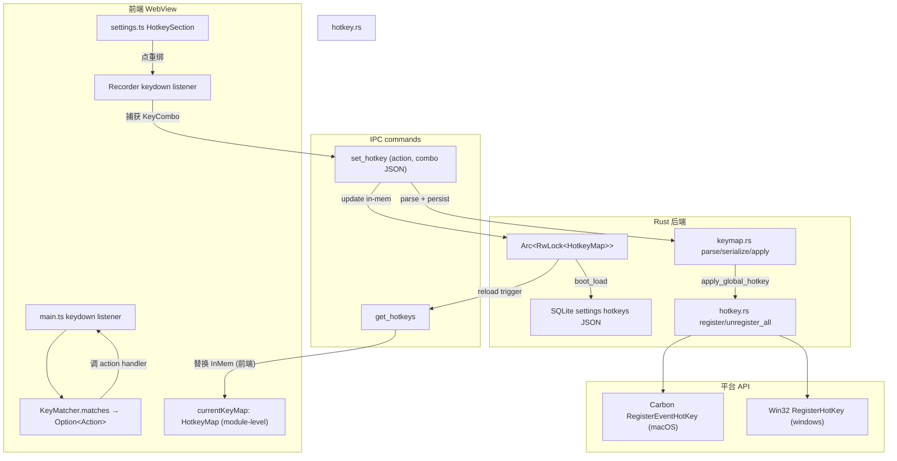

## Goal Capsule

**Objective.** 用户能在「设置」面板中查看与重新绑定快捷键(1 个全局 `⌥⌘V` + 11 个面板内主要快捷键),改写即时生效且跨重启保留;主面板底部 `.hint` 块从主面板移除,快捷键从此只在设置里看。

**Means.** 数据走 `settings` 表新增 key=`hotkeys` JSON 列(与现有 `panel_opacity` / `guest_mode` 同表同形);全局热键 API 改为 `register(app, action, combo) -> Result<(), ConflictReason>`,多 `EventHotKeyID` / 多 `RegisterHotKey` id 路由;前端 `keydown` 处理改为数据驱动 dispatch(单 `KeyMatcher.matches` 入口 + `dispatch(action)` 单派发点);设置 UI 加点击捕获录制 + 后台冲突反馈(贯穿 `KTD1` / `KTD3` / `KTD4` / `KTD5` / `KTD6`)。

**Authority hierarchy.** 本 plan 的 Product Contract 是事实来源;`docs/plans/2026-09-24-0931-feat-clipvault-mvp-plan.md` U4 中"全局快捷键默认值可在 first-run UI 提示时调整"的承诺是本 plan 的起源 —— 但 U4 原文未落地,本 plan 是它的首次落地。Windows plan / 多类型 plan 不受本 plan 影响。

**Stop conditions.** U1-U6 全部完成,验证基线全过,macOS / Windows 真机 AE1-AE4 全部通过。已 commit 的代码保留,`clickShortcut` 重新绑定路径在 plan 之外不可自定义快捷键(本 plan 不动 watcher 端 `⌥` 双击 skip_next 修饰)。

**Execution profile.** 6 个 implementation unit,顺序依赖(U1 → U2 → U3 → U4 → U5 → U6,U5/U6 同步);预期 commit 数 6 个,每个 unit 一个 commit。

---

## Product Contract

### Summary

把主面板底部那个列了 13 个快捷键(`↩` / `↑↓` / `⌘1–9` / `⌘E` / `⌘P` / `⌘L` / `⌘O` / `⌘⇧V` / `⌘⇧G` / `⌘⇧N` / `⌘,` / `esc` / 全局 `⌥⌘V`)的 `.hint` 块挪走,设置面板里新加「快捷键」区块,提供点击捕获式重绑 + 后台冲突检查 + 持久化与跨重启保留。

### Problem Frame

ClipVault 当前把快捷键硬编码在三处:`hotkey.rs:144-156` 用 Carbon `RegisterEventHotKey` 注册单一全局热键;`main.ts:649-778` 一个 130 行的 keydown `if`-`else` 链直接派发;各 `editor-hint` 块(也是 macOS)与 `index.html:39` 的 `.hint` div 用固定的字面布局展示。三个层都没有抽象,既不可配置,也没有冲突反馈。

讲用户体验的角度讲,plan U4 明确写了"全局快捷键默认值可在 first-run UI 提示时调整" —— 用户从未看到可改入口。讲 surface 来讲,`.hint` 占主面板底部约 1/6 高度,13 个键帽横排,严重压缩列表可视区;它本身又是 read-only,与既有不可改的现实不符。

### Requirements

按 concern 分组。

**数据持久化(后端)**

- R1. ClipVault 必须把用户快捷键映射持久化在 `settings` 表新增 key `hotkeys` 的 value 列,与现有 `guest_mode` / `panel_opacity` 同表同 schema。
- R2. ClipVault 必须把 `HotkeyMap`(Action → KeyCombo)序列化为 JSON 字符串落库;启动时反序列化,缺省回落到产品默认。
- R3. ClipVault 必须在 settings 表里读到非法 / 缺字段的 `hotkeys` 时,静默回落到默认且**不**修改库。
- R8. ClipVault 必须把运行时 `HotkeyMap` 存在 `Arc<RwLock<HotkeyMap>>`(与现有 `Arc<AtomicU32>` panel_opacity 同形,扩展性考虑 RwLock 以支持并发读 + 偶尔替换),并在 `setup` 中 `boot_load_hotkeys` 与现有 `boot_load_panel_opacity` 并列调用。

**全局热键(平台层)**

- R4. ClipVault 必须支持对全局热键 `⌥⌘V` 重新绑定;新绑定经 Carbon / `RegisterHotKey` 注册成功后才落库并**生效**;注册失败返回 `ConflictReason` 给前端,旧绑定保持不写库。
- R5. ClipVault 必须提供多 hotkey id 路由(macOS `EventHotKeyID.id` / Windows `i32` HOTKEY_ID),以便未来再扩展其它全局热键(目前 1 个)不需要重写 register 路径。

**面板内快捷键(WebView 层)**

- R6. ClipVault 必须把面板内 11 个快捷键(`↩` / `↑↓` / `⌘E` / `⌘P` / `⌘L` / `⌘O` / `⌘⇧V` / `⌘⇧G` / `⌘⇧N` / `⌘,` / `esc`)的派发改成数据驱动 dispatch —— 改 1 处按键表即可生效,不需重写 `if`-`else`。
- R7. ClipVault 必须在前端 `keydown` 处理里读当前 in-memory `HotkeyMap`,而不是硬编码 modifier 组合字符串。

**设置 UI**

- R9. ClipVault 必须在设置面板新增「快捷键」区块,每行 = `action` 中文标签 + 当前绑定显示 + 「重绑」按钮。
- R10. 用户点击「重绑」后,前端进入「录制态」 —— 按下一个非修饰键即视为新绑定;`Escape` 取消;`Enter` 不算主键(避免抢用户输入)。
- R11. 录制态按下后,前端调 `set_hotkey` IPC → 后端持久化 + 重新注册(若是全局热键)+ 同步前端 in-memory;返回 `Err` 时前端 `toast` 提示「被占用」,原 binding 保持。

**主面板移除**

- R12. ClipVault 必须从主面板底部 `.hint` div 完全移除快捷键展示;`styles.css` 移除 `.hint` / `.hint kbd` / `.hint .keycap` / `.hint-note` 样式;保留 `.editor-hint`(编辑器底栏仍需)。
- R13. ClipVault 必须不引入「快捷键在设置里」的指引条(用户选定完全静默移除)。

### Acceptance Examples

- AE1. 用户在设置里把全局 `⌥⌘V` 改成 `⌃⌥L`,保存后从下个 `⌃⌘L` 起呼出面板,`⌥⌘V` 不再响应。
- AE2. 用户把面板内 `⌘P`(置顶)改成 `⌘T`,选中条目按 `⌘T` → 切换置顶,`⌘P` 不再响应。
- AE3. 把全局热键改成已被其它程序占用的组合,Toast 提示「被占用」并保持原 binding,settings 表 `hotkeys` 行未改。
- AE4. 重启 ClipVault,自定义 binding 仍然生效(从 `settings` 表 `hotkeys` 行恢复)。

### Scope Boundaries

**In scope.**

- 1 个全局热键(目前只有 `⌥⌘V`)+ 11 个面板内主要快捷键(`↩` / `↑↓` / `⌘E` / `⌘P` / `⌘L` / `⌘O` / `⌘⇧V` / `⌘⇧G` / `⌘⇧N` / `⌘,` / `esc`)可重绑。
- 数据驱动 dispatch + 持久化 + 设置 UI + 点击捕获 + 冲突反馈。
- 冲突检查 = Carbon / `RegisterHotKey` 返回非 0。

**Out of scope (本 plan 不做).**

- `⌘1–9` 序号直选快捷键(用户范围协商结果未选)。
- `⌥` 双击修饰键触发 `skip_next`(watcher 端,与面板快捷键机制不同)。
- 快捷键 profile / 多预设切换(增量太大,不做)。
- 全局快捷键被非 Carbon / `RegisterHotKey` 路径占用时的兜底检测 —— 系统级无 API,low-level 处理。

**Deferred for later.**

- 把 `⌥` 双击修饰也接入 keymap 抽象(架构上需重新设计 watcher 双击检测,本 plan 不动)。

---

## Planning Contract

### Key Technical Decisions

KTD1. 数据落 `settings` 表 key=`hotkeys` JSON 列(单 value 字段内含 `actions` map),不新建独立 `hotkeys` 表。理由:与 `privacy.rs:panel_opacity` 同形,schema 不必升 V4,符合项目"仅 multi-key U 才升 schema"的现状。
`(session-settled: user-directed — chosen over 新建 hotkeys 表: 与现有隐私模块同表实现一致性高,Schema V4 不必升级)`

KTD2. 快捷键抽象拆为 `HotkeyAction`(语义标识,平台无关) + `KeyCombo { mods: Combo(bitflag), key: CharKind }`(按键描述,平台无关)。平台翻译只发生在 `hotkey.rs` 翻译成 Carbon / `VK_*`,在 `frontend/src/keymap.ts` 翻译成 `⌘` / `Ctrl+` 字形。

KTD3. 全局热键 register API 改签名为 `register(app, combo: &KeyCombo) -> Result<(), ConflictReason>`,与现有 `pub fn register(app: &AppHandle)` 单参签名不兼容;U2 重构,且 `unregister_all()` 必须保留用于切换时的清空。Mac 侧 `HOTKEY_REF: AtomicUsize` 改成 `Mutex<Vec<(EventHotKeyRef, HotkeyAction)>>`,handler 通过 `id` 路由;Windows 侧 `Pump` 内部维护 `HashMap<i32, HotkeyAction>`。
`(session-settled: user-directed — chosen over patch 上游 tray-icon 等方案外延: 当前需求为新增 keymap 模式,不依赖其它 crate patch)`

KTD4. 前端 keydown 改为单 `KeyMatcher.matches(ev) → Option<HotkeyAction>`(内部按 currentKeyMap 查表)+ `dispatch(action)` 单一入口;既有 `if`-`else` 链整体删。`currentKeyMap` 为 module 级变量,`loadKeymap()` 拉一次 + `set_hotkey` 后再拉。

KTD5. 录制态用全窗口 `keydown` 监听 + `preventDefault`;`Escape` 退出、`.modifier-only` 拒绝、其它按 `parseKeyCombo` 解析;解析失败时 `toast` 提示,不变更行。

KTD6. 全局热键切换流程:`unregister_all` → 对每个新 combo 调 `register` → 任一失败整体返回 `Err`,保留旧注册状态(不部分成功)。`ConflictReason` 包含 platform 错误码 + 原始 Carbon / `Win32` `Errno`。

KTD7. macOS / Windows 之外的平台(Linux)按现有 `#[cfg(...)]` 路径降级,`register` 返回 `Ok(())`(占位),设置 UI 不显示全局热键区;其它按 platform 列照常渲染。

KTD8. 持久化路径与 `panel_opacity` 完全同形:`Arc<RwLock<HotkeyMap>>` 共享 + settings 表 `hotkeys` 行;`boot_load_hotkeys` 在 `setup` 中先于 watcher spawn 执行,与 `boot_load_panel_opacity` 同型。

### High-Level Technical Design

整个改动覆盖 4 层:**数据** / **全局热键** / **面板内 dispatch** / **设置 UI**。下面用 mermaid 概述关键流。



关键路由:**前端只有一条** KeyMap 命中分支(单 `matches` + 单 `dispatch`),后端 `apply_global_hotkey` 是单入口,把 `HotkeyMap` 中所有全局热键重新注册。

### Assumptions

- A1. 用户不会同时改多个全局热键(目前只有 1 个);设置 UI 在改全局热键时同步显示新 binding,无并发需要。
- A2. watcher 端命令实现路径(⌥ 双击)不在本 plan 范围(plan 协商阶段已确认)。
- A3. macOS / Windows 之外的平台(Linux)按现有 `#[cfg(...)]` 路径降级,`hotkey.rs` / `keymap.rs` 注册为 no-op,前端不显示设置区块的全局热键区。
- A4. `settings` 表 `hotkeys` 行 value 字段最大长度 < 1 KB,文本 TEXT 类型够用;不需改 schema 列类型。

### Sequencing

U1 → U2 → U3 → U4 → U5 → U6。U1 是数据基础(必须先),U2 必须在 U3 / U4 前(U4 设置 UI 改键依赖 U2 的 register 重构),U5 可与 U6 并行(U6 是验收)。具体 commit 顺序见每个 unit 的 `Dependencies`。

---

## Implementation Units

### U1. 数据层:HotkeyMap 数据结构 + settings 表 hotkeys 行

**Goal.** 抽出平台无关的 `HotkeyAction` enum + `KeyCombo` 类型;实现与 `panel_opacity` 同形的 `parse / load / persist / boot_load` 函数 + JSON 序列化 + 单测。

**Requirements.** R1, R2, R3, R8

**Files.**
- `clipvault-core/src/keymap.rs`(新):类型定义 + 默认值 + serialize/parse 纯函数
- `app/src/keymap.rs`(新):`parse_hotkeys / load_hotkeys / persist_hotkeys / boot_load_hotkeys / apply_hotkey_to_global / set_hotkey`(与 `privacy.rs` 的 `panel_opacity` 同形)
- `app/src/commands.rs`(修改):加 `get_hotkeys` / `set_hotkey` IPC 命令(签名见 U4)
- `app/src/lib.rs`(修改):`pub mod keymap`
- `app/src/main.rs`(修改):在 `setup` 里 `boot_load_hotkeys` 与现有 `boot_load_panel_opacity` 并列调
- `app/src/AppState`(修改):加 `keymap: Arc<RwLock<HotkeyMap>>`
- `clipvault-core/src/keymap_test.rs`(新):单测

> **后续变更（2026-10-16，「删除选中条目」）.**
> 变体数已经**不是 13 而是 14**：`HotkeyAction` 新增 `DeleteEntry`（默认绑定 `⌘⌫` /
> `Ctrl+Backspace`），`CharKind` 新增 `Backspace`；因此默认条目数也是 14。下面
> §Approach 的两条清单已就地更正；§Test scenarios / §Verification 里仍写「13」的
> 是**当时（2026-10-14）的事实**（那时 `main.ts` 的硬编码链就是 13 条），未改。
> 另外两点与实现对齐：默认映射的构造函数在代码里叫 `HotkeyMap::default_map()`
> （不是 `default()`）；本行列出的 `keymap_test.rs` 从未挂上 `mod`（29 个用例从来没
> 被编译过），已于 2026-10-16 删除，其中的独有覆盖搬进了 `keymap.rs` 的
> `#[cfg(test)] mod tests`。基数现在由 `default_map_covers_every_action`（core）与
> `frontend/src/settings.test.ts` 的分组断言钉住。

**Approach.**
1. `HotkeyAction` enum 完整 14 个变体:`OpenPanel` / `Paste` / `EditNote` / `TogglePin` / `MoveToVault` / `DeleteEntry` / `OpenUrl` / `OpenVault` / `ToggleGuestMode` / `SkipOnce` / `OpenSettings` / `Close` / `MoveUp` / `MoveDown`
2. `KeyCombo { mods: Mods, key: CharKind }`,`Mods` 是 bitflags(`Meta/Ctrl/Alt/Shift`),`CharKind` 是 `Enter / Escape / ArrowUp / ArrowDown / Comma / Backspace / Char(char)`(letter / digit / symbol 都走 `Char`)
3. `Mods` bit 编号:Meta=0x01 / Shift=0x02 / Alt=0x04 / Ctrl=0x08(与 Carbon 位不对齐,由 `hotkey.rs` 在 register 时翻译)
4. `HotkeyMap::default_map()` 14 条硬编码条目,字面与现行 keydown 列表 1:1
5. JSON 格式:`{ "version": 1, "actions": { "open_panel": {"mods":["meta","alt"], "key":"v"}, ... } }`;`version` 字段为未来 schema 演进预留
6. `parse` 失败 → 返回 `Err`,具体值为哪个字段错;`load_hotkeys` 对 `Err` 时返回 `Ok(default())`,**不**修改库(R3 守得住)
7. `boot_load_hotkeys(storage, slot)`:读 `hotkeys` 行,parse 失败则保持 slot 默认为 `HotkeyMap::default()`,返回 `bool`(true = 用了库,false = 用了默认)

**Patterns to follow.** `app/src/privacy.rs:112-160` 整个 `panel_opacity` 段,逻辑形态、命名、clamp 风格;`clipvault-core` 模块位置(`classify.rs` 的同型 helper 模块)。

**Test scenarios.**
- 默认值 `HotkeyMap::default()` 与现行 13 个硬编码快捷键 1:1 对应(逐条 assert `default().get("OpenPanel") == KeyCombo { mods: Meta|Alt, key: Char('v') }`)
- `serialize(default())` 输出符合预期 schema(含 `version: 1` 与 13 个 action)
- `parse(serialize(default())) == Ok(default())`(往返不丢字段)
- `parse(invalid_json)` 返回 `Err`,`load_hotkeys` 对 `parse` 失败时返回 `Ok(default())`
- `parse(missing_field)` 不修改其它字段,缺失字段回落到默认
- `parse(modifier_only)`(`mods` 非空但 `key` 为 `None`)视为非法 → `Err`
- `parse(unknown_action)` 不报 `Err`,未识别 action 丢弃(前向兼容)
- `parse(version=999)` 返回 `Err`(版本未知)
- `Mods::contains` + `Mods::is_subset` + `Mods::is_disjoint` 单测

**Verification.** `cargo test -p clipvault-core keymap_test` 全过;`cargo test -p clipvault` 全过(不引入回归)。

---

### U2. 全局热键 register / unregister API 重构 + 多 hotkey id 路由

**Goal.** 让 `hotkey::register(app, action, combo)` 接受显式 `KeyCombo`,失败时返回 `ConflictReason`;macOS 用 `EventHotKeyID.id` 区分多 hotkey;Windows 同样支持多 `i32` id 派发。

**Requirements.** R4, R5

**Dependencies.** U1(`HotkeyAction` / `KeyCombo` 数据类型)

**Files.**
- `app/src/hotkey.rs`(重构):`register(app, action: HotkeyAction, combo: &KeyCombo) -> Result<(), ConflictReason>` + `unregister_all()`
- `app/src/keymap.rs`(修改):`apply_global_hotkey(keymap: &HotkeyMap) -> Result<(), ConflictReason>`(串起 `register`)

**Approach.**
1. macOS 侧:`HOTKEY_REF: AtomicUsize` 改成 `Mutex<Vec<(EventHotKeyRef, EventHotKeyID, HotkeyAction)>>`(多 hotkey);handler 收到 `EventHotKeyID` 后通过 `id` 字段路由到具体 action;翻译 `KeyCombo → Carbon`(Meta→`cmdKey`=0x0100 / Shift→`shiftKey`=0x0200 / Alt→`optionKey`=0x0800 / Ctrl→`controlKey`=0x1000;letter→`kVK_ANSI_<X>`)
2. Windows 侧:`Pump` 内部维护 `HashMap<i32, HotkeyAction>`;handler 收到 `WM_HOTKEY` 的 wparam 是 id,查表路由;翻译 `KeyCombo → Win32`(Ctrl→`MOD_CONTROL`=0x0002 / Alt→`MOD_ALT`=0x0001 / Shift→`MOD_SHIFT`=0x0004 / Win→`MOD_WIN`=0x0008;letter→`VK_<X>`)
3. `apply_global_hotkey` 是入口:`unregister_all` → 对每个要保留的全局 hotkey(`HotkeyAction::OpenPanel`,未来多时迭代 map)调 `register` → 任一失败整体返回 `Err`,保留旧注册状态(不部分成功)
4. `unregister_all` 用于切换 hotkey 时清空旧注册
5. 其它平台(`#[cfg(not(any(target_os = "macos", target_os = "windows")))]`)降级为 no-op,`register` / `unregister_all` 返回 `Ok(())`
6. `ConflictReason` 包含 platform 错误码 + 原始 Carbon / `Win32` `Errno`,前端用通用「被占用」 toast(用户选定,不在前端细分原因)

**Patterns to follow.** 现有 macOS / Windows 两个 `mod imp` / `mod imp_win` 的 Carbon / `RegisterHotKey` 调用风格 + `HOTKEY_SIGNATURE` 常量;不引入新依赖。

**Test scenarios.**
- 翻译表 `KeyCombo { mods: Meta|Alt, key: Char('v') }` → macOS `(KVK_ANSI_V=0x09, cmdKey|optionKey=0x0900)` 一一对照表(枚举 8 个 modifier × 26 个 letter,至少抽样测试)
- 翻译表同上 → Windows `(VK_V, MOD_CONTROL|MOD_ALT)`
- `unregister_all` 后再注册:macOS 内部 `Mutex<Vec<...>>` 清空;Windows `HashMap` 清空
- 不变式:macOS `EventHotKeyID.id` 在同一进程内不重复(id 自增分配)
- 不变式:Windows `Pump.thread_id` 不变(MSDN 要求 register 与 unregister 同线程,本计划保持)
- 错误路径:macOS `RegisterEventHotKey` 返回非 0 → `register` 返回 `Err(ConflictReason::Taken)`
- 错误路径:Windows `RegisterHotKey` 返回 0 → 同上

**Verification.** `cargo test -p clipvault hotkey_test`(已存在的 `hotkey_test` 模块)全过;翻译表 + register/unregister 路径覆盖。

---

### U3. 前端 keydown dispatch + 启动拉取 HotkeyMap

**Goal.** 把 `main.ts` 现有 13 个 `if`-`else` keydown 处理改为数据驱动 dispatch;启动时从 `get_hotkeys` 拉一次,后续 `set_hotkey` 后通过 reload 同步。

**Requirements.** R6, R7

**Dependencies.** U1(后端类型与 IPC)、U2(全局 hotkey 路由)

**Files.**
- `frontend/src/keymap.ts`(新):`KeyCombo / HotkeyAction / HotkeyMap` TS 类型 + `KeyMatcher.matches(ev) → Option<HotkeyAction>` + `parseKeyCombo(ev: KeyboardEvent) → KeyCombo | null` + `loadKeymap()` + `reloadKeymap()` + 与后端 IPC `invoke('get_hotkeys')` / `invoke('set_hotkey', ...)` 接线
- `frontend/src/main.ts`(修改):启动时 `await loadKeymap()` + 替换 `document.addEventListener('keydown')` 主体
- `frontend/src/settings.ts`(修改):导出 `setHotkey(action, newCombo) → Promise<Result<...>>` helper(给 U4 用)

**Approach.**
1. `keymap.ts` 内部 `currentKeyMap: HotkeyMap` module 级变量;`loadKeymap()` 拉一次 + 后续 `set_hotkey` 成功后 `loadKeymap()` 再拉覆盖
2. `KeyMatcher.matches(ev)`:遍历 `currentKeyMap.actions`,对每条 `(action, combo)` 检查 modifier 是否一致 + `ev.key` 是否映射到 `combo.key`(`ev.key === "Enter"` 对 `CharKind::Enter` / `ev.key === "Escape"` 对 `CharKind::Escape` / `ev.key.toLowerCase()` 对 `CharKind::Char`);返回第一个命中 action
3. `dispatch(action)` 单一入口调既有 `activate / moveSelection(-1) / moveSelection(+1) / editNote / togglePin / moveCurrentToVault / openUrlAction / openVault / toggleGuestMode / triggerSkipOnce / openSettings / closeSettings`
4. 加密区模态 + 设置模态 的特殊处理(允许 Esc、禁 navigator 等)在 `dispatch` 后按 `isEditorOpen / isVaultOpen / isSettingsOpen` 分流,避免双 `if`-`else`
5. `parseKeyCombo(ev)`:`Escape` / `Enter` / `ArrowUp/Down` / `,` / 单字符(`length === 1`);`modifier-only`(`ev.metaKey` 但 `ev.key === "Meta"` / `"Control"` 等)拒绝;返回 `null`
6. `reloadKeymap()` 写 `get_hotkeys` 调用,失败时保持 in-memory 不变(不静默回落,console.error)

**Patterns to follow.** `frontend/src/platform.ts` `KEY_LABELS` 的字形转换、`localizeKeycaps` 的遍历改写模式;`settings.ts` 的 `invoke` 错误处理(`try/catch` 默认回退)。

**Test scenarios.**
- `KeyMatcher.matches(metaKey+E)` 返回 `Some(EditNote)`(修改前是命中 `⌘E`)
- `KeyMatcher.matches(metaKey+Shift+E)` 返回 `None`(当前没映射)
- `KeyMatcher.matches(ctrlKey+E)`(Windows)返回 `Some(EditNote)`(`metaKey || ctrlKey` 兼容写法)
- 修改 in-memory `currentKeyMap` 后,下一次 `matches` 立即生效(同 module 闭包)
- `parseKeyCombo(Escape)` 返回 `KeyCombo { mods: empty, key: Escape }`
- `parseKeyCombo(metaKey)` 返回 `null`(`modifier-only` 拒绝)
- `loadKeymap()` 失败时回落默认 mapping,console.warn
- `dispatch(Paste)` → 既有 `activate()` 调用,行为不变

**Verification.** `npm run build` 通过;真机启动后 console 无错,`currentKeyMap` 启动 = default,所有 13 个快捷键命中行为不变(无回归)。

---

### U4. 设置 UI:快捷键区块 + 点击捕获 + 冲突反馈

**Goal.** 设置面板新增「快捷键」区块,每行 action 标签 + 当前 combo + 「重绑」按钮;点击进入录制态,按下捕获,IPC 调 `set_hotkey`;若冲突,Toast 提示并保持原 binding。

**Requirements.** R9, R10, R11

**Dependencies.** U2(`register` 返回冲突)+ U3(IPC 已通)

**Files.**
- `frontend/index.html`(修改):在 `#settings` `.editor-card` 内加 `.settings-hotkeys-section`(新)+ 静态 `<ul class="hotkey-list" id="hotkey-list">`(空 list,启动渲染)
- `frontend/src/settings.ts`(修改):加 `renderHotkeysSection(container: HTMLElement)`(挂在 `openSettings` 末尾) + `enterRecorder(action)` + 退出键 `Escape`
- `frontend/src/styles.css`(修改):`.settings-hotkeys-section` / `.hotkey-row` / `.hotkey-row.recording` / `.hotkey` 类键帽(沿用 `.hint` 删除前的视觉规范)
- `app/src/commands.rs`(修改):`#[tauri::command] fn set_hotkey(action: String, combo: serde_json::Value, state: State<'_, AppState>) -> Result<(), String>`

**Approach.**
1. `index.html` 静态模板占位(空 list),启动后设置打开时 `renderHotkeysSection` 渲染
2. 每行 HTML 结构:`<li class="hotkey-row" data-action="${action}"><label>${label}</label><span class="hotkey">${localizedCombo(combo)}</span><button class="hotkey-rebind">重绑</button></li>`
3. `enterRecorder(action)`:
   - 全窗口 `keydown` 监听(一次性,`addEventListener` with `{ once: true })`
   - 第一个非 `Escape`、非 `modifier-only` 键作为 `newCombo`
   - `Escape` 退出(只关录制态)
   - 调 `setHotkey(action, newCombo)`;返回 `Err` → Toast 提示 `${actionLabel} 已被占用,已回退到原绑定`,原 binding 保持;返回 `Ok` → `loadKeymap()` 刷新前端 in-memory + 重渲本行
4. 录制态:行加 `.recording` class,`<span class="hotkey">` 闪烁(`@keyframes hotkey-recording 1.5s ease-in-out infinite alternate`)
5. `localizedCombo(combo)` 复用 `platform.ts` `keys()` 字形转换,把 `KeyCombo` 字面化为 `⌘⇧V` / `Ctrl+Shift+V` 等
6. `set_hotkey` IPC:action 用 `String` 收(避免 enum 版本不兼容),combo 用 `serde_json::Value` 走 JSON;后端 parse 后落库 + `apply_global_hotkey`
7. 全局热键区(action=`OpenPanel`)与面板内快捷键区(action=其它)同一区块,统一渲染;唯一区别是全局热键在 `index.html` 顶部加一行「全局」标题分组(可选,U4 实现时再决定)

**Patterns to follow.** 现有 `settings.ts` 的 `refreshAccessibilityBanner` / `refreshKeychainBanner` 的 innerHTML 渲染模式 + `toast()` 文字提示风格;既有 `.banner-btn` 按钮样式复用为 `.hotkey-rebind`。

**Test scenarios.**
- 打开设置面板,快捷键区块出现 13 行,每行 label + 当前 combo + 重绑按钮
- 点击「重绑 (OpenPanel)」,该行进入录制态(`.recording` class、`<span>` 闪烁);按 `⌥⌘L` → 行更新显示 `⌥⌘L`,in-memory `currentKeyMap` 同步,settings 表 `hotkeys` 行更新
- 录制态按 `Escape` → 退出录制,无变更
- 录制态按 `Cmd` 单键(`metaKey` 真但 `key === "Meta"`) → 忽略,继续等下一个键
- `set_hotkey` 模拟 Carbon 返回占用(`apply_global_hotkey` 返回 `Err`)→ Toast 提示「已被占用」,原 binding 保持,settings 表未修改
- `set_hotkey` 改 `⌘P` 为 `⌘T` → 面板内 `⌘P` 不再触发 `toggle_pin`(U3 测试覆盖),`⌘T` 命中新条目

**Verification.** `npm run build` 通过;`cargo tauri dev` 真机手动验收 + U2 的 register 失败路径已用后端单元测试覆盖(不依赖前端 E2E)。

---

### U5. 移除主面板 .hint + 配套样式清理

**Goal.** 把主面板底部 `.hint` 块完全移除,不留任何「快捷键往设置里看」的指引条。

**Requirements.** R12, R13

**Dependencies.** U4(设置 UI 已可看快捷键,移除面板 hint 不会让快捷键信息丢失)

**Files.**
- `frontend/index.html`(修改):删除 `<div class="hint">...</div>`(line 35-39 整块)
- `frontend/src/styles.css`(修改):删除 `.hint` / `.hint kbd` / `.hint .keycap` / `.editor-hint kbd` / `.editor-hint .keycap` / `.hint-note` 段;保留 `.editor-hint`(编辑器底栏仍在用)
- `frontend/src/main.ts`(修改):移除对 `.hint` 的任何引用(若有)

**Approach.**
1. 删除 `<div class="hint">` 整块(13 个键帽横排的容器)
2. 删除配套样式;`.editor-hint` 段保留(编辑器 / 加密区 / 设置模态 各自的 hint 仍需)

**Patterns to follow.** 现存 `.hint` 块结构在 `frontend/index.html:35-39` 注释明确解释为何放在这里 —— 删除时把注释一并删。

**Test scenarios.**
- 主面板底部不再显示快捷键 hint
- 编辑器、加密区、管理模态内 `.editor-hint` 仍然正常(它们不依赖 `.hint`)
- 浏览器开发者工具确认 `.hint` DOM 已无实例
- 打开设置面板 → 快捷键区块可见 → 信息完整(链接已断,无断开信息)

**Verification.** `npm run build` 通过;真机启动看主面板底栏是否为空(无 hint 显示)。

---

### U6. 验证 / 文档

**Goal.** 全量套测试 + 真机验收 + README 文档同步。

**Requirements.** R1-R13 全覆盖

**Dependencies.** U1-U5

**Files.**
- 无新代码
- `README.md`(修改):新增「快捷键」段,说明可重绑的 13 个快捷键列表 + 设置入口

**Approach.**
1. 执行项目验证基线命令(见 Verification Contract)
2. macOS 真机:启动 → 打开设置 → 重绑全局热键 → 退出重启 → 仍生效(AE1)
3. Windows 真机:同 macOS(AE1)
4. README 加段,引用 plan path

**Patterns to follow.** 现有 README 结构(用户已经熟悉)。

**Test scenarios.**
- `cargo check --workspace --all-targets` 通过
- `cargo clippy --workspace --all-targets -- -D warnings` 通过
- `cargo test --workspace` 通过(包括 U1/U2 新增单测 + 已有 131 passed + 22 passed 仍 green)
- `(cd frontend && npm run build)` 通过
- CI windows job 通过(`.github/workflows/package.yml` 的 `windows` job 跑 `clippy -D warnings` + `cargo test` + NSIS 打包)
- 真机 AE1-AE4 全部通过

**Verification.** 所有命令 exit 0 + 真机 AE 通过 + CI windows job .

---

## Verification Contract

**仓库验证基线**(项目 AGENTS.md 已有,所有 U 完成后必须全过):

```bash
cargo check --workspace --all-targets
cargo clippy --workspace --all-targets -- -D warnings
cargo fmt --all -- --check
cargo test --workspace
(cd frontend && npm run build)
```

**本 plan 新增**:

```bash
cargo test -p clipvault-core keymap_test
cargo test -p clipvault hotkey_test
```

**CI windows job 必须仍然通过**:`.github/workflows/package.yml` 的 `windows` job 跑 `clippy -D warnings` + `cargo test` + NSIS build。本 plan 改动涉及 Windows 路径(`hotkey.rs` Windows + 新 commands `keymap.rs`),`cfg(target_os = "windows")` 分支必须在 CI 跑一遍编译 + lint。

**真机验收**(U6):

| 平台 | AE1 全局热键重绑 | AE2 面板内重绑 | AE3 冲突反馈 | AE4 重启保留 |
|---|---|---|---|---|
| macOS | 手动 | 手动 | 手动 | 手动 |
| Windows | 手动 | 手动 | 手动 | 手动 |

---

## Definition of Done

**全局**(U1-U6 全部完成后):

- 6 个 unit 全部 commit + push(每个 U 一个 commit)
- 验证基线命令全过(仓库基线 + plan 新增)
- macOS 真机 AE1-AE4 全部通过
- Windows 真机 AE1-AE4 全部通过(若 CI windows job green,Linux 上 Rust 路径 OK;真机一次性完成)
- 计划文件中 R1-R13 全部满足
- `app 131 passed + core 22 passed` 基线 + 新增 `keymap_test` + `hotkey_test` 全过

**Per-Unit done signals.**

| U | Done when |
|---|---|
| U1 | `cargo test -p clipvault-core keymap_test` 全过;`HotkeyMap::default()` 与现行硬编码 1:1 对应;`boot_load_hotkeys` 在 `main.rs` `setup` 中已调 |
| U2 | `cargo test -p clipvault hotkey_test` 全过;`apply_global_hotkey` 完整覆盖三种(成功 / 部分失败 / 全部失败) |
| U3 | 真机 `keymap.ts` 加载成功(Vite 打包后为 `keymap.js`),console 无错,`currentKeyMap` 启动 = default;13 个快捷键命中行为不变(无回归) |
| U4 | 真机点击「重绑 OpenPanel」 + 按 `⌥⌘L` → 行显示新 combo;按 `⌥⌘V` 不再呼出面板;按 `⌥⌘L` 重新呼出 |
| U5 | 真机主面板底部无快捷键展示 |
| U6 | 验证基线 + CI windows job 都过 |

---

## Sources & Research

- `app/src/hotkey.rs:144-156` —— 现行 macOS Carbon `RegisterEventHotKey` 注册点;U2 重构此处
- `app/src/hotkey.rs:286` —— 现行 Windows `RegisterHotKey` 注册点;U2 重构此处
- `app/src/privacy.rs:112-160` —— `panel_opacity` 同形持久化模式;U1 复制
- `app/src/storage.rs:363-385` —— `get_setting` / `set_setting` 通用 KV API;U1 直接复用
- `app/src/commands.rs:510-530` —— `set_guest_mode` IPC 写路径模板;U4 复制
- `app/src/commands.rs:534-536` —— `get_guest_mode` IPC 读路径模板;U3 复制
- `frontend/src/main.ts:649-778` —— 现行 130 行 keydown `if`-`else`;U3 整体替换
- `frontend/src/platform.ts:45-66` —— `KEY_LABELS` + `keys()` 字形转换;U3/U4 复用
- `frontend/src/settings.ts:78-89` —— 横幅 innerHTML 渲染模式;U4 复用
- `frontend/src/index.html:35-39` —— 现行 `.hint` div;U5 删除
- `clipvault-core/src/schema.rs:35-37` —— `settings` 表现有 schema;U1 不动 schema,V4 不升
- `docs/plans/2026-09-24-0931-feat-clipvault-mvp-plan.md` U4 + KTD2 — "全局快捷键默认值可在 first-run UI 提示时调整"承诺的首次落地