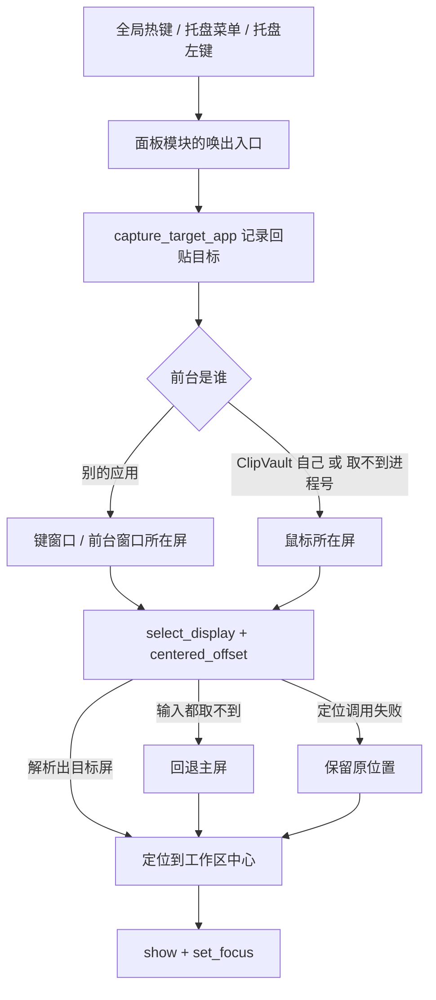
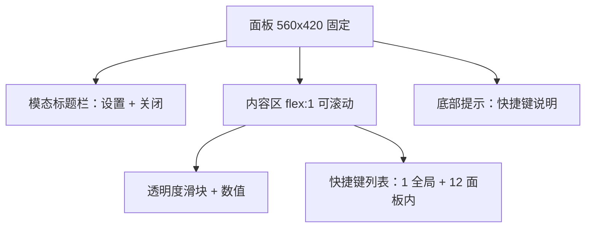

# 面板多屏摆放与设置面板放不下 - Plan

## Goal Capsule

**Objective.** 多屏用户按呼出快捷键（或点托盘）时，命令面板出现在他此刻正在工作的那块屏上，而不是永远出现在主屏；打开设置后，设置面板的每一段内容——包括透明度滑块与快捷键列表——都看得见、够得着、能滚动。

**Means.** 面板模块（`app/src/panel.rs`）收下唯一的唤出入口：先按「前台是不是自己 → 是则看鼠标屏，否则看键窗口/前台窗口所在屏 → 再退主屏」解析目标屏，在该屏工作区内居中，然后 `show()` + `set_focus()`（KTD1–KTD4、KTD9）。判据算术与自指判定都是平台无关纯函数（KTD2）。设置模态把内容区改成面板内滚动、标题栏与底部提示常驻（KTD5）；面板透明度改由 `--panel-alpha` 变量同时驱动面板背景与设置遮罩，使设置态下拖动滑块也看得见变化（KTD6）。

**Authority hierarchy.** 本 plan 的 Product Contract 是事实来源；`docs/plans/2026-09-24-0931-feat-clipvault-mvp-plan.md` 的窗口契约（560×420 逻辑像素 / `decorations:false` / `alwaysOnTop` / `transparent`）与 `docs/plans/2026-10-13-1716-feat-windows-platform-support-plan.md` 的「平台无关决策层一行不改、平台差异走 `#[cfg]`」仍然有效。本 plan 只替换 `tauri.conf.json` 的 `center:true` 所导致的「固定主屏」行为，属于有意的产品行为变更（见 Scope Boundaries）。

**Stop conditions.** U1–U6 全部完成，验证契约全绿，macOS 真机 AE1–AE6 通过；Windows 侧以 CI `windows` job（整树 clippy + test + NSIS）为编译底座，真机至少走完 AE1–AE3 与 U3 列出的托盘自指场景。U4/U5 不依赖 U1–U3，可以先独立完成并单独交付，不因此阻塞收尾。

**Execution profile.** 6 个 implementation unit，但只有 5 个 commit：U1 与 U2 **必须同一个 commit 落地**（U1 的纯函数在 U2 接线之前没有生产调用方，单独提交会被 `clippy -D warnings` 判为 `dead_code`），U3 依赖 U2，U6 收尾。**U4/U5 只动前端、与后端没有任何代码交集，建议先落并先交付**：设置放不下是所有用户都会遇到的回归，而多屏摆放只影响多屏用户，把前者排在后者（尤其排在只能在 CI 上验证的 Windows 适配）之后没有任何好处。U3 若因 Windows 编译问题需要多轮修补，允许拆成 2 个 commit。

---

## Product Contract

### Summary

把主面板的唤出落点从「永远是主屏」改成「焦点所在屏的工作区居中」，并让设置模态在固定的 560×420 面板内可滚动、滑块可达；顺手让透明度调整在设置态下可感知。

### Problem Frame

现在面板窗口的落点在 `app/tauri.conf.json` 里由 `center:true` 决定，而 Tauri 的 `center` 只在窗口创建时生效一次、且总是相对主显示器（`tauri-runtime-wry` 构建窗口时取 `primary_monitor`）。唯一的唤出入口 `tray::show_panel` 只做 `show()` + `set_focus()`，从不改位置，所以全应用没有任何一处读过显示器列表或调用过定位 API。多屏用户在副屏工作时呼出面板，面板会出现在另一块屏幕上。

设置模态是叠在面板内的一层覆盖层（`.editor` 居中 + `.editor-card`），卡片既没有 `max-height` 也没有滚动。快捷键自定义上线后，设置卡片里多了 1 行全局热键 + 12 行面板内热键，内容高度远超 420 逻辑像素；卡片被垂直居中，于是上下两端一起被窗口裁掉：标题栏、紧贴其下的透明度滑块、底部提示都在窗口之外，且没有任何滚动可以挽回。用户报告的「面板透明度没办法设置」，就是滑块落在被裁掉的顶部、根本够不着；滑块本身与 `get/set_panel_opacity` 命令、`--bg` 变量链路都是通的。

还剩一处会影响「透明度」体感的细节：`--bg` 只作用于 `.panel` 背景，而设置模态用一层 `rgba(0,0,0,0.4)` 遮罩 + 近乎不透明的卡片盖住了面板。即使滑块够得着，在设置打开时拖动它，屏幕上可感知的变化也接近于零。

### Requirements

**多屏摆放**

- R1. 每次唤出（全局热键、托盘菜单、托盘左键点击）时，主面板必须在「当前有键盘焦点的显示器」的工作区内居中后显示，不再固定主屏。「有键盘焦点的显示器」按平台取：macOS 取键窗口所在屏（`NSScreen.mainScreen`），Windows 取前台窗口所在屏（`GetForegroundWindow`）。
- R2. 当 ClipVault 自己是前台应用时（托盘菜单弹出、面板已可见并持有 key 窗口），「焦点显示器」必须改取鼠标所在显示器，不得把面板判给它自己的菜单窗口或面板窗口；该判定必须是平台无关的纯函数，两端适配层只负责取前台进程号。
- R2a. 「焦点显示器」的输入优先级是：前台窗口（非 ClipVault 自己）→ 鼠标所在屏 → 主显示器；定位调用本身失败时保留原位置。前台进程号取不到时按下一档处理，不得因此直接跳到主显示器。
- R3. 解析不出目标屏时（取不到前台窗口**且**取不到鼠标位置、或显示器列表为空）必须回退到主显示器；定位调用本身失败时（平台 API 报错、macOS 不在主线程）保留面板原有位置。两种情况都不得阻止唤出——面板照常显示。
- R4. 定位必须发生在 `show()` 之前，并保持 `capture_target_app()` → `show()` → `set_focus()` 的既有顺序不变。
- R5. 回贴链路里三处重显面板的位置（`app/src/commands.rs` 的降级提示路径）不得重新定位：面板留在唤出时的位置。
- R6. 居中基准是显示器工作区（macOS 扣除菜单栏 / Dock，Windows 扣除任务栏），不是整屏矩形。
- R7. 面板尺寸与窗口属性保持不变：560×420 逻辑像素、`resizable:false`、`decorations:false`、`alwaysOnTop:true`、`transparent:true`；`tauri.conf.json` 的 `center:true` 保留不动——它只在窗口创建时生效一次，每次唤出的重定位会覆盖它。

**设置面板可用性**

- R8. 设置内容超出面板高度时，内容区必须在面板内滚动，标题栏与底部提示常驻可见。
- R9. 透明度滑块必须始终可达：打开设置即能看到它，不被裁切、不需要手动拖动面板窗口。
- R10. 每次打开设置时，内容区滚动位置复位到顶部。
- R11. 快捷键重绑进入录制态的行必须可见：若该行已滚出视口，自动滚入（`block: nearest`，只滚最小距离）。
- R12. 滚动容器必须保留可见的滚动 affordance（细滚动条），不得把滚动条完全隐藏。
- R17. 设置内容区必须是滚轮事件的唯一归属：在设置打开时滚动内容区，不得带动面板底层列表一起滚动。

**透明度反馈**

- R13. 设置面板打开时拖动透明度滑块，屏幕上必须出现可见变化：面板背景与设置遮罩同时随滑块值变化。

**跨平台与约束**

- R14. 两端落点行为一致（都以焦点显示器为目标、都在工作区内居中），共享的是「选屏 + 居中 + 自指判定」这套纯函数；两端喂进纯函数的焦点输入语义不同（macOS 已是键窗口所在屏，Windows 是前台窗口矩形），这一点不得含糊。
- R15. 平台差异走 `#[cfg]` 分支，且可抽成吃显式平台参数的纯函数部分必须能在 macOS 上被单测覆盖（Windows 分支的算术不依赖真机）。既有先例：`app/src/storage.rs` 的 `resolve_data_dir`、`app/src/pasteback.rs` 的 `modifier_label`、`app/src/tray.rs` 的 `TrayState::tooltip`。
- R16. 不得引入网络出口或新增重型依赖；平台绑定只允许加在 `cfg(target_os = ...)` 下（`app/Cargo.toml` 的 `[target.'cfg(...)'.dependencies]` 段）。

### Acceptance Examples

- AE1. 双屏、用户在外接屏的某个 App 中按 `⌥⌘V`：面板出现在外接屏的工作区正中央，主屏没有面板。（Covers R1）
- AE2. 双屏、用户在外接屏工作，把鼠标移到主屏菜单栏点击托盘图标：面板出现在鼠标所在的主屏，而不是面板上一次所在的屏。（Covers R2）
- AE3. 用户拔掉外接屏后按 `⌥⌘V`：面板仍在屏内可见（回到主屏居中），不会出现在已消失的坐标上。（Covers R3）
- AE4. 用户按 `⌘,` 打开设置：标题「设置」与底部提示同时可见，快捷键列表可以滚动，透明度滑块就在标题下方且可拖动；滚到列表底部后按 `Escape` 关闭、再打开，内容区回到顶部。（Covers R8、R9、R10）
- AE5. 用户在设置里把透明度从 78% 拖到 40%：拖动过程中能看见面板背景与设置遮罩一起变淡；关闭设置后主面板按新值半透明。（Covers R13）
- AE6. 用户回车回贴并触发降级提示（未授权辅助功能 / 目标窗口已切换）：提示面板出现在原位置，不发生跨屏跳动。（Covers R5）

### Scope Boundaries

**In scope.**

- 唤出时按焦点显示器定位（含托盘路径的自指回退）与工作区居中。
- 设置模态在固定尺寸面板内的滚动布局、滚动复位与录制行可见。
- 透明度调整在设置态下的可见反馈。
- 平台差异的纯函数化与两端一致性。
- README / AGENTS.md 的行为说明与实施进度更新。

**Out of scope（本 plan 不做）。**

- 面板尺寸随设置内容临时长高（见 KTD5 的取舍）。
- 「记住上次唤出位置」/「面板跟随鼠标移动」/ 设置项化的显示器选择档位。
- 用户手动拖动面板后的位置持久化——每次唤出都会重新居中（面板顶部搜索栏仍是拖拽区，拖拽只影响本次会话内的位置）。
- macOS 全屏 Space 的特判（见 Risks 中的已知限制）。
- 托盘「加密区 / 关于」占位入口的语义修整。

**Deferred to Follow-Up Work.**

- 重新唤出时自动关闭已打开的设置模态。研究与实测都指出这是既有缺陷（面板隐藏后设置仍是打开态，重新唤出时设置可见但键盘焦点在搜索框，出现「看到的是设置、敲进去的是搜索框」），但它需要 Rust 侧显式的「面板已隐藏」信号来避开与托盘 `open-settings` 事件的时序竞争，超出本次确认的范围，单独跟进。
- 为非 macOS / 非 Windows 目标提供定位（当前 Linux 等平台沿用 `#[cfg]` 降级，面板留在原位）。

---

## Planning Contract

### Key Technical Decisions

KTD1. 「焦点显示器」的判据是**键窗口所在屏（macOS `NSScreen.mainScreen`）/ 前台窗口所在屏（Windows `GetForegroundWindow`），且在前台是 ClipVault 自己时退到鼠标所在屏**。托盘路径在 macOS 上必然自指：菜单一弹出，前台/key 窗口就变成 ClipVault 的菜单窗口，再按「焦点屏」解析只会把面板判回自己所在的那块屏，与本次修复意图相反。注意 `NSScreen.mainScreen` 的准确语义是「当前接收键盘事件的窗口所在屏」，不等于「前台 App 所在屏」（一个 App 可以跨屏多窗口），排障时按前者理解。Windows 上托盘图标/菜单**未必**把 ClipVault 顶成前台窗口，因此那条自指分支在 Windows 上可能不触发（见 U3 的待验证场景）。行业实现（PowerToys 命令面板、Flow Launcher）默认鼠标屏、并把「活跃窗口屏」作为可选档；本 plan 取「聚焦优先、鼠标兜底」，因为没有引入设置项，用户明确要的就是「聚焦哪个屏幕」。

KTD2. 判据里凡是**决策**（不是取 I/O）的部分都抽成平台无关纯函数，放在 `app/src/panel.rs`：

1. `focused_source(front_pid: Option<i32>, self_pid: i32) -> FocusSource`——判定焦点输入取哪一档（R2a）：前台是别的应用取 `Frontmost`；前台是自己（托盘菜单弹出、面板持有 key 窗口）或取不到前台进程号时取 `Cursor`。取不到前台进程号不能直接跳主屏——鼠标位置通常仍在，这是与 R3 一致的一档。**不要复用** `pasteback::should_replace_target`：它的 `None` 语义是「视同自己、保留旧目标」，与这里的三态判定不同。
2. `select_display(focused, cursor, displays) -> Option<usize>`——先判包含（focused 优先、cursor 其次），包含都落空取最近，列表为空返回 `None`。
3. `centered_offset(work_area, window_size) -> (dx, dy)`——取松弛量的一半；窗口大于工作区时钳到 0。上游 `tauri-runtime-wry` 的 `calculate_window_center_position` 是同类先例，但它不钳位、会算出负坐标，本 plan 的钳位是有意改进。
4. `appkit_frame_origin(offset, work_area, window_size)`——把「左上原点、y 向下」的居中结果换算成 AppKit 的左上角点（左下原点、y 向上）。这是整条链路里最容易错、又最不该只靠真机验的一步。

各矩形以小体积的本地几何类型表示而非 `tauri::Monitor`：`Monitor` 的字段是 `pub(crate)`、没有公开构造函数，macOS 的目标屏数据来自 `NSScreen` 而不是 Tauri 的显示器列表，两端都自己读、自己喂。两端适配层只做「取 rect / 取 pid / 落位」。

KTD3. macOS 侧用 `NSScreen.mainScreen`（键窗口所在屏）与 `NSEvent.mouseLocation`（全局鼠标点，AppKit 点）取屏，落位用**直接 AppKit 的 `NSWindow.setFrameTopLeftPoint`**，而不是 Tauri 的 `set_position`。两个理由：(1) tao 的 `set_outer_position` 在 macOS 上无条件 `dispatch_async` 到主队列，而 `show()` 在主线程上是同步的，`set_position(); show();` 会先画出旧位置的一帧；直接调 AppKit 是同步的。(2) 全程留在 AppKit 点坐标里，可以绕开 tao 自己的点/像素换算（`util::window_position` / `cursor_position` 把 `CGDisplay::main().pixels_high()` 当逻辑点用）。`WebviewWindow::ns_window()` 是 tauri 的稳定公开逃生口，tauri 自己的文档示例与运行时都直接对返回值调 AppKit，仓库里 `pasteback::imp` 也已在同类边界直调 AppKit，因此不构成新的破例。**不需要改 `app/Cargo.toml`**：`NSScreen` / `NSWindow` / `NSEvent`（以及自指判定要用的 `NSWorkspace` / `NSRunningApplication`）都已随 crate 默认 feature 打开。tauri 自带的 `center()` 不适用——它居中到窗口**当前**所在屏，不是焦点屏。

KTD4. Windows 侧用 `GetForegroundWindow`（返回裸 `HWND`，用 `HWND::is_invalid()` 校验）+ `GetWindowThreadProcessId`（pid 经 `Option<*mut u32>` 出参）判断「前台是不是自己」，配合 `GetCursorPos`（返回 `Result`）；把点交给 Tauri 的 `monitor_from_point` 拿到 `Monitor`，再用 `set_position(PhysicalPosition)` 落位。理由：这样不必新增 `Win32_Graphics_Gdi`（`MonitorFromWindow` / `GetMonitorInfoW` 所在 feature，当前未启用），也不碰 `cursor_position()` 在 macOS 上「物理像素 vs 逻辑点」的坑。`monitor_from_point` 在 Windows 走 `MONITOR_DEFAULTTONULL`，只有在点落在显示器之间的空隙时才返回 `None`。坐标空间按平台各取所长：macOS 走 AppKit 点、Windows 走物理像素（窗口逻辑尺寸按目标屏 `scale_factor` 换算），都是各自缩放下不会算错的方向。落位用的 `SetWindowPos` 带 `SWP_ASYNCWINDOWPOS`：调用线程拥有窗口时等效同步，但这**不是**保证同步的原语。

KTD5. 设置面板的修法是**窗口尺寸不变、内容区在卡片内滚动**：`.settings-card` 加高度上限，内容区 `flex:1; min-height:0; overflow-y:auto`，标题栏与底部提示常驻（沿用 `frontend/src/styles.css` 里加密区 `.vault-card` + `.vault-list` 的既有做法）。高度上限写成相对 `.editor` 内容盒的 `max-height: 100%`，**不要**写成「面板高度减去 16px」——`.editor` 的 16px 内边距是四周各一份、竖直方向是 32px，按单边算会正好复现本次要修的两端裁切。内容区同时是滚轮事件的唯一归属（R17），避免滚动穿透到面板底层的 `.list`。放弃「打开设置时把面板临时长高」的理由：那要每次开关都 `set_size` + 重算居中 + 关闭时还原，还要吞下缩放变化事件与混合 DPI 的定位问题，代价明显大于收益，而且 12 行快捷键在 640 高度下依然要滚。

KTD6. 透明度反馈靠一个新变量 `--panel-alpha`：`.panel` 背景继续由它派生（保持现有 `--bg` 语义，`--bg` 改为引用该变量而不是各写一份字面量），设置遮罩也由它派生（`#settings` 的遮罩透明度和它同向变化），`applyPanelOpacity` 保持唯一写入者。跨边界不变量：CSS 的默认 alpha 必须等于 Rust `privacy::DEFAULT_PANEL_OPACITY`（78），且不得越出 `[MIN_PANEL_OPACITY, MAX_PANEL_OPACITY] = [30, 100]`。这样需要人工同步的只有「Rust 常量 ↔ CSS 默认值」一对。

KTD7. `app/src/commands.rs` 里三处回贴后重显面板的位置**不重新定位**，并在代码里留下注释固定这个决定。理由：那三处不是唤出，重贴后目标 App 已回到前台，「焦点屏」会变成目标 App 所在屏，面板会在用户眼前跳屏；面板本来就该留在唤出时的位置（R5）。

KTD8. macOS 全屏 Space 不做特判：定位仍指向那块屏，若该屏正处于全屏 Space，面板可能直到用户退出全屏才可见。理由：这与现状一致（现在固定主屏也有同样问题），要真正盖住全屏应用需要把 `NSWindow` 子类化成 `NSPanel` 并设 `[CanJoinAllSpaces | Stationary | FullScreenAuxiliary]`，属于独立课题；`set_visible_on_all_workspaces` 只是其中一半（只加 `CanJoinAllSpaces`），本 plan 不动它。

KTD9. 把唯一的唤出入口从 `tray.rs` 迁进 `app/src/panel.rs`（托盘与热键只调用它）。理由：R4 要求「先定位、再 show」的时序现在只靠注释维持，任何新唤出路径直接 `window.show()` 就会静默跳过定位；把入口放进面板模块后，这条时序由模块边界而不是注释保证，DoD 里「只有一个唤出入口」也从人工检查升级成结构事实。迁移是纯搬移 + 接线，不改既有 `capture_target_app()` → `show()` → `set_focus()` 三步的顺序与语义。

### High-Level Technical Design

唤出链路的落点决策（U1–U3）：

设置模态的区域构成（U4、U5；窗口尺寸不变）：

---

### Risks & Dependencies

- **macOS 定位会静默降级。** 拿不到 `MainThreadMarker`（或键窗口屏取不到）时走 R3 的「定位调用失败」分支——保留面板原位置，而没有任何测试会红。缓解：该分支留一条按路径去重的调试日志作为可观测信号，并在真机验收里显式核对「唤出后是否真的在焦点屏」。
- **两端靠两套不同的时序机制。** macOS 唤出路径本来就在主线程（Carbon 回调、托盘事件），定位是同步生效的；Windows 的热键路径跑在 `app/src/hotkey.rs` 自建的消息泵线程上，靠 Tauri 事件循环的 FIFO 投递保证「先定位、后 show」。改动任一唤出路径的线程模型都会破坏各自的前提，U2/U3 的 Approach 里写明这一点。
- **Windows 的托盘自指假设未经证实。** 点通知区图标未必把 ClipVault 顶成前台窗口；若 `GetForegroundWindow` 仍指向上一个应用，面板会落到「上一个前台窗口所在屏」而不是鼠标屏（R2 的意图）。U3 把这一条列为必须真机确认的场景。
- **混合 DPI 的换算面。** Windows 侧要把 560×420 按目标屏 `scale_factor` 换成物理像素再算偏移，错一处就偏出半屏；macOS 侧全程 AppKit 点，天然规避。
- **全屏 Space 上唤出可能看不见面板**（KTD8），与现状一致但不理想。
- **手动拖拽的位置不留存。** 面板顶部搜索栏是 `data-tauri-drag-region`，用户可以拖；每次唤出重新居中会覆盖拖动结果，本次按「每次唤出」的语义接受，并写进文档。
- **提交顺序风险。** U1 单独提交会被 `clippy -D warnings` 判为 `dead_code`（纯函数在接线前没有生产调用方）；U3 若先于 U2 落地，Windows 目标同样没有调用方。缓解：U1+U2 同 commit，U3 紧随其后。另一处同类但更隐蔽：U2 落地的 Windows 桩只是让整树编译得过，共享纯函数在 Windows 目标上要等 U3 才有生产调用方，因此 Windows 的 CI job 在 U3 之后跑才有意义（本机 macOS 也不会替它发现这个问题）。
- **CI 覆盖缺口。** `.github/workflows/package.yml` 只由 `push: tags: ['v*']` 与 `workflow_dispatch` 触发，没有 PR / push 分支触发；Windows 目标的整树编译与 lint 需要手动 dispatch（或在分支上打 tag）才会跑。Linux 目标在任何 job 里都不编译，因此 Deferred 中的 Linux 降级不构成有保障的契约。
- **Windows 落位不是保证同步的原语**（`SWP_ASYNCWINDOWPOS`），只是在调用线程拥有窗口时等效同步；真机上若观察到面板先出现在旧位置，优先怀疑这里。

### Sources / Research

实施前值得先读的落点与依据：

- `app/src/tray.rs` —— 现在唯一的唤出入口与「先记目标、再 show」的顺序约束（KTD9 把它迁进面板模块）。
- `app/src/panel.rs` —— 面板生命周期模块，以及纯判定 + 内联测试的既有写法（`should_auto_hide`）。
- `app/src/storage.rs`、`app/src/pasteback.rs`、`app/src/tray.rs` —— 平台差异的纯函数先例：`resolve_data_dir`、`modifier_label`、`should_replace_target`（注意其 `None` 语义与 KTD2 的新谓词相反）、`TrayState::tooltip`。
- `app/src/commands.rs` —— 回贴后重显面板的三处（R5 / KTD7）。
- `app/tauri.conf.json` —— 窗口契约与只在创建时生效的 `center:true`。
- `frontend/src/styles.css`、`frontend/src/main.ts`、`frontend/src/settings.ts` —— `.vault-card` + `.vault-list` 滚动先例、`.editor` 的几何、`applyPanelOpacity` / `openSettings` / `startRecording`。
- tauri 2.11.6 `src/window/mod.rs`（`Monitor::{size,position,work_area,scale_factor}`，全为物理像素）与 tauri-runtime-wry 2.11.4 `src/monitor/{macos,windows}.rs`（`work_area` 分别来自 `NSScreen.visibleFrame` 与 `MONITORINFO.rcWork`）。
- tao 0.35.3 `src/platform_impl/macos/window.rs` 与 `util/async.rs` —— `set_outer_position` 无条件 `dispatch_async`、`show()` 在主线程走同步路径（KTD3 的依据）；`util/mod.rs` 的点/像素换算。
- tauri 2.11.6 `src/webview/webview_window.rs` —— `ns_window()` 逃生口（含 tauri 自己直接调 AppKit 的示例）、`center()`（只居到窗口当前所在屏，故不采用）、`set_visible_on_all_workspaces`。
- tauri-runtime-wry 2.11.4 `src/window/mod.rs` —— `calculate_window_center_position`：居中算术的上游先例，且它不做钳位。
- objc2-app-kit 0.3.2 `src/generated/NSScreen.rs`、`NSEvent.rs` —— `mainScreen`/`screens` 需要 `MainThreadMarker`，`NSEvent::mouseLocation` 不需要；`NSScreen` / `NSWindow` / `NSEvent` 已随 crate 默认 feature 打开，无需改 `app/Cargo.toml`。
- windows 0.61.3 `Win32/UI/WindowsAndMessaging/mod.rs` —— `GetForegroundWindow`（裸 `HWND`）、`GetCursorPos`（`Result`）、`GetWindowThreadProcessId`（pid 出参）的归属 feature 与签名；`MonitorFromWindow`/`GetMonitorInfoW` 在未启用的 `Win32_Graphics_Gdi` 下。tao 0.35.3 `src/platform_impl/windows/monitor.rs` 给出 `monitor_from_point` 的 `MONITOR_DEFAULTTONULL` 语义。
- 外部：Apple AppKit 的 `NSScreen.mainScreen`（键窗口所在屏）、`screens[0]` 为菜单栏屏、`NSWindow.setFrameTopLeftPoint`（左下原点、仅主线程）、`NSEvent.mouseLocation`（全局坐标）；PowerToys 命令面板与 Flow Launcher 的显示器选择档位（默认鼠标屏、另设「活跃窗口屏」，KTD1 的行业依据）；MDN `scrollbar-width`（不要把滚动条完全隐藏）。

---

## Implementation Units

### U1. 摆放决策纯函数层

**Goal.** 把「前台是不是自己」「选哪块屏」「在工作区里居中到哪」「怎么换算成 AppKit 的左上角点」做成不依赖平台的纯函数与数据结构，并在 macOS 上覆盖两端的判据算术。

**Requirements.** R1、R2、R2a、R3、R6、R14、R15

**Dependencies.** 无（但**必须与 U2 同一个 commit 落地**：这些纯函数在接线之前没有生产调用方，单独提交会被 `clippy -D warnings` 判为 `dead_code`）

**Files.** `app/src/panel.rs`（修改：新增纯函数与内联 `mod tests`）

**Approach.**

1. 定义仅供本模块使用的轻量几何类型（矩形/点，`f64` 分量），不放平台类型。自造而不是复用 `tauri::Monitor`：其字段是 `pub(crate)`、没有公开构造函数，且 macOS 的目标屏数据来自 `NSScreen` 而非 Tauri 的显示器列表。
2. `focused_source(front_pid: Option<i32>, self_pid: i32) -> FocusSource`：前台是别的应用取 `Frontmost`；前台是自己或进程号取不到取 `Cursor`。与 `pasteback::should_replace_target` 的三态语义不同，不复用、不复述其判据。
3. `select_display(focused: Option<Rect>, cursor: Option<Point>, displays: &[Display]) -> Option<usize>`：按 bounds 判包含，顺序为 focused 优先、cursor 其次；包含都落空时取轴对齐距离最近的显示器；`displays` 为空返回 `None`。
4. `centered_offset(work: Rect, window: (f64, f64)) -> (f64, f64)`：取两个方向松弛量的一半；窗口大于工作区时钳到 0（贴工作区左上角，而不是把面板推到负坐标外）——上游 `calculate_window_center_position` 不做钳位，这是有意的改进。
5. `appkit_frame_origin(offset, work: Rect, window: (f64, f64)) -> (f64, f64)`：把左上原点、y 向下的居中结果换算成 AppKit 的左上角点（左下原点、y 向上）。它只在 macOS 有意义，用 `#[cfg(target_os = "macos")]` 门控——否则 Windows 目标上会出现一个没有生产调用方的死函数，`clippy -D warnings` 会因此报错；门控后它在 macOS 上照常被单测覆盖。
6. `Display` 同时带 bounds 与 work 两块矩形：选屏用 bounds（全屏矩形），落位用 work（工作区）——macOS 分别对应 `frame` / `visibleFrame`，Windows 分别对应显示器矩形 / `rcWork`。
7. 其余纯函数按 `pub(crate)` 收在本模块内，够两端适配层调用即可，不扩 `pub` 面。

**Patterns to follow.** `app/src/storage.rs` 的 `resolve_data_dir`（纯函数 + 显式参数 + 内联测试）、`app/src/panel.rs` 现有的 `should_auto_hide` 与其 `mod tests`。

**Test scenarios.**

- 前台进程号是别的应用时，`focused_source` 返回 `Frontmost`。
- 前台进程号等于自身进程号时，`focused_source` 返回 `Cursor`（托盘菜单弹出、面板已持有 key 窗口的自指情形）。
- 前台进程号取不到（`None`）时，`focused_source` 返回 `Cursor`——不是直落主屏（R2a）。
- 焦点矩形完全落在第二块屏（负原点，例如 x = -229）时，选中的是第二块屏。
- 焦点矩形落在两块屏之间不存在的间隙时，选中距离最近的那块屏。
- 焦点矩形为空、鼠标点落在第二块屏时，选中第二块屏。
- 焦点与鼠标都为空时返回 `None`（调用方据此回退主屏）。
- 显示器列表为空时返回 `None`。
- 工作区大于窗口时，居中偏移为两个方向松弛量的一半。
- 工作区比窗口小（缩放到很小的显示配置）时，偏移钳到 0 且不为负。
- 带负原点工作区（副屏在主屏左侧）时，偏移相对该工作区原点计算，不相对全局原点。
- `appkit_frame_origin` 在负原点工作区、工作区小于窗口、以及恰好贴屏幕下沿三种输入下，把左上原点结果换算成正确的 AppKit 左上角点（含 y 轴翻转方向）。

**Verification.** `cargo test --workspace` 中新增用例全绿；除 `appkit_frame_origin`（`#[cfg(target_os = "macos")]`）外，纯函数不引用任何 `#[cfg]` 专有类型；与 U2 同 commit 提交后 `clippy -D warnings` 不报 `dead_code`。

---

### U2. macOS 定位适配、唤出入口迁移与接线

**Goal.** 在 macOS 上按 KTD1 的判据取到目标屏并把面板居中过去；把唯一的唤出入口迁进面板模块，使定位与显示始终成对发生；定位失败不影响唤出。

**Requirements.** R1、R2、R2a、R3、R4、R6、R14

**Dependencies.** U1（同 commit）

**Files.** `app/src/panel.rs`（修改：`#[cfg(target_os = "macos")]` 适配层、`pub(crate)` 定位入口、迁入的唤出入口）、`app/src/tray.rs`（修改：托盘菜单/点击改调面板模块的唤出入口）、`app/src/hotkey.rs`（修改：两处热键回调改调同一入口）、`app/src/commands.rs`（修改：仅为 KTD7 补注释，不改行为）

**Approach.**

1. 适配层先从 `NSWorkspace` 的前台应用取进程号，交给 U1 的 `focused_source` 判定：`Frontmost` 用 `NSScreen.mainScreen`，`Cursor` 用 `NSEvent.mouseLocation`。
2. 由 `NSScreen.screens` 的 `frame` 构造 `Display` 列表（选屏用），由 `visibleFrame` 提供落位用的工作区；窗口逻辑尺寸沿用 `tauri.conf.json` 的 560×420（AppKit 点即逻辑像素，不需要缩放换算）。鼠标那一档把点喂给 `select_display` 的 `cursor` 参数；两档都取不到屏时回退主屏（R3）。
3. 落位用直接 AppKit 的 `setFrameTopLeftPoint` + U1 的 `appkit_frame_origin`，必须在主线程执行；拿不到 `MainThreadMarker` 时走 R3 的「定位调用失败」分支（保留原位置），并留一条按路径去重的调试日志（Risks 里的可观测信号）。
4. 把唤出入口从 `app/src/tray.rs` 迁进 `app/src/panel.rs`（KTD9），内部顺序固定为：取目标 App → 定位 → `show()` → `set_focus()`；托盘与热键只调用它，不再各自 `show()`。
5. 为 `#[cfg(target_os = "windows")]` 同时落一个「尽力而为」的空实现（返回「本次不定位」，让整树在 Windows 目标上编译得过），U3 再把它替换成真实适配；这也是 U3 的依赖前提。
6. 在 `app/src/commands.rs` 三处重显位置加注释，说明为何不重新定位（KTD7），并把 `center:true` 保留在 `tauri.conf.json` 这件事记在同一处注释或提交信息里。

**Technical design（方向性，非实现规范）.** 定位入口的形状是「尽力而为」：先解析目标屏与偏移，任何一步返回 `None`/`Err` 就静默返回（除调试日志外），由调用方继续 `show()`。

**Patterns to follow.** `app/src/pasteback.rs` 的 `mod imp`（`#[cfg(target_os = "macos")]` + `MainThreadMarker` 判断 + `unsafe` objc 调用 + 纯谓词先例 `should_replace_target`）、`app/src/tray.rs` 现有的 `show_panel` 顺序注释（迁移时一并带走，它说明为何那三步的顺序是关键约束）。

**Test scenarios.**（平台绑定本身需真机；判据算术的覆盖在 U1）

- 真机双屏：在副屏前台 App 中按热键，面板在副屏工作区居中，不压到菜单栏/Dock。
- 真机双屏：面板停在副屏时，把鼠标移到主屏并点击托盘图标，面板出现在主屏鼠标处（覆盖 R2 的自指回退）。
- 真机：没有任何前台窗口（点桌面）后按热键，面板落到鼠标所在屏；鼠标位置也取不到时落到主屏。两种情况都不阻断唤出（覆盖 R2a / R3）。
- 真机：先拔出外接屏再按热键，面板回到主屏工作区居中。
- 真机：拖拽面板到别处后再次唤出，面板回到焦点屏居中（记录「拖拽位置不持久」为预期行为）。
- 真机：三种唤出路径（热键 / 托盘菜单 / 托盘左键）都落到同一入口，行为一致（KTD9 的接线验证）。

**Verification.** `cargo tauri dev` 下上述场景逐条肉眼通过；`cargo check/clippy/fmt` 全绿；`grep -rn "fn show_panel" app/src` 只命中面板模块，且托盘与热键文件里不再有直接 `.show()`。

---

### U3. Windows 定位适配

**Goal.** 在 Windows 上实现与 macOS 同源的判据与落位，替换掉 U2 留下的 Windows 桩，且不新增 Win32 feature、不改平台无关决策层。

**Requirements.** R1、R2、R2a、R3、R4、R6、R14、R15

**Dependencies.** U2（U2 的接线是平台无关的，因此必须先有一个 `#[cfg(target_os = "windows")]` 的空实现让整树在 Windows 目标上编译得过，本单元把它替换为真实适配）

**Files.** `app/src/panel.rs`（修改：`#[cfg(target_os = "windows")]` 适配层）

**Approach.**

1. 用 `GetForegroundWindow` 取前台窗口（返回裸 `HWND`，用 `HWND::is_invalid()` 校验），用 `GetWindowThreadProcessId` 的 `Option<*mut u32>` 出参取进程号，交给 U1 的 `focused_source` 判定。
2. `Frontmost` 档：用 `GetWindowRect`（已在启用的 `Win32_UI_WindowsAndMessaging` 下，无需新 feature）取前台窗口矩形，把它的中心点作为 `select_display` 的 `focused` 输入——这是 R1「Windows 取前台窗口所在屏」的唯一取数路径，只判自指而不取矩形就会退化成「面板跟着鼠标跑」。
3. `Cursor` 档：用 `GetCursorPos`（返回 `Result`）取鼠标点，作为 `cursor` 输入。
4. 由 `available_monitors()` 构造 `Display` 列表（bounds 用 `position`/`size`，工作区用 `work_area`），按物理像素参与判据；选中的点交给 `monitor_from_point` 拿目标屏，窗口尺寸按该屏 `scale_factor` 换算成物理像素后再算偏移。
5. 落位用 `set_position(PhysicalPosition)`；两个输入都取不到时回退主屏，定位调用失败时保留原位置（R3）。
6. 不新增第二个唤出入口——本单元只提供适配层，唤出入口已在 U2 收进面板模块。
7. 本单元跑在 `app/src/hotkey.rs` 自建的消息泵线程上，不是主线程：只允许用线程安全的 Tauri API（`available_monitors` / `monitor_from_point` / `set_position`），不得引入任何主线程假设。

**Technical design（方向性，非实现规范）.** 判据算术复用 U1 的纯函数，本单元只提供「物理像素的 rect 列表」与「前台进程号 / 鼠标点」。

**Patterns to follow.** `app/src/pasteback.rs` 的 `mod imp_win`（`#[cfg(target_os = "windows")]` + `windows` crate 的 `Result` 风格错误处理）、`app/src/winclip.rs`（测试与实现分离的模块习惯）。

**Test scenarios.**

- Windows 真机双屏：在副屏前台窗口中按 `Ctrl+Alt+V`，面板在副屏工作区居中，不压任务栏。
- Windows 真机：点托盘图标唤出时，面板出现在鼠标所在屏；**同时确认此时 `GetForegroundWindow` 是否已指向 ClipVault 自己**（若否，说明自指分支在 Windows 上不触发，需按 R2 的意图修正判据，而不是放行）。
- Windows 真机：无前台窗口（例如前台刚失去激活）时，面板回退鼠标屏或主屏，且不阻断唤出。
- Windows 真机：缩放不一致的双屏（例如 100% + 150%）下，面板在目标屏居中且尺寸不出现二次缩放。
- Windows 真机：面板先出现在旧位置一帧再跳过去（若观察到，按 Risks 里的 `SWP_ASYNCWINDOWPOS` 线索排查）。
- 整树 `cargo clippy --workspace --all-targets -- -D warnings` 在 Windows 目标上通过（本机 macOS 不编译该分支）。

**Verification.** 手动触发 CI 的 `windows` job（`workflow_dispatch`，或在分支上打 tag——该 workflow 不响应 PR / push 分支）全绿：整树 clippy + `cargo test` + NSIS 打包；Windows 真机场景逐条通过。

---

### U4. 设置面板内容溢出的滚动适配

**Goal.** 设置模态在固定 560×420 面板内可滚动，标题栏、透明度滑块与底部提示不再被裁掉。

**Requirements.** R8、R9、R10、R11、R12、R17

**Dependencies.** 无（与后端解耦）

**Files.** `frontend/index.html`（修改：设置卡片内为内容区加包裹元素）、`frontend/src/styles.css`（修改：设置卡片高度上限、内容区滚动、滚动条样式）、`frontend/src/main.ts`（修改：打开设置时复位滚动）、`frontend/src/settings.ts`（修改：录制态行滚入视口）

**Approach.**

1. 把设置卡片里「透明度字段 + 快捷键区块」包进一个内容区元素，标题栏与底部提示留在卡片直接子级（保持原有 DOM 顺序与 id 不变，仅加一层容器）。
2. 卡片加上高度上限 `max-height: 100%`（相对 `.editor` 的内容盒解析，已自动扣除四周各 16px 的内边距），内容区 `flex:1; min-height:0; overflow-y:auto`——`min-height:0` 是让 flex 子项真的能被压缩、从而触发滚动的关键。**不要**把上限写成「面板高度减去 16px」：竖直方向的内边距是 32px，按单边算会正好复现本次要修的裁切。
3. 滚动条用细滚动条而不是完全隐藏（R12），不得使用会移除可访问性 affordance 的写法。
4. 内容区同时是滚轮事件的唯一归属（R17）：面板底层的 `.list` 在设置打开时不得随滚动一起动。
5. `openSettings()` 在显示模态后把内容区 `scrollTop` 复位到 0；`startRecording()` 进入录制态后把该行 `scrollIntoView({ block: "nearest" })`，并给行留出与容器内边距相称的滚动边距，避免贴边时被标题栏遮住。
6. 不改动快捷键的现有键盘派发（`frontend/src/keymap.ts` 的数据驱动 dispatch）与 `Escape` 关闭语义。

**Patterns to follow.** `frontend/src/styles.css` 的 `.vault-card { max-height: 80% }` + `.vault-list { flex:1; overflow-y:auto }`（仓库里唯一已解决同问题的先例）；`.editor-head`/`.editor-foot` 的既有结构。

**Test scenarios.**（前端无 DOM 测试环境——只有 `frontend/src/keymap.test.ts` 这类纯逻辑用例，本单元以真机验收为准）

- 真机：`⌘,` 打开设置，标题「设置」「关闭」按钮、透明度滑块、底部提示同屏可见。
- 真机：用滚轮/触控板滚到快捷键列表底部，再按 `Escape` 关闭、重新打开，内容区回到顶部。
- 真机：点某一行的「重绑」使其进入录制态，若该行接近视口底部，行自动滚入可见区。
- 真机：面板高度不变（560×420），滚动只发生在内容区，标题栏与底部提示不位移。
- 真机：在设置内容区滚动时，面板底层的剪贴板列表不跟着动（R17）。
- 真机：把窗口调到最小可用显示配置（例如 1280×800 的笔记本屏）时行为一致。

**Verification.** `(cd frontend && npm run build)` 与 `(cd frontend && npm test)`（`frontend/src/keymap.test.ts` 是快捷键派发的回归护栏，本单元明确不改 `keymap.ts`，这条命令能立刻判定是否误伤）均通过；真机场景逐条通过。注意 `npm test` 在 CI 里不跑，必须在本地执行。

---

### U5. 设置态下的透明度可见反馈

**Goal.** 打开设置拖动透明度滑块时，用户能立刻看见变化。

**Requirements.** R13

**Dependencies.** U4

**Files.** `frontend/src/styles.css`（修改：新增透明度变量、设置遮罩改由该变量派生）、`frontend/src/main.ts`（修改：`applyPanelOpacity` 同时写新变量）

**Approach.**

1. 在 `:root` 定义面板透明度变量，默认值与后端 `DEFAULT_PANEL_OPACITY`（78%）对齐且落在 `[30, 100]` 内；把现有 `--bg` 的字面量改成**引用该变量**，使 `.panel` 背景成为派生值而不是第二份默认值。
2. `applyPanelOpacity(percent)` 保持唯一写入者（启动时对齐、滑块 `input`、`change` 落库三个调用点都不变），只写这一个变量。
3. 设置模态自身的遮罩由同一变量派生，使遮罩随透明度同向变化；其它模态（备注编辑器、加密区）不动，控制影响面。
4. 卡片本身保持接近不透明的可读背景——变透明的是遮罩，不是正文。

**Patterns to follow.** `frontend/src/main.ts` 的 `applyPanelOpacity`（一处改变量、全页生效的既有做法）、`frontend/src/styles.css` 顶部 `:root` 变量块、`app/src/privacy.rs` 的 `DEFAULT_PANEL_OPACITY` / `MIN_PANEL_OPACITY` / `MAX_PANEL_OPACITY`（KTD6 的跨边界不变量）。

**Test scenarios.**（同 U4，无 DOM 测试环境）

- 真机：设置打开时把滑块从 78% 拖到 40%，遮罩与面板背景同时变淡，变化过程可见。
- 真机：关闭设置后主面板按新值半透明；重启 ClipVault 后仍是新值。
- 真机：滑块拖到最小值（30%）与最大值（100%）时，设置卡片内的文字仍可读（卡片背景不随变量变化）。
- 真机：备注编辑器与加密区模态的遮罩不受影响（回归检查）。

**Verification.** 真机场景逐条通过；CSS 默认值等于 Rust `DEFAULT_PANEL_OPACITY`（78）且落在 `[30, 100]` 内（KTD6 的跨边界不变量，需要一个能看见该常量与 `:root` 的复核）；`--bg` 是派生值，`applyPanelOpacity` 是全页唯一写入者。

---

### U6. 文档与实施进度

**Goal.** README 说明新的唤出落点与设置滚动行为，AGENTS.md 的实施进度段落同步本次改动。

**Requirements.** 无新增；落实 R1、R8 的用户可见说明

**Dependencies.** U2、U3、U4、U5

**Files.** `README.md`（修改：面板行为 / 透明度说明）、`AGENTS.md`（修改：实施进度段）

**Approach.** README 里补一句多屏行为（面板在焦点所在屏居中打开、每次唤出重新居中、拖拽位置不留存）与设置面板可滚动的说明；AGENTS.md 的进度段按仓库既有写法追加本次改动，并把已经过期的测试基线数字**更正为实测值**（见 Verification Contract）。不新增截图、不改打包与分发段落。

**Test expectation:** none -- 纯文档改动。

**Verification.** 文档描述与真机行为一致；不含与 plan 冲突的旧描述。

---

## Verification Contract

| 检查 | 命令 | 适用 |
|---|---|---|
| 编译（含测试目标） | `cargo check --workspace --all-targets` | 全部 unit |
| Lint | `cargo clippy --workspace --all-targets -- -D warnings` | 全部 unit |
| 格式 | `cargo fmt --all -- --check` | 全部 unit |
| 单测 | `cargo test --workspace` | U1 起全部；**当前实测基线 181 passed（app 154 + core 27）+ 1 ignored**，本次只增不减。`AGENTS.md` 记的 131 / 22 已过期，由 U6 更正 |
| 前端构建 | `(cd frontend && npm run build)` | U4、U5 |
| 前端单测 | `(cd frontend && npm test)` | U4、U5；仅本地跑，CI 不覆盖 |
| 唤出入口唯一性 | `grep -rn "fn show_panel" app/src`（只应命中面板模块）＋ `grep -rn "\.show()" app/src/tray.rs app/src/hotkey.rs`（须空） | U2 起 |
| 网络出口审计 | `cargo tree \| grep -E 'reqwest\|hyper'`（须空）；`grep -rE 'reqwest::\|hyper::\|TcpStream\|std::net::' app/src clipvault-core/src`（须空） | U2、U3（新增原生绑定后复跑） |
| macOS 真机验收 | `cargo tauri dev` + 双屏 | AE1–AE6 全量 |
| Windows 编译与 lint | CI `.github/workflows/package.yml` 的 `windows` job | U3；本机 macOS 不编译该分支。该 workflow 只由 `push: tags: ['v*']` 与 `workflow_dispatch` 触发，**push 普通分支不会跑**，需手动 dispatch 或在分支上打 tag |
| Windows 真机验收 | NSIS 安装包 | 至少 AE1–AE3，外加 U3 列出的托盘自指场景 |

## Definition of Done

- 全部 6 个 unit 完成；U4/U5（纯前端）可以先于 U1–U3 落地并单独交付，不作为整体完成的阻塞项。唤出入口已收进 `app/src/panel.rs`：`grep -rn "fn show_panel" app/src` 只命中面板模块（托盘与热键各自只剩调用点），且 `grep -rn "\.show()" app/src/tray.rs app/src/hotkey.rs` 为空——没有任何唤出路径绕过定位直接 `show()`。
- U1 与 U2 同一 commit 落地，`clippy -D warnings` 不报 `dead_code`。
- AE1–AE6 在 macOS 真机逐条通过；AE1–AE3 与 U3 的托盘自指场景在 Windows 真机通过；CI 的 `windows` job（手动 dispatch）全绿。
- 设置模态在 560×420 面板内不再有任何内容落在视口之外，滚动条可辨（R12），滚动不穿透到底层列表（R17）。
- 透明度滑块可达、可拖、拖动时可见变化，且值在重启后保持；CSS 默认值与 Rust `DEFAULT_PANEL_OPACITY` 一致（KTD6）。
- 定位被放弃的分支留下按路径去重的调试日志，静默降级可被发现。
- 网络出口审计为空；未新增非 `cfg` 门控的平台依赖；`app/Cargo.toml` 无必要改动（若为显式性补声明，需在提交信息里说明理由）。
- R5 的三处重显位置保持不定位，并有代码注释说明原因（防止后来者「顺手」加上）。
- 清理：实现过程中若尝试过被放弃的路径（例如先用 Tauri `set_position` 再改用直接 AppKit、或先给 Windows 加了 `Win32_Graphics_Gdi`），不得留下死代码、未使用的辅助函数或注释掉的旧分支。
- 文档（README / AGENTS.md）与最终行为一致，AGENTS.md 的测试基线数字已更新为实测值。
