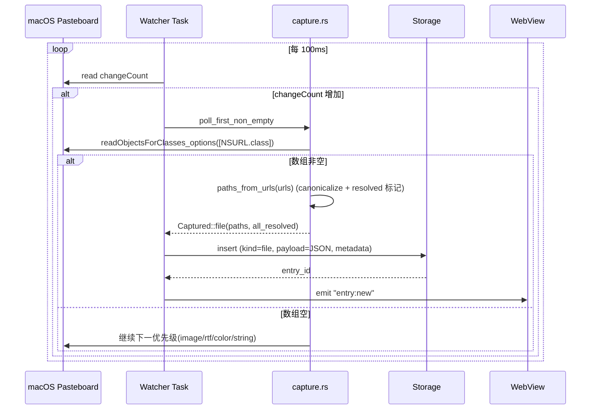
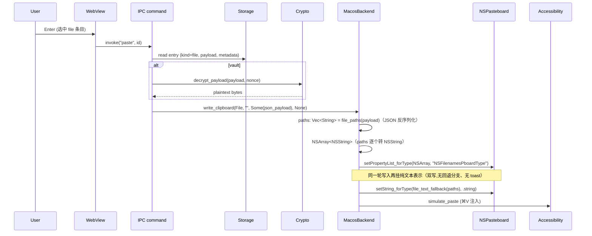

## Goal Capsule

**Objective.** macOS 端 file 类型（NSFilenamesPboardType）采集与回贴修成真实现：用户从 Finder 复制文件后 ClipVault 主面板出现 file 条目，按 Enter 在接收 NSFilenamesPboardType 的应用（Finder / Slack 上传框等）拿到文件引用；在只接收纯文本的应用从同一块剪贴板的纯文本表示拿到路径文本（不弹降级 toast）。

**Means.** 采集侧用 `NSPasteboard.readObjectsForClasses_options` 读 `[NSURL.class]` 拿文件 URL 数组（Apple 文档明确推荐此 API，multi-type plan U2 也按此设计）；pasteback 在一次写入里同时挂 `.filenames`（`setPropertyList_forType` 写 `NSArray<NSString>` 到 `NSFilenamesPboardType`，multi-type plan U4 / KTD9）与 `.string`（`setString_forType` 写 `\n` 拼接的路径文本）两种表示，由接收方各取所需，不设失败回退分支、不弹降级 toast。

**Authority.** multi-type plan R18-AE10 是 file 类型的范围；本 plan 是其 macOS 端未完成实现的收口，不新增 R-ID 也不偏离既有范围。

**Stop conditions.** U1–U4 Verification 全过；AE1–AE3 在 macOS 13+ Apple Silicon 与 Intel 上跑通；multi-type plan AE1–AE8 / AE9 / AE10 / AE11 / AE12 在新实现下不退化(AE10 的 macOS 端是本 plan AE1/AE2/AE3 落地);R13 网络出口静态审计仍空。

**Execution profile.** 4 个 Implementation Unit，全部由 `ce-work` 在本会话串行提交；终态可单独发版（patch bump）。

---

## Product Contract

> **Product Contract preservation.** R3 / KTD2 / AE2 / AE3 已改写为实现期经用户批准的双写设计（原「按 `setPropertyList_forType` 返回 false 回退 `setString` + 降级 toast」机制作废，理由见 KTD2）；其余 R / AE / U ID 全部保持原样、未做增删改号。

### Summary

把 multi-type plan 范围内 file 类型（NSFilenamesPboardType）的 macOS 端两处占位实现改成真实现：采集从 ASCII 字节扫描换成 `readObjectsForClasses_options` 走 NSURL，回贴从「只写 `setString` 的 `\n` 拼接」换成**一次写入同时挂 `.filenames`（`setPropertyList_forType` 写 `NSArray<NSString>`）与 `.string`（`setString_forType` 写 `\n` 拼接的路径文本）两种表示**，由接收方各取所需。不设「写失败回退」分支、不弹降级 toast（该分支的判据不可观测，见 KTD2）。Windows 端不动（已是真实现）；不动 schema V3、不动 R13、不新增其他类型。

### Problem Frame

multi-type plan 落地 v0.2.0 时留下两处 macOS 端 file 类型的占位实现，原因都是 multi-type plan U2 / U4 把"完整实现"留到了后续：

1. **采集侧假实现**：`app/src/capture.rs` 的 `parse_filenames_plist` 与 `extract_printable_paths` 用 ASCII 字节扫描试图从 NSKeyedArchiver 二进制 plist 里"挑出可打印片段"。NSKeyedArchiver bplist 的内容由 `$version` / `$objects` / `$top` 等键组织和索引，路径串虽然存在但分布得不可预测，扫描几乎拿不回完整路径数组，结果 `poll_filenames` 返回空 vector 走 fallthrough，整个 file 优先级被旁路。
2. **回贴侧退化路径**：`app/src/pasteback.rs` 的 `MacosBackend::write_clipboard` 在 `ContentKind::File` 分支注释自陈"MVP U4 阶段采用 setString_forType 退化路径"，把 paths 用 `\n` 拼接写 `.string` 类型，根本没走 multi-type plan KTD9 声明的 `setPropertyList_forType` 写 `.filenames`。

两个 bug 复合起来：用户复制 Finder 文件 → ClipVault 没采集到 → 主面板没有 file 条目；即便用历史库或人工手段造出一条 file 条目，按 Enter 粘贴到 Finder 复制目的地或 Slack 上传框等接收方，目标应用收到的是 `\n` 拼接的纯文本（不是 NSFilenamesPboardType），回贴到 Finder 不能触发文件复制。

Windows 端的 `app/src/winclip.rs` 早就是真实现：`DragQueryFileW` 读 `CF_HDROP` 句柄拿路径、`build_dropfiles` 写 `CF_HDROP`，回贴侧同时挂 `CF_HDROP` 与 `CF_UNICODETEXT`（`\r\n` 拼接），与 macOS 端收口后的设计思路一致（走 OS 提供的文件路径 API + 文件引用与纯文本双写），本 plan 收口时 macOS 端采用与 Windows 端对称的「OS-native 读 + 双写」形态（分隔符 macOS 用 `\n`、Windows 用 `\r\n`）。

### Key Decisions

1. **采集侧走 `readObjectsForClasses_options` with `[NSURL.class]`,不引入 plist crate.** `(session-settled: user-approved — chosen over 自写 NSKeyedArchiver plist 解析 + plist crate 显式声明: Apple 文档明确推荐 readObjects(forClasses:options:) with NSURL 读 NSFilenamesPboardType; multi-type plan U2 原本就按此设计,落到代码时走偏了; 不引入 plist crate 避免给 macOS 端加新依赖面,NSURL.path() 直接拿绝对路径,跳过 NSKeyedArchiver 解码).` Governs R1, R2.
2. **pasteback 对 file 类型一次写入同时挂 `NSFilenamesPboardType`（`NSArray<NSString>`,绝对路径）与 `NSPasteboardTypeString`（paths 按 `\n` 拼接）两种表示;不设"写失败回退"分支,不弹降级 toast.** `(session-settled: user-approved — chosen over 维持当前"setString 默认 + 失焦比对切 setPropertyList": multi-type plan KTD9 已经声明 setPropertyList 是默认路径,当前代码注释自陈是 MVP 占位;`setPropertyList_forType` 的返回值只报告写入本机剪贴板是否成功（`clearContents()` 之后实际恒为 true）,不反映目标应用能否消费文件引用,拿它当降级判据的回退分支永远不会触发、只认文本的目标应用会什么都贴不出来,故实现期经用户批准改为一次写齐两种表示、由接收方各取所需).` Governs R3;原初稿的「写失败回退 + 降级 toast」在实现期经用户批准作废。
3. **Windows 端 file 采集 / 回贴保持不变.** `DragQueryFileW` 读 + `CF_HDROP` / `CF_UNICODETEXT` 双写已是真实现,Apple macOS 端走 NSURL.readObjects 与之对称。Governs R6.

### Actors

- **A1. macOS 用户.** 在 Finder 选中文件按 `⌘C`,期望 ClipVault 主面板「最近」tab 出现 file 条目,按 Enter 粘贴回原应用收到文件引用;在只接收纯文本的应用从剪贴板的纯文本表示拿到路径文本(无 toast)。
- **A2. 目标应用.** 接收 NSFilenamesPboardType 时能解析路径数组(Finder / Slack 上传框 / Notion / VS Code 资源管理器等);仅接收纯文本时只能拿到路径文本(TextEdit / Terminal / 部分 web 表单)。
- **A3. ClipVault 进程.** watcher / storage / pasteback 模块;macOS 端通过 NSPasteboard 与系统剪贴板交互,通过 Carbon 事件注入与目标应用交互。

### Key Flows

#### F1. macOS Finder 文件复制采集

**Trigger.** 用户在 Finder 选中 1 个或多个文件,按 `⌘C`;系统把绝对路径数组以 NSFilenamesPboardType 写进 NSPasteboard(NSKeyedArchiver bplist 或 XML plist)。

**Steps.**
1. watcher 每 100ms 轮询 NSPasteboard changeCount,检测到增长时进入 `capture::poll_first_non_empty`。
2. 按 `filenames → image → rtf → color → string` 顺序探测,filenames 优先级先走。
3. `poll_filenames` 调 `readObjectsForClasses_options` with `[NSURL.class]`,拿到 `NSArray<NSURL>`;对每个 NSURL 取 `.path()` 拿绝对路径。
4. 走与现有相同的 canonicalize 流程:成功用规范路径,失败保留原串并标 `resolved = false`。
5. 构造 `Captured::file(resolved, all_resolved)`,走 watcher.process 现有去重 + skip-once + guest mode + 25MB 检查 + `fingerprint()` + 落库。

**Covers R1, R2, R4.**

#### F2. macOS file 回贴

**Trigger.** 用户在主面板选中 file 条目,按 Enter。

**Steps.**
1. 走现有 Accessibility 授权 + `hide_panel_and_restore_focus` + 焦点目标应用比对(multi-type plan U8 / pasteback 模块)。
2. `MacosBackend::write_clipboard` 检测到 `kind = File`,把 payload 反序列化为 `Vec<String>`,构造 `NSArray<NSString>`,调 `setPropertyList_forType` 写 `.filenames`(类型字符串 `"NSFilenamesPboardType"`)。
3. 同一轮写入再挂 `.string`:把 paths 用 `\n` 拼接后 `setString_forType` 写 `.string`。两种表示在同一次 `clearContents()` 之后的写入里一起挂上,接收方各取所需(Finder / Slack 上传框读 `.filenames`,TextEdit / 网页输入框读 `.string`);不设"返回 false 回退"分支,也不弹降级 toast。
4. 注入 `⌘V` 编排沿用现有 `simulate_paste`。

**Covers R3.**

### Requirements

#### 采集与回贴的真实现

- **R1.** macOS 端 watcher 必须能读取 NSFilenamesPboardType 数据,正确提取被复制文件的绝对路径数组;读 API 走 `NSPasteboard.readObjectsForClasses_options` with `[NSURL.class]`,从每个 NSURL 的 `.path()` 拿绝对路径;失败或数组为空时返回 None,让 watcher 走下一优先级(与现有 fallthrough 语义一致)。
- **R2.** macOS 端采集得到的绝对路径数组走现有 file 分路径(对应 `Captured::file(resolved, all_resolved)` 构造),`payload` 是 JSON 字节(沿用 multi-type plan U2),`metadata_json.paths` / `metadata_json.resolved` 与 `content_hash` 不变。
- **R3.** macOS 端 pasteback 把 file 类型写入剪贴板时,**一次写入同时挂两种表示**:`setPropertyList_forType` 写 NSFilenamesPboardType(参数是 `NSArray<NSString>`,类型字符串 `"NSFilenamesPboardType"`)给认文件引用的应用,`setString_forType` 写 `NSPasteboardTypeString`(paths 用 `\n` 拼接)给只认文本的应用;两种表示挂在同一块剪贴板上,接收方各取所需。不存在"若 `setPropertyList_forType` 返回 false 则回退 `setString_forType`"的分支,也不弹降级 toast。

#### 与既有契约的一致性

- **R4.** macOS 端 file 类型的 `content_hash`(`Captured::fingerprint`)在 paths 数组不同时必须保持不同,沿用 multi-type plan U2 / commit `a418756` 修复后的「`kind:payload` 摘要」逻辑。
- **R5.** macOS 端 25MB payload 上限保留(multi-type plan R23),file 类型的 JSON 字节 payload 远低于此上限,watcher 现有 size 检查不需要调整。
- **R6.** Windows 端 file 采集(`DragQueryFileW`)与回贴(`CF_HDROP` 写)路径保持不变,仍是 multi-type plan 范围的真实现;本 plan 不动。
- **R7.** R13 网络出口约束继续满足:`app/src/**/*.rs` / `clipvault-core/src/**/*.rs` 仍无 `reqwest` / `hyper` / `TcpStream` / `std::net::*` 调用点;`plist` crate 不引入(本 plan 改走 `readObjectsForClasses_options`);commit 前 `cargo tree | grep -E 'reqwest|hyper'` 与 `grep -rE 'reqwest::|hyper::|TcpStream|std::net::' app/src clipvault-core/src` 两条静态审计均空。

### Acceptance Examples

#### AE1. macOS Finder 多文件采集 (Covers R1, R2)

- **Inputs.** 在 Finder 选中 `/Users/leo/Documents/report.pdf` 与 `/Users/leo/Documents/data.csv` 按 `⌘C`。
- **Expected.** ClipVault 主面板「最近」tab 出现一条 `auto_category = "file"` 的条目,列表项显示文件名 + 路径;FTS5 搜索框输入 `report` 命中该条目(multi-type plan R22,文件名入 FTS);复制第二次相同文件 5 秒内不入库(`should_dedup` 沿用)。

#### AE2. macOS file 回贴到 NSFilenamesPboardType 接收者 (Covers R3)

- **Inputs.** 选中 AE1 的条目,目标应用为 Slack 上传框(接收 NSFilenamesPboardType)或 Finder 复制目的地。
- **Expected.** 目标应用从 `.filenames` 表示收到文件引用(Slack 上传框列出 `report.pdf` 与 `data.csv`;Finder 粘贴为文件复制);同一块剪贴板上两种表示都已写入 —— `setPropertyList` 式文件引用写入 1 次、`setString_forType` 文本写入 1 次(paths 按 `\n` 拼接);失焦比对(WindowSwitched)判据通过。

#### AE3. macOS file 回贴到纯文本接收者 (Covers R3)

- **Inputs.** 选中 file 条目,目标应用为 TextEdit 或 Terminal(仅接收纯文本)。
- **Expected.** 目标应用不消费 `.filenames`,改从同一块剪贴板的 `.string` 表示拿到 paths 用 `\n` 拼接的文本(TextEdit 里出现两行绝对路径);`.filenames` 表示同时存在但被忽略;不弹降级 toast(双写无需检测目标应用是否识别 NSFilenamesPboardType)。

#### AE4. 既有 AE 不退化 (Covers R7)

- **Inputs.** multi-type plan AE1–AE8 / AE9 / AE10 / AE11 / AE12 的输入条件。
- **Expected.** 行为不变:文本 / 图片 / RTF / 颜色 / URL 采集与回贴、Vault 加密、FTS 命中、25MB payload skip 行为与 multi-type plan 完成态(v0.2.0-multi-type)一致。

### Scope Boundaries

#### In scope (v1 收口)

- macOS 端 `poll_filenames` 改用 `readObjectsForClasses_options` 读 NSFilenamesPboardType
- macOS 端 `MacosBackend::write_clipboard` 的 `ContentKind::File` 分支一次写入同时挂 `.filenames`(`setPropertyList_forType` 写 `NSArray<NSString>`)与 `.string`(`setString_forType` 写 `\n` 拼接的路径文本)
- macOS 端 file 类型的单元测试覆盖新路径(`readObjectsForClasses_options` 失败 / `NSURL.path()` 拿不到 / payload 非法 / 双写的纯文本表示 / vault payload 解密)
- AE1 / AE2 / AE3 在 macOS 13+ Apple Silicon 与 Intel 上的真机验收
- 多类型 plan 自陈的"MVP U4 阶段采用 setString_forType 退化路径"注释删除或改写

#### Out of scope

- Windows 端 file 采集 / 回贴路径(已是真实现,本 plan 不动)
- multi-type plan 范围内的其他类型(image / rtf / color / URL)
- 新文件类型(剪贴板服务 / Finder 标签颜色 / Spotlight comment / QuickLook 缩略图 等)
- plist crate 引入(改走 `readObjectsForClasses_options`,不引入 plist crate)
- macOS 端 pasteback 目标应用识别(继续走失焦比对,不引入新机制)
- schema V3 / R13 / 25MB payload 上限等既有约束

### Dependencies / Assumptions

#### Assumptions

- Apple 文档明确推荐 `readObjectsForClasses_options` with `[NSURL.class]` 读 NSFilenamesPboardType;modern macOS (10.6+) Finder 复制文件产生的 NSFilenamesPboardType 数据能被该 API 解析。
- `NSURL.path()` 拿绝对路径时不需要 `canonicalize` 再调用一次 FS(NSURL 已经是绝对路径);`canonicalize` 仅用于 `resolved` 标记。
- `setPropertyList_forType` 在 NSPasteboard 上的合约:plist 必须是 NSArray / NSDictionary / NSString / NSNumber / NSDate / NSData 之一;NSArray<NSString> 合法。
- `objc2 0.6.4` + `objc2-app-kit 0.3.2` 暴露的 `setPropertyList_forType(&AnyObject, &NSPasteboardType)` 与 `readObjectsForClasses_options(&NSArray<AnyClass>, Option<&NSDictionary<...>>) -> Option<Retained<NSArray>>` 签名稳定,使用模式与现有 `pasteback.rs` / `capture.rs` 的 `unsafe { pb.dataForType(NSPasteboardTypePNG) }` 一致。
- macOS 13+ / 14+ Finder 复制文件时 NSFilenamesPboardType 数据格式是 NSKeyedArchiver bplist;`readObjectsForClasses_options` 不需要我们手动判 binary vs XML,与 multi-type plan U2 原本的设计一致。
- multi-type plan U1 / U2 / U3 / U4 / U5 / U6 / U7 的 storage / search / pasteback / watch / capture 测试在新实现下不退化(具体测试名见 multi-type plan U2/U4 Verification 与 Implementation Units)。

#### External dependencies

- 不新增 crate 依赖。`plist` crate 不再引入(原 call-out 提出引入,改走 `readObjectsForClasses_options` 后不需要)。
- `objc2 0.6.4` / `objc2-app-kit 0.3.2` / `objc2-foundation 0.3.2` 已固定在 `app/Cargo.toml`,不调整。

### Open Questions

#### Resolve Before Planning

无。决策已在 Phase 0.7 call outs 与本 plan Key Decisions 中锁定(采集侧从 plist crate 改为 readObjects,理由在 KTD1)。

#### Deferred to Implementation Units

- 路径 canonicalize 失败时是否仍 `Captured::file` 标 `resolved = false` 而不是把整个 file 条目丢弃:沿用 multi-type plan U2 行为,U1 直接复用。
- 构造 `NSArray<NSString>` 的具体 API(objc2-foundation 0.3.2 公开 `from_slice` / `from_iter` 是否可用):U2 实现时查证;不可用则用 `unsafe { NSArray::initWithObjects_count(Allocated::new(), ptr, cnt) }` 模式(与 `pasteback.rs` 既有 `unsafe { ... }` 风格一致),或 `NSMutableArray::from_slice(...).into_super()` 中转。`setPropertyList_forType` 接受 `&AnyObject`,NSArray<NSString> 通过 `as_ref()` 桥接(任一形式都能得到 `&AnyObject` 视图)。
- 目标应用是否识别 NSFilenamesPboardType —— **实现期已定,不再作为待办**:不检测。双写(`.filenames` + `.string`)让接收方各取所需;"`setPropertyList_forType` 返回 false 触发回退"这一判据不可观测(返回值只报告写入本机剪贴板是否成功,`clearContents()` 之后实际恒为 true)故不存在;失焦比对(WindowSwitched)仍由既有 `perform_paste` 五分支逻辑负责,不引入新判据。
- `NSURL.path()` 返回 nil 的边界处理:全部 NSURL 跳过 / downcast 失败时 `paths_from_urls` 返回 None(已写进 U1 Approach);不需要新增判据。

### Risks & Dependencies

- **macOS 15 假设不变.** multi-type plan R18 已经验证 macOS 13+ 仍挂 NSFilenamesPboardType;本 plan 假设 macOS 15 沿用同一格式且 `readObjectsForClasses_options` 仍能解析。真机 AE 验收在 macOS 13+ / 14 上完成,macOS 15 在 main 分支发版前未做真机验证,发版后由用户报告触发跟进。
- **`readObjectsForClasses_options` options 参数传 None.** Apple 文档对 file URL 读取推荐 `NSPasteboardURLReadingFileURLsOnlyKey`,但 NSFilenamesPboardType 本身就是文件 URL 集合,None 已够用;U1 实现时如果实际效果不对(空数组),再补 `NSPasteboardURLReadingFileURLsOnlyKey` 的 options dict。
- **setString_forType 写 .string 的文本表示.** 双写里 `.string` 携带的是 `\n` 拼接的路径文本;若目标应用对 `\n` 拼接不友好(罕见),纯文本粘贴体验会差。本 plan 不展开。
- **R13 网络出口约束.** 沿用 multi-type plan 既有审计,本 plan 不引入新依赖,`app/Cargo.toml` 不调整。

### Sources / Research

- `app/src/capture.rs` (L607-691): macOS 端假实现 `poll_filenames` / `parse_filenames_plist` / `extract_printable_paths`,是本次修复目标。
- `app/src/pasteback.rs` (L574-589): `MacosBackend::write_clipboard` 在 `ContentKind::File` 分支的"MVP U4 阶段采用 setString_forType 退化路径"实现,与 multi-type plan KTD9 冲突。
- `app/src/winclip.rs` (L364-401): Windows 端真实现 `build_dropfiles` / `DragQueryFileW` 是 macOS 端回贴的对照模板。
- `docs/plans/2026-09-27-1038-feat-multi-type-clipboard-monitoring-plan.md`: multi-type plan 的 R18 / R22 / AE10 是本 plan 的契约来源。
- `app/src/watcher.rs` (L98-253): watcher process 路径(去重 + skip-once + guest mode + 25MB 上限 + thumbnail + insert_captured),file 类型走与既有 binary 类型相同的 process 流程。
- `app/src/capture.rs` (L540-606): macOS 颜色捕获的真实现(`NSKeyedUnarchiver::unarchivedObjectOfClass_fromData_error` + `NSColor::colorUsingColorSpace(.sRGBColorSpace())` + RGBA 文本构造),是 macOS 端 NSKeyedArchiver 解码的现成参考。
- `clipvault-core/src/content_kind.rs`: `ContentKind::File` / `Image` / `Rtf` / `Color` 枚举。
- `clipvault-core/src/schema.rs`: entries 表 schema V3,file 类型的 `payload` 是 JSON 字节。
- `app/Cargo.toml`: `objc2 = "0.6"`、`objc2-app-kit = "0.3"`、`objc2-foundation = "0.3"` 固定。
- `objc2-app-kit 0.3.2 generated/NSPasteboard.rs` (L362-470): 暴露 `writeObjects` / `readObjectsForClasses_options` / `setPropertyList_forType` / `setString_forType` / `dataForType` / `propertyListForType` 等 API。
- `objc2-foundation 0.3.2 generated/NSURL.rs` (L1131, L1266, L1314): `fileURLWithPath` / `absoluteString` / `path()` 拿绝对路径。
- `objc2-foundation 0.3.2 generated/NSArray.rs` (L93, L97): `count()` 与 `objectAtIndex` 用于遍历 NSArray。
- git log `a418756` (fix(capture): 二进制指纹漏掉 payload,图片/文件/RTF/颜色第二条起被静默丢弃): multi-type plan 之后对 file 类型的 fingerprint 修复,本 plan 沿用。
- git log `2e029c6` (feat(capture): multi-type NSPasteboard polling with priority, U2): multi-type plan U2 原本按 readObjects 设计,落地时走偏。
- Apple Developer Documentation: NSPasteboard.readObjects(forClasses:options:) with NSURL 是读 NSFilenamesPboardType 的推荐 API。

---

## Planning Contract

### Key Technical Decisions

- **KTD1. 采集侧走 `NSPasteboard.readObjectsForClasses_options` with `[NSURL.class]`,不引入 plist crate.** `(session-settled: user-approved — chosen over plist crate + 自写 NSKeyedArchiver plist 解析: multi-type plan U2 原本就按 readObjects 设计,落地时走偏;Apple 文档明确推荐此 API 读 NSFilenamesPboardType;plist crate 显式声明会让 macOS 端多一个依赖面,而 NSURL.path() 已经直接拿绝对路径,跳过 NSKeyedArchiver 解码).` Governs U1, R1, R2, R7.
- **KTD2. pasteback 对 file 类型一次写入同时挂 `NSFilenamesPboardType`(NSArray<NSString> 绝对路径)与 `NSPasteboardTypeString`(paths 按 `\n` 拼接)两种表示;不存在"写失败回退"分支,不弹降级 toast.** `(session-settled: user-approved — chosen over 维持"setString 默认 + 失焦比对切 setPropertyList": multi-type plan KTD9 已经声明 setPropertyList 是默认路径,当前实现注释自陈是 MVP 占位;`setPropertyList_forType` 的返回值只报告写入本机剪贴板是否成功（`clearContents()` 之后实际恒为 true）,它不反映目标应用能否消费文件引用 —— 拿它当判据的回退分支永远不会触发,只认文本的目标应用会什么都贴不出来,故改为一次写齐两种表示、由接收方各取所需;Windows 端早已同义（`CF_HDROP` + `CF_UNICODETEXT` 一起挂).` Governs U2, R3;本决策在实现期经用户批准修订为双写形态,原「失败回退 + 降级 toast」设计作废。
- **KTD3. file 类型的 payload 仍是 JSON 序列化的 `Vec<String>`,不改成 NSKeyedArchiver 字节或 plist 字节.** `(inferred from multi-type plan U2 既有实现 — chosen over 把 payload 改成 NSKeyedArchiver 编码: multi-type plan U2 已经把 file payload 定为 JSON,与 metadata_json.paths 同源,改格式会破坏 R22 文件名 FTS 索引与 vault 加密的现成路径).` Governs U1, U2, R2, R4.

### High-Level Technical Design

#### F1 macOS 文件采集时序(新实现)

#### F2 macOS file 回贴时序(新实现)

### Assumptions

- `readObjectsForClasses_options` 拿到的 NSArray 是 generic NSArray,`objectAtIndex` 返回 `Retained<AnyObject>`,downcast 到 NSURL 后 `.path()` 拿绝对路径。
- `setPropertyList_forType` 的 objc2 0.3.2 签名是 `unsafe fn (&self, plist: &AnyObject, data_type: &NSPasteboardType) -> bool`;NSArray<NSString> 通过 `as_ref()` 桥接到 `&AnyObject`。
- 现有 fingerprint / dedup / vault / FTS 在新实现下不退化;具体测试名见 multi-type plan U1-U7 Verification。
- macOS 13+ / 14+ 仍挂 NSFilenamesPboardType(multi-type plan R18 已经验证);macOS 15+ 假设不变。
- `paths_from_urls` 作为纯函数可单测,`poll_filenames` 仍是 NSPasteboard 集成入口(无单元测试覆盖,真机验收)。

### Sequencing (Milestones)

- **M0 — 采集真实现:** U1 完成,`poll_filenames` 改用 `readObjectsForClasses_options`,plutil-style 假实现删除。
- **M1 — 回贴双写:** U2 完成,一次写入同时挂 `.filenames`(`setPropertyList_forType` 写 NSFilenamesPboardType)与 `.string`(`setString_forType` 写 `\n` 拼接文本),无回退分支、无 toast。
- **M2 — 单元测试:** U3 完成,`paths_from_urls` 与 pasteback mock 覆盖新路径。
- **M3 — 真机验收:** U4 完成,AE1 / AE2 / AE3 在 macOS 13+ Apple Silicon 与 Intel 上跑通,AE4 不退化。

每个 Milestone 完成 = 对应 U 的 Verification 全项通过,且不影响后续 U 开工。

---

## Implementation Units

### U1. macOS 端 NSFilenamesPboardType 采集改用 readObjects(forClasses: [NSURL.class])

- **Goal.** 替换 `capture::poll_filenames` 中的 `parse_filenames_plist` 与 `extract_printable_paths` 为 `readObjectsForClasses_options` 走 NSURL,从 NSURL.path() 拿绝对路径数组,再走现有 canonicalize + `Captured::file` 构造。
- **Requirements.** R1, R2, R4, R7.
- **Dependencies.** 无(不引入 plist crate)。
- **Files.** `app/src/capture.rs`(改 `poll_filenames` 与新 `paths_from_urls` 纯函数;删 `parse_filenames_plist` / `extract_printable_paths` 函数本体)。
- **Approach.**
  - `poll_filenames` 内:调 `NSArray::from_slice(&[NSURL::class()])` 构造 class_array,调 `readObjectsForClasses_options(&class_array, None)` 拿 NSArray(`Option<Retained<NSArray>>`,元素是 `AnyObject`);`is_empty` 时返回 None;非空时调 `paths_from_urls(&objects)` 拿 Captured。
  - 新增 `paths_from_urls(objects: &NSArray<AnyObject>) -> Option<Captured>` 纯函数:遍历 `objectAtIndex(i)`,对每个 `AnyObject` 先 `.isKindOfClass(NSURL::class())` 检查,再 `.downcast::<NSURL>()` 拿到具体 NSURL(参照 `capture.rs` `rgba_from_archived` 的同模式),然后 `.path()` 拿 `Option<Retained<NSString>>`,转 String;canonicalize 成功用规范路径,失败保留原串并标 `resolved = false`;全部 NSURL 都跳过或 downcast 失败 → 返回 None;最终构造 `Captured::file(resolved, all_resolved)`。
  - 删除 `parse_filenames_plist` 与 `extract_printable_paths` 函数本体(两者都是 `#[cfg(target_os = "macos")]` 函数,无对应 `#[cfg(test)]` 单测——`tests` module 仅覆盖 `poll_first_non_empty` 等公共入口,直接删函数即可,无需处理 tests module)。
  - `poll_first_non_empty` 的 `filenames` 优先级探测调用 `poll_filenames`,签名不变。
  - 失败兜底:readObjects 返回 None / 空数组 / 全部 NSURL downcast 失败或 `path()` 拿不到 → `paths_from_urls` 返回 None → `poll_filenames` 返回 None → watcher 走下一优先级。
- **Execution note.** Start with the read refactor and the new pure `paths_from_urls` function; delete the old `parse_filenames_plist` and `extract_printable_paths` (no test bodies to clean up — both are `#[cfg(target_os = "macos")]` non-test functions) only after `paths_from_urls` is in place — leaving them as dead code is the failure mode the implementation note guards against.
- **Test scenarios.**
  - Covers AE1. `paths_from_urls_resolves_existing_paths`:对存在的目录构造 NSURL,断言返回 `Captured::file([<规范路径>], true)`,`metadata["resolved"] == true`,canonicalize 生效(如 `/tmp` → `/private/tmp`)。
  - `paths_from_urls_unresolvable_keeps_original_with_resolved_false`:NSURL 指向 `/nonexistent/path/that/does/not/exist`,canonicalize 失败,标 `metadata["resolved"] == false`,paths 仍包含原串。
  - `paths_from_urls_empty_returns_none`:空数组 → None。
  - `paths_from_urls_skips_non_file_urls` / `paths_from_urls_all_non_file_returns_none`:非文件 URL 的条目被跳过;全部被跳过时返回 None,让 watcher 走下一优先级。
  - `poll_filenames_returns_none_for_text_only_pasteboard`:只有纯文本的粘贴板上 `poll_filenames` 返回 None(不误判成 file)。
  - `read_objects_round_trips_filenames_written_as_property_list`:把 `NSArray<NSString>` 用 `setPropertyList_forType` 写进命名粘贴板的 `.filenames` 后,`poll_filenames` 能经 `readObjectsForClasses_options` 以 NSURL 读回并还原路径数组(证明"写进去读得回来"的闭环)。
  - 既有 `poll_first_non_empty_returns_none_when_change_count_unchanged` / `poll_first_non_empty_returns_none_when_change_count_decreased` 不退化;`poll_first_non_empty` 的签名(`(change_count, prev_change_count) -> Option<Captured>`)与既有其他 kind 的轮询一致。
- **Verification.** U1 是「采集真实现」的实施 unit,其 Verification 反映 U1 自身的可验证边界:`cargo build -p app` 退出码 0(无 paths_from_urls 测试时仍能编译);既有 `capture::tests::poll_first_non_empty_returns_none_when_change_count_unchanged` / `capture::tests::poll_first_non_empty_returns_none_when_change_count_decreased` / `capture::tests::file_captured_serializes_paths_into_payload`(后者验证 `Captured::file` 构造契约,U1 依赖)不退化;既有 watcher / pasteback / storage 测试不因 U1 的 capture.rs 改动而失败。`paths_from_urls*` 单测的绿是 U3 的 Verification 收口条件,不在 U1 验收内。

### U2. macOS 端 pasteback 对 file 类型双写 NSFilenamesPboardType 与纯文本表示

- **Goal.** `MacosBackend::write_clipboard` 在 `ContentKind::File` 分支**一次写入同时挂两种表示**:`setPropertyList_forType` 写 `NSArray<NSString>` 到 `NSFilenamesPboardType`(给 Finder / Slack 上传框这类认文件引用的应用),`setString_forType` 写 `NSPasteboardTypeString`(paths 按 `\n` 拼接,给 TextEdit / 网页输入框这类只认文本的应用)。不存在"`setPropertyList_forType` 返回 false 就回退"的分支,也不弹降级 toast——返回值只报告写入剪贴板是否成功,不反映目标应用能否消费文件引用(见 KTD2)。
- **Requirements.** R3, R4.
- **Dependencies.** U1(采集已经能产出 paths 数组,payload 仍是 JSON 字节)。
- **Files.** `app/src/pasteback.rs`(改 `ContentKind::File` 分支为双写,删 MVP 占位注释;新增 `file_paths(payload) -> Vec<String>` 与 `file_text_fallback(paths) -> String` 两个纯函数与模块级 `NSFILENAMES_PBOARD_TYPE` 常量)。不涉及 `commands.rs`(无回退信号、无 toast 需要接线)。
- **Approach.**
  - `MacosBackend::write_clipboard` 在 `ContentKind::File` 分支:
    - `file_paths(payload)`:把 payload 反序列化为 `Vec<String>`(顶层 JSON 字符串数组;非 JSON / 空 / 元素非字符串 / 空数组都返回空数组,不 panic)。
    - 把每个 path 转 `NSString::from_str`,收集成 `Vec<Retained<NSString>>`,用 `NSArray::from_retained_slice(&ns_paths)` 构造 `NSArray<NSString>`(若公开 API 不可用,改走 `unsafe { NSArray::initWithObjects_count(Allocated::new(), ptr, cnt) }` 模式,与 `pasteback.rs` / `capture.rs` 现有 unsafe 块风格一致)。
    - 调 `pasteboard.setPropertyList_forType(&plist, &NSString::from_str(NSFILENAMES_PBOARD_TYPE))`;`NSFILENAMES_PBOARD_TYPE: &str = "NSFilenamesPboardType"` 常量放在模块顶部;`setPropertyList_forType` 接受 `&AnyObject`,`NSArray<NSString>` 经 `unsafe { Retained::cast_unchecked(array) }` 桥接(类型擦除的指针转换,不改动态类型;带 SAFETY 注释)。
    - 紧接着 `setString_forType` 写 `.string`,内容是 `file_text_fallback(paths)`(paths 用 `\n` 拼接;空数组得空串)。
    - 两次写入都在同一次 `clearContents()` 之后发生;`let _ =` 模式沿用现有写法,`panic` / `unwrap` 都不出现;不返回任何回退信号,`PasteOutcome` 不新增变体。
  - 删掉 `ContentKind::File` 分支顶部"MVP U4 阶段采用 setString_forType 退化路径"注释,改写为简短的"双写:同一块剪贴板同时挂文件引用与纯文本路径,接收方各取所需;不做失败回退(返回值不反映目标应用兼容性)"说明。
  - vault payload 解密路径在 U2 之前已经走完(沿用 multi-type plan U6),U2 不重复。
- **Execution note.** 先落 `file_paths` / `file_text_fallback` 两个纯函数与常量,再改 `ContentKind::File` 分支为双写;删掉旧 MVP 占位注释与新结构一并落盘。不要引入"回退信号 / toast 文案 / commands.rs 分支"——那是被否掉的初稿设计,没有任何可观测触发点。
- **Test scenarios.**
  - Covers AE2. `pastebackend_file_reaches_write_clipboard_with_payload`:file 条目的 JSON payload 原样交给后端(`perform_paste` 返回 `PasteOutcome::Pasted`,`wrote_kind == File`,`wrote_payload_len` 等于 payload 长度),后端据此双写。
  - Covers AE3. `file_text_fallback_joins_paths_with_newline`:双写里的纯文本表示按 `\n` 拼接(`["/a.pdf","/b.csv"]` → `"/a.pdf\n/b.csv"`,空数组 → `""`),对应纯文本目标应用读到的那份内容。
  - `file_paths_decodes_json_payload`:`file_paths` 解出顶层 JSON 字符串数组。
  - `file_paths_tolerates_missing_or_malformed_payload`:`None` / 空字节 / 非 JSON / 顶层非数组 / 元素非字符串 / 空数组都得空数组,不 panic。
  - `pastebackend_file_vault_decrypts_payload_first`:vault 条目先解密 payload → JSON paths,断言后端拿到的是解密后的明文(不是密文),与 multi-type plan U6 vault 解密路径一致。
  - 现有 `perform_paste` 的 VaultDecryptFailed / NoAccessibility / Pasted / WindowSwitched / ClipboardOnly 五个分支行为不变;不存在 FilePasteFallback 变体。
- **Verification.** `cargo test -p app pasteback_test::file_paths_*` 与 `cargo test -p app pasteback_test::file_text_fallback_joins_paths_with_newline` 与 `cargo test -p app pasteback_test::pastebackend_file_*` 全绿;`cargo test -p app pasteback_test::perform_paste_*` 不退化;`cargo test -p app` macOS 平台下全绿。

### U3. 单元测试覆盖新路径

- **Goal.** 把 U1 / U2 的新路径纳入单测,留下回归保护;`paths_from_urls` / 双写的 `.filenames` 写入(经 `readObjectsForClasses_options` 读写闭环)/ 纯文本表示(`file_text_fallback`)/ vault 解密路径都有明确测试名可 grep。
- **Requirements.** R1, R3, R4.
- **Dependencies.** U1, U2。
- **Files.** `app/src/capture.rs`(在 `tests` module 加 `paths_from_urls_*` / `poll_filenames_*` / `read_objects_round_trips_*` 测试);`app/src/pasteback_test.rs`(加 `file_paths_*` / `file_text_fallback_*` / `pastebackend_file_*` 测试)。
- **Approach.**
  - capture.rs 的 `tests` module:沿用现有 `NSCOLOR_SRGB_ARCHIVE_B64` fixture 的模式,`#[cfg(target_os = "macos")]` 守恒,NSURL 在测试里现造(用 `url(path)` 辅助函数 → `NSURL::fileURLWithPath(&NSString::from_str(...))`),不要复用 mock 形式;`read_objects_round_trips_filenames_written_as_property_list` 用命名粘贴板(而非 `generalPasteboard`)避免碰用户剪贴板。
  - pasteback_test.rs:沿用现有 `MockBackend` / `MockDecryptor` 模式(`file_paths` / `file_text_fallback` 是纯函数,直接断言;`pastebackend_file_*` 断言 `perform_paste` 把 file 条目的 payload 原样交给后端),不需要新增 mock trait 方法。
  - 现有 `pastebackend_text_*` / `pastebackend_image_*` / `pastebackend_color_*` 测试不动。
- **Test scenarios.** 见 U1 / U2 的 Test scenarios 列表(U3 是它们的载体,不重复)。
- **Verification.** `cargo test -p app capture::tests::paths_from_urls_*` 与 `cargo test -p app capture::tests::read_objects_round_trips_filenames_written_as_property_list` 与 `cargo test -p app pasteback_test::file_paths_*` 与 `cargo test -p app pasteback_test::file_text_fallback_joins_paths_with_newline` 与 `cargo test -p app pasteback_test::pastebackend_file_*` 全绿;既有 capture / pasteback 测试不退化。

### U4. macOS 真机验收 AE1 / AE2 / AE3

- **Goal.** 在 macOS 13+ Apple Silicon 与 Intel 上跑通 multi-type plan AE10 与本 plan AE1 / AE2 / AE3,确保新实现不破坏既有 AE,作为发布门槛。
- **Requirements.** R1, R3, R4, R5, R7.
- **Dependencies.** U1, U2, U3。
- **Files.** 无新文件;PR 描述里记录真机验收日志。
- **Approach.**
  - `cargo tauri dev` 启动 ClipVault debug build;按 AGENTS.md 「辅助功能授权」一节,在终端 app(Terminal / iTerm2 / Warp / VS Code)所在的辅助功能列表里打开开关,确保 `simulate_paste` 注入生效。
  - **AE1 验收:** 在 Finder 选中 2-3 个文件(`/a.pdf` `/b.csv` / `/c.txt`)按 `⌘C`;主面板「最近」tab 出现一条 `auto_category = "file"` 条目,列表项显示文件名 + 路径;FTS5 搜索 `report` 命中(multi-type plan R22,文件名入 FTS,需文件名是英文路径里有 `report`)。记录 5 秒内重复 `⌘C` 同一组文件,主面板不出现新条目(`should_dedup` 沿用)。
  - **AE2 验收:** 选中 AE1 的条目,目标应用为 Slack 上传框(NSFilenamesPboardType 接收);Slack 上传框列出文件名;同一块剪贴板上 `.filenames` 与 `.string` 两种表示都已写入;失焦比对通过。
  - **AE3 验收:** 选中 file 条目,目标应用为 TextEdit(纯文本接收);TextEdit 从 `.string` 表示读到两行绝对路径(用 `\n` 分隔);无降级 toast(双写不检测目标应用,也没有回退分支)。
  - **AE4 验收:** 复制一段纯文本(走 `.string` 优先级);复制一张 PNG(走 image 优先级);复制一段 RTF(走 rtf 优先级);复制一个十六进制颜色(走 color 优先级);`⌘O` 打开一个 URL(走 URL 打开动作);Vault 加密一条文本后回贴解密正常。各项行为与 multi-type plan 完成态(v0.2.0-multi-type)一致。
  - **R13 静态审计:** `cargo tree -p app | grep -E 'reqwest|hyper'` 应空;`grep -rE 'reqwest::|hyper::|TcpStream|std::net::' app/src clipvault-core/src` 应空。
- **Execution note.** 真机验收由 executor(ce-work 或人)在 macOS 13+ 真机上手工执行并记录到 PR 描述,不在自动化测试范围;Accessibility 授权的终端 app 配置在 AGENTS.md 已说明。
- **Test scenarios.** 见 Approach 段;`Test expectation: none` — 本 plan 不写自动化测试覆盖真机行为。
- **Verification.** AE1 / AE2 / AE3 / AE4 在 macOS 13+ Apple Silicon 与 Intel 上各自跑通一次,执行记录保留在 PR 描述中;R13 两条静态审计命令退出码 0、输出空。

---

## Verification Contract

### Build & Lint

- `cargo build --workspace` 退出码 0。
- `cargo clippy --workspace --all-targets -- -D warnings` 退出码 0。
- `cargo fmt --all -- --check` 退出码 0。

### Tests

- `cargo test --workspace`:单元 + 集成测试全绿。具体覆盖点:
  - `clipvault-core`:原有 ContentKind / schema / entry 字段 round-trip 不退化(multi-type plan U1 测试)。
  - `app::capture`:`paths_from_urls_resolves_existing_paths` / `paths_from_urls_unresolvable_keeps_original_with_resolved_false` / `paths_from_urls_empty_returns_none` / `paths_from_urls_skips_non_file_urls` / `paths_from_urls_all_non_file_returns_none` / `poll_filenames_returns_none_for_text_only_pasteboard` / `read_objects_round_trips_filenames_written_as_property_list` 全绿;既有 `poll_first_non_empty_returns_none_when_change_count_*` 不退化。
  - `app::pasteback`:`file_paths_decodes_json_payload` / `file_paths_tolerates_missing_or_malformed_payload` / `file_text_fallback_joins_paths_with_newline` / `pastebackend_file_reaches_write_clipboard_with_payload` / `pastebackend_file_vault_decrypts_payload_first` 全绿;既有 `perform_paste_*` 与 `pastebackend_text_*` / `pastebackend_image_*` / `pastebackend_color_*` 不退化。
  - `app::watcher`:file 类型 process 路径(`fingerprint` + `dedup` + `insert_captured` + 25MB 检查)沿用 multi-type plan U2 / U3 测试,新实现不退化。
  - `app::thumbnail`:file 类型不调 thumbnail(走 image 路径才有 thumbnail),既有 thumbnail 测试不动。
  - `app::storage`:file 类型 insert_entry_binary + vault 加密 payload 路径沿用 multi-type plan U1 / U6 测试,新实现不退化。
- `cargo build --workspace --release` 不退化。
- 双写静态审计:`grep -rn "NSFilenamesPboardType\|setPropertyList_forType" app/src/pasteback.rs` 与 `grep -rn "file_text_fallback" app/src` 均非空(file 分支两种表示都在写);`grep -rn "FilePasteFallback\|目标应用不支持文件引用" app/src` 为空(不存在回退信号与降级 toast)。

### AE 手工验收(Milestone M3 完成时)

| AE | 操作 | 期望 |
|---|---|---|
| AE1 | Finder 选 2-3 个文件 `⌘C` | 主面板出现 1 条 `auto_category = "file"` 条目 + 文件名 + 路径;FTS 命中文件名 |
| AE2 | 选中 AE1 条目,回贴到 Slack 上传框 | 上传框列出文件名;同一块剪贴板双写 `.filenames` 与 `.string` 两种表示 |
| AE3 | 选中 file 条目,回贴到 TextEdit | 文本里两行绝对路径(`\n` 拼接,取自 `.string` 表示);无降级 toast |
| AE4 | multi-type plan AE1–AE8 / AE9 / AE10 / AE11 / AE12 全部输入 | 行为与 v0.2.0-multi-type 完成态一致 |
| R13 静态审计 | `cargo tree -p app | grep -E 'reqwest|hyper'` 与 `grep -rE 'reqwest::|hyper::|TcpStream|std::net::' app/src clipvault-core/src` | 两条命令输出空,退出码 0 |

### Static Network Egress Check

- 沿用 multi-type plan 审计:`app/src/**/*.rs` / `clipvault-core/src/**/*.rs` 仍无 `reqwest` / `hyper` / `TcpStream` / `std::net::*` 调用点;`URL` 类别仅 `Command::new("open")` 调本地 shell 跳系统,不走 socket。
- 本 plan 收口不引入新 crate 依赖(plist crate 改走 `readObjectsForClasses_options` 后取消);`app/Cargo.toml` 不调整。

### Performance Smoke

- 复制 100 个不同文件的 Finder 多选,主面板渲染首屏 < 100ms(沿用 multi-type plan Performance Smoke 同一档预算)。
- 25MB payload 上限保留(本 plan 不触及)。

---

## Definition of Done

### Per Unit 完成标准

每个 `U<N>` 在 Verification 字段全项通过,且:
- 全部新增/修改 `.rs` 文件已落盘。
- 单元/集成测试覆盖本 U 引入的行为分支(测试嵌入 `capture.rs` 的 `tests` module 与 `pasteback_test.rs`)。
- 测试失败时 debug 输出不回传生产日志路径。

### 全局完成标准

- 全部 4 个 U 的 Verification 全项通过。
- AE1 / AE2 / AE3 / AE4 在 macOS 13+ Apple Silicon 与 Intel 上各自跑通一次,执行记录保留在 PR 描述中。
- multi-type plan AE1–AE8 / AE9 / AE10 / AE11 / AE12 在新实现下不退化(单测覆盖 + 真机 AE4 验收;AE10 的 macOS 端由本 plan AE1/AE2/AE3 替代)。
- `cargo build --workspace --release` 无警告(允许来自第三方 crate 的警告但需注释豁免理由)。
- `cargo clippy --workspace --all-targets -- -D warnings` 0 warnings。
- R13 网络出口静态审查为 0 外发 socket(`cargo tree | grep -E 'reqwest|hyper'` 空,`grep -rE 'reqwest::|hyper::|TcpStream|std::net::' app/src clipvault-core/src` 空)。
- 满足 Goal Capsule 的 Stop conditions。

### Cleanup 完成标准

- `parse_filenames_plist` / `extract_printable_paths` 函数本体与对应单测已删除(不留在 diff 里)。
- `app/src/capture.rs` 顶部对 plist 解析假实现相关的注释已删除。
- `app/src/pasteback.rs` `ContentKind::File` 分支顶部 "MVP U4 阶段采用 setString_forType 退化路径" 注释已删除,改写为简短的"双写(文件引用 + 纯文本)、不做失败回退"说明。
- 工作区根目录不存在未在前述 Output Structure 中说明的临时文件、scratch、实验脚本。

### 提交策略(给到 `ce-work` 执行阶段)

- 按 4 个 U 顺序串行实现 + 提交,每个 U 一个或多个 commit;commit message 形如 `fix(capture): macOS file pasteboard read via NSURL (U1)` / `fix(pasteback): macOS file write via setPropertyList_forType (U2)`。
- 终态一个 release tag `v0.4.1`(从 v0.4.0 patch bump,假设 v0.4.0 在 main 已发布;若 v0.4.0 还未正式发布则同步合并到下一次发版)。
- 单 PR(M3 完成时开),目标分支为 main;PR 描述引用 multi-type plan 的 R18 / AE10 与本 plan 的对应章节,真机验收日志(Apple Silicon 与 Intel)分别贴两条。
