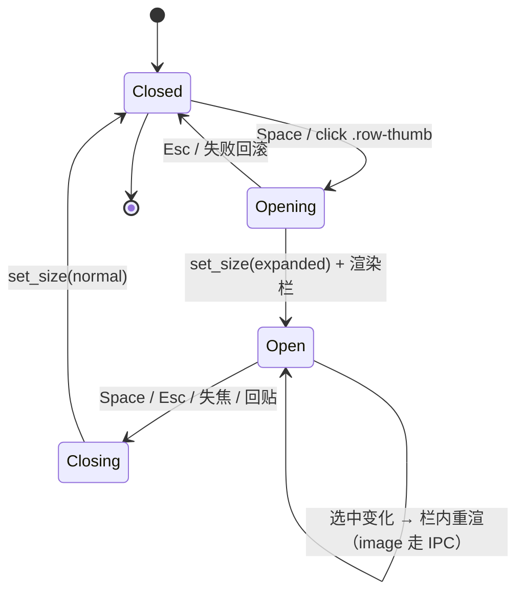
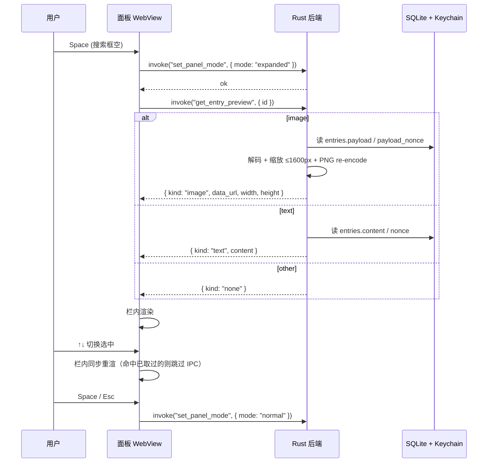

## Goal Capsule

- **Objective:** 用户在主列表里选中条目时，可以在**不离开主面板、不遮挡列表**的前提下，看到图片的大图或长文本的完整内容，便于在回贴前确认。
- **Means:** 在面板窗口右侧（空间不够时改左侧）临时长出一栏，复用同一 WebView 与搜索框焦点；图片由后端裁到预览尺寸再回传，长文本直接用 DTO 里的 content。Means: 面板扩展 + 单一新 IPC 命令 (KTD1, KTD4)。
- **Authority hierarchy:** `AGENTS.md` 中 R13（不联网）继续生效；平台布局约束由 `app/src/panel.rs` 的 `PANEL_SIZE` 主导，本次计划把它参数化为「normal / expanded」两档。
- **Stop conditions:** Implementation Units 全部完成；R13 审计（`grep -rE 'reqwest::|hyper::|TcpStream|std::net::' app/src clipvault-core/src`）为空；`cargo test --workspace` 与 `npm --prefix frontend test` 全绿。
- **Who finishes and ships:** `ce-work` 在本会话内承接实现 → 简化 → 评审 → 提交；PR 描述由其生成。

---

## Product Contract

### Summary

为 ClipVault 面板添加一个「列表旁预览栏」：选中图片或长文本条目时按一次快捷键，窗口右侧长出一栏并显示该条目的原图（按预览尺寸回传）或全文（可滚动）；列表保持可交互，方向键移动选中条时预览栏同步更新。开关式触发：再按一次或 Esc 关闭。两端平台同一套实现，不引入新依赖。

### Problem Frame

面板默认 560×420，列表里的图片只能看到 64×64 缩略图，长文本只能看到前 120 字符（`frontend/src/panel.ts` 的 `previewOf`）。在按 Enter 回贴之前，用户经常需要确认这是不是想贴的那一条；目前只能盲回贴或打开外部看图器。MVP plan 的「Key Flow」第 3 步曾承诺 `Space` 在长文本时预览完整内容，一直没有落地。R13 禁网约束意味着不能走「上传再返回外链」之类的取巧路径，必须本地完成。

### Summary

- 在面板内为 image / 长文本条目加一个「列表旁预览栏」，选中即显、按需更新。
- 触发是开关式快捷键（默认 Space，重绑走现有 keymap 体系），并支持点缩略图打开。
- 长文本走 DTO 自带 content（加密区走后端解密）；图片走后端裁到预览尺寸（≤ 1600px 长边）再 base64 回传，原图不灌进 WebView。
- 不做缩放 / 平移 / 旋转、另存为、多图对比、文件 / RTF / 颜色类型的 Quick Look；不引入新外部依赖。
- 两端平台同一实现；面板尺寸从固定 560×420 变成可参数化的两档（normal / expanded）。

### Requirements

#### 预览栏展示

- R1. 面板可以临时长出一栏，出现在列表右侧（当工作区右侧空间不够时改左侧），列表在栏开启期间保持完全可交互。
- R2. 栏内根据选中条目的 `content_kind` 分别渲染：image 显示原图（已由后端按预览尺寸回传）、长文本显示完整 content（可滚动）；file / rtf / color 显示一句简短提示。
- R3. 栏开启期间，方向键改变选中条目时，栏内渲染内容即时更新（图片走 IPC、文本走已有 DTO 字段，不重新打开栏）。
- R4. 栏关闭时把窗口尺寸收回原 560×420，并把列表位置对齐到本次开启前的同一条工作区边界。

#### 数据与后端

- R5. 新增一条 Tauri 命令 `get_entry_preview(id) -> Result<PreviewDto, String>`：根据条目 `content_kind` 与 `is_vault` 返回适配后的预览数据；id 不存在或硬错误返回 `Err(String)`，与「id 存在但 kind 不支持」区分；id 存在时：图片返回 `Ok(PreviewDto { kind: "image", data_url, mime, ... })`、文本返回 `Ok(PreviewDto { kind: "text", content, ... })`、其它 kind（file / rtf / color）返回 `Ok(PreviewDto { kind: "none", data_url: None, content: None, undecryptable: false })` 让前端显示提示。
- R6. 图片预览在后端解码并缩放到长边 ≤ 1600px（PNG re-encode），再 base64 编码。`image` crate 已是依赖，不新增 crate。
- R7. 加密区条目走现有解密路径：image 用 `payload_nonce` 解 `payload`、text 用 `nonce` 解 `content`；不可解密时返回 `Ok(PreviewDto { kind: "image"|"text", data_url: None 或 content: None, undecryptable: true })`，前端展示「无法解密」（与 R5 的「id 不存在」区分：后者走 `Err`）。

#### 入口与交互

- R8. 新增 keymap 动作 `preview`（与现有 14 个动作并列），默认绑定为单按 Space，可在设置面板重绑。
- R9. Space 触发 `preview` 时，若搜索框里有内容则让位给原生行为（不打断用户输入查询词）；搜索框为空时才切换预览栏。
- R10. 预览栏开启期间，再按 Space 或 Esc 即关闭。
- R11. 点击行内缩略图（仅 image 行的 `.row-thumb`）亦可切换预览栏；点击行内其它区域维持原有的「单击选中」语义。
- R12. 任何「关面板」的路径（窗口失焦自动收起、Esc 走 IPC `invoke("hide_panel")` 后端 `pasteback::hide_panel_and_restore_focus` 完成收尾、回贴后端隐藏、托盘「关闭」）都要先关闭预览栏、把窗口尺寸收回到 normal，再走原流程。

#### 平台与质量

- R13.（继承 AGENTS.md）不新增 `reqwest` / `hyper` / 任何 socket；提交前审计 `grep -rE 'reqwest::|hyper::|TcpStream|std::net::' app/src clipvault-core/src` 必须为空。
- R14. macOS 与 Windows 同一套实现；Windows 分支由 `packaging/check-windows.sh` + `.github/workflows/ci.yml` 的 windows job 覆盖类型检查 / clippy / `cargo test`，真机验收由 Windows plan 的 AE 系列补。
- R15. 现有 keymap `default_map_covers_every_action` 与 `all_actions()` 数组的编译期护栏必须随新动作扩展，`HotkeyAction::from_json_str` / `json_key` / Rust + TS 两端的默认映射 / ACTION_LABELS / dispatch switch 都要同步。

### Key Flows

- F1. 主列表预览与回贴
  - **Trigger:** 用户在搜索框为空时按 Space（或点缩略图）。
  - **Steps:** 面板从 normal 切到 expanded；预览栏按当前选中的 image / 文本渲染；若 image 且未取过预览，触发 `get_entry_preview`；方向键移动选中条时栏内同步更新；再按 Space / Esc / 回贴 / 失焦 → 切回 normal。
  - **Outcome:** 列表与预览栏同时可用，回贴后端隐藏面板、预览栏随之一并消失。
  - **Covers:** R1, R2, R3, R4, R8, R9, R10, R11, R12.
- F2. 加密区预览
  - **Trigger:** 在加密区管理模态内对图片 / 长文本条目触发预览。
  - **Steps:** 后端 `get_entry_preview` 用 `payload_nonce` / `nonce` 解密；不可解密时 `undecryptable: true` → 栏内显示「无法解密」；可解密时按 image / text 渲染。
  - **Outcome:** 用户在加密区模态内可以预览加密的图片 / 文本（解密结果不进入其它流程）。
  - **Covers:** R5, R6, R7.

### Acceptance Examples

- AE1. **image 预览：选中→预览→翻页同步。** Given 主列表含 ≥ 2 条 image 条目、面板已打开；When 选中第一条按 Space；Then 面板扩展，预览栏显示该图；When 按 ↓ 切到第二条；Then 预览栏更新为第二条的图（前后两次都来自后端 IPC，结果不混）。
- AE2. **长文本预览：搜索框有内容时 Space 仍输入空格。** Given 搜索框里有 "foo"；When 按 Space；Then 搜索框变成 "foo "，预览栏未打开；When 退格删到空再按 Space；Then 预览栏打开并显示当前选中条目全文。
- AE3. **加密区不可解密。** Given 加密区有一条图片条目且 Keychain 密钥缺失（`is_decryptable: false`）；When 触发预览；Then 后端返回 `undecryptable: true`，预览栏显示「无法解密」，不返回明文。
- AE4. **关面板路径均先收窗口。** Given 预览栏已开；When 用户按 Esc 走 `hide_panel_and_restore_focus`、或窗口失焦自动收起、或回贴后端隐藏；Then 窗口先回到 560×420，预览栏随之隐藏。

### Scope Boundaries

#### Deferred for later

- 图片缩放 / 平移 / 旋转：本次只显示原图缩放至预览尺寸的版本。
- 「在系统看图器 / Finder 中打开原图」「复制图片到剪贴板」「保存为文件」：列为后续 PR，本次不实现。
- 加密区列表的缩略图渲染（当前 `renderVaultList` 不显示 thumb）：不与本次预览栏一起做；保持范围收敛。

#### Outside this product's identity

- 多人 / 多端同步、AI 摘要、文件 / RTF / 颜色类型的系统级 Quick Look：与本计划的「面板内预览栏」目标无关。
- 任何把图片 / 内容上传到云端以换取「外链可分享」的能力：直接与 R13 / AGENTS.md 的离线原则冲突。

### Outstanding Questions

无阻塞性开放问题。R6 的 1600px 长边上限在实现期可按实测大图渲染时间微调；R8 的默认键在 U5 阶段如发现门控行为不够好用再回到本节。

### Sources & Research

- `app/src/panel.rs`（PANEL_SIZE 常量、imp_macos、imp_win、place_panel 入口）
- `app/src/commands.rs`（`to_dtos`、`paste_entry`、`list_vault` 的 DTO 形态与现有 Tauri 命令）
- `app/src/thumbnail.rs`（`make_thumbnail` 的 64×64 缩略图实现，作为本次 preview 缩放的最近参考）
- `app/src/storage.rs`（`Entry::payload` / `payload_nonce` / `nonce` / `is_decryptable` 的字段）
- `clipvault-core/src/schema.rs`（V3 migration：`payload` BLOB / `payload_nonce` / `metadata_json`）
- `clipvault-core/src/keymap.rs`（`HotkeyAction` 枚举、`default_map` / `parse` / `serialize` / `all_actions` 数组）
- `frontend/src/keymap.ts`（`HotkeyAction` 联合类型、`parseKeyCombo` / `keyFromEvent` / `dispatchHotkeyAction` / `textFieldOwnsDeleteKey`）
- `frontend/src/panel.ts`（`renderEntries` 的 image / text kind 渲染、`previewOf` 的 120 字符截断）
- `frontend/src/editor.ts`（浮层模态的 open/close 状态机，作为前端预览模块的最近参考）
- `frontend/src/main.ts`（dismissOverlays、pasteEntry、vault handler、`window.addEventListener("focus", ...)` 的 on-show 重置）
- `frontend/src/settings.ts`（`ACTION_LABELS` / `GLOBAL_ACTIONS` / `PANEL_ACTIONS` / `renderHotkeysSection`）
- `app/tauri.conf.json`（`resizable: false`、560×420 起始尺寸、csp 含 `data:`）

外部研究未运行（用户未要求，本地模式清楚）。

---

## Planning Contract

### Key Technical Decisions

- KTD1. 预览栏用「面板窗口长出一栏」实现（同一 WebView，焦点不丢）。`(session-settled: user-directed — chosen over 另起伴随窗口: 不需要第二 WebView、不需要跨窗口焦点与生命周期、焦点始终在搜索框、列表照旧可交互)`
- KTD2. 预览动作的默认键为 Space；与搜索框「有内容时打空格」的需求冲突用焦点门解决（搜索框 value 非空 → 让位给原生）。`(session-settled: user-directed — chosen over ⌘Y: 与 MVP plan 关键流程「Space 预览完整内容」一致；带门而不是换键，降低用户记忆负担)`
- KTD3. 点击行内 `.row-thumb` 切换预览栏；点击其它区域维持「单击选中」原语义。`(session-settled: user-directed — chosen over 只走键盘: 图片条目靠缩略图发现，鼠标用户有零学习成本的入口；dismissOverlays 路径与回贴语义不受影响)`
- KTD4. 图片预览在后端统一解码并缩放到长边 ≤ 1600px，PNG re-encode，再 base64。`(session-settled: user-directed — chosen over 直接回传原 payload: 原图可能 25MB，base64 进 IPC + 灌进 WebView 是双重风险；1600px 已能喂饱 4K 屏面板扩展后约 1000px 宽的预览栏)`
- KTD5. 加密区条目复用同一 IPC；后端用现有 `payload_nonce` / `nonce` 解密，`is_decryptable=false` 时返回 `undecryptable=true`，前端展示「无法解密」而非明文。`(session-settled: user-directed — chosen over 不做加密区预览: 加密区里图片条目的 64×64 缩略图本来就是明文 metadata_json 的一部分，加密的是原图本身；解密结果不外流，只在栏内展示)` Governs R5, R7.
- KTD6. 面板尺寸从硬编码的 `PANEL_SIZE: (f64, f64) = (560.0, 420.0)` 参数化为 `panel_size_for(mode: PanelMode) -> (f64, f64)`，其中 `PanelMode = Normal | Expanded`，expanded 默认 960×420（预览栏占 400px 宽、保持 420 高度）。`place_panel` 接收 size 参数；imp_macos 与 imp_win 同步。`(技术选择 — 替代: 引入新结构体 PanelSize 走值类型：比直接改 PANEL_SIZE 更内聚，新增 normal 路径不受 expanded 路径牵连)`
- KTD7. 窗口扩展的落位以「列表的左上角」为锚点：normal 时居中落位（沿用现有判据），expanded 时把列表左上锚在 normal 中心，栏向右侧展开；工作区右侧空间不够时把栏翻到左侧、列表左上改为 normal 中心再向左扩展；都不够时把 expanded 宽度收缩到工作区可容。`(技术选择 — 替代: 重新算 expanded 中心：保持「居中」直觉，但列表会左右抖动，与用户持续打字的屏幕位置不连续；锚列表则不抖)`
- KTD8. 新增 keymap 动作 `preview`（Rust 端 `HotkeyAction::Preview`、TS 端 `"preview"` 联合成员），按现有 14 动作的护栏同步：所有 `from_json_str` / `json_key` / `all_actions` 数组 / `default_map_covers_every_action` / `ACTION_LABELS` / `PANEL_ACTIONS` / `dispatchHotkeyAction` 都要加上对应条目。`(技术选择 — 替代: 复用 `edit_note` / `toggle_pin` 等动作的 action id 命名风格，保持与现有 14 个 wire-format 字符串一致)`

### High-Level Technical Design

### Assumptions

- 实现期若发现 `resizable: false` 与运行时 `set_size` 在某个真实平台组合下冲突，回退策略是临时改 `resizable: true`（视觉无副作用：面板没有拖拽柄，运行时 set_size 行为不变）。
- expanded 默认 960×420 在标准 14" 笔记本（≈ 1440×900 逻辑点）下能完整放下；超高 DPI 屏的预览栏像素密度由 WebView 自身缩放负责，不在 plan 范围。
- AE3 走 `is_decryptable` 字段现有的判定路径（`storage.rs` 的 `list_vault` / `to_dtos` 已计算该字段），不需要新加解密失败检测逻辑。

### Sequencing

按依赖倒推：U1（后端 IPC + 预览缩放 + 解密）→ U2（面板尺寸参数化 + 落位）→ U3（前端预览模块）→ U4（主流程接线）→ U5（keymap 动作）→ U6（文档与验收示例）。U5 与 U6 之间没有硬依赖；U1 / U2 可在同一 PR 中拆分提交（先 Rust 后前端接 IPC）。

---

## Implementation Units

### U1. 后端 preview IPC + 预览缩放 + 加密区解密

- **Goal:** 在 Rust 端实现 `get_entry_preview(id) -> Option<PreviewDto>`：image 走缩放重编码、text 走解密、其它返回 `kind = "none"`；`is_decryptable = false` 时统一返回 `undecryptable = true`。
- **Requirements:** R5, R6, R7, R13.
- **Files:**
  - `app/src/preview.rs`（新建）
  - `app/src/lib.rs`（导出新模块）
  - `app/src/commands.rs`（注册 `get_entry_preview` 命令 + 引入 `PreviewDto`）
  - `app/tauri.conf.json` 或 `app/src/main.rs`（把命令加入 invoke handler 列表）
  - `app/src/preview_test.rs`（新建）
- **Approach:**
  1. 在 `preview.rs` 中实现 `make_preview_image(bytes: &[u8], max_dim: u32) -> Option<(Vec<u8>, u32, u32)>`：复用 `image` crate，参照 `thumbnail.rs::make_thumbnail` 的 `image::load_from_memory` + `resize_exact` + `PngEncoder::write_image` 模式；返回 (PNG 字节, 渲染宽, 渲染高)。失败时 `None`。
  2. 在 `preview.rs` 中实现 `get_entry_preview_inner(state, id) -> Result<PreviewDto, String>`：先按 id 读 `Entry`（含 `payload` / `payload_nonce` / `content` / `nonce` / `content_kind` / `is_vault` / `is_decryptable`）；按 `content_kind` 分派：
     - `image`：从 `payload` 解码（vault 则先用 `payload_nonce` 解 `payload`），再调 `make_preview_image`；若 `is_decryptable = false` 直接返回 `undecryptable: true`。
     - `text`：vault 用 `nonce` 解 `content` 字节再 UTF-8 验；非 vault 直接读 `content`。
     - 其它：返回 `kind: "none"`。
  3. `PreviewDto` 在 commands.rs 顶层定义，与 `EntryDto` 同形（Serialize）；字段：`kind: String`（`"image" | "text" | "none"`）、`mime: Option<String>`、`data_url: Option<String>`（image 用 `data:image/png;base64,...`）、`content: Option<String>`（text 用）、`undecryptable: bool`。
  4. `get_entry_preview` 命令：参数 `id: i64, state: State<'_, AppState>`；整段 IO 走 `state.storage` 的现有 `with_conn` 入口或新增的 payload 读取入口；不做缓存。
- **Patterns to follow:** `thumbnail.rs::make_thumbnail` 的纯函数 + 错误用 `Option` 上抛的形态；`commands.rs` 的命令文件组织 + `tauri::command` 注解。
- **Test scenarios:**
  - Happy path: 给一条非 vault 的 image 条目，预览返回 `kind="image"` 且 `data_url` 解码后是 PNG，渲染宽高 ≤ 1600 且保持原图长宽比。
  - Happy path: vault 文本条目，返回 `kind="text"` 且 `content` 与原文一致；解密过程使用 `payload_nonce`/`nonce` 现有路径。
  - 边缘: 超过原图 1600px 的截图，缩放后长边恰好为 1600（不超 1px）。
  - 错误: `is_decryptable=false` 时返回 `undecryptable=true` 且 `data_url`/`content` 均为 `None`，**绝不返回明文**。
  - 错误: `content_kind="color"` 返回 `kind="none"`，无 IO 异常。
  - 错误: id 不存在返回 `Err(String)`，不静默返回 `None`（区别「kind=none」与「条目不存在」）。
- **Verification:** `cargo test -p app preview::` 与 `cargo test -p app commands::` 全绿；新增 `make_preview_image_*` 至少 3 例 + `get_entry_preview_inner_*` 至少 4 例。

### U2. 面板尺寸参数化 + 窗口扩展 / 收拢命令

- **Goal:** `PANEL_SIZE` 改造成「normal / expanded」两档；新增 `set_panel_mode(mode: String)` Tauri 命令，调用方传 `"normal" | "expanded"`。
- **Requirements:** R1, R4, R14.
- **Files:**
  - `app/src/panel.rs`（新增 `PanelMode` 枚举、`panel_size_for` 纯函数、改 `place_panel` 签名、`PANEL_SIZE` 替换为 `panel_size_for(PanelMode::Normal)` 调用）
  - `app/src/commands.rs`（注册 `set_panel_mode` 命令）
  - `app/src/panel_test.rs`（已有；新增 `panel_size_for` 的若干用例）
  - `app/src/main.rs`（把 `set_panel_mode` 加入 invoke handler）
- **Approach:**
  1. `PanelMode` 枚举：`Normal` / `Expanded`，后者默认值 `(960.0, 420.0)`。
  2. `panel_size_for(mode: PanelMode) -> (f64, f64)`：纯函数，便于单测；正常档与现有 `PANEL_SIZE` 完全一致。
  3. `place_panel(window: &WebviewWindow, mode: PanelMode)`：imp_macos 与 imp_win 都改为 `let (w, h) = panel_size_for(mode);` 替换原 `PANEL_SIZE.0/1`；Windows 端的 `PANEL_SIZE.0 * scale` 改为 `w * scale`、`h * scale`。
  4. `set_panel_mode(window: &WebviewWindow, mode: String)` Tauri 命令：解析 mode → 调用 `window.set_size(LogicalSize::new(w, h))` → 调用 `place_panel(window, mode)`；先 `set_size` 再 `place_panel`，落位用「列表左上 = expanded 前的列表左上」语义（KTD7）。
  5. expanded 落位算法：取 `display.work`、与 expanded 尺寸算水平方向空间；若 `work.x + work.w - cur_x >= w` 则向右扩（`cur_x` 保持，`cur_y` 保持），否则向左扩（`cur_x` 取 `cur_x - (w - normal_w)`）。`cur_x` / `cur_y` 来自当前窗口位置（`window.outer_position()`），不是 normal 中心 —— 避免和正常档判据打架。
  6. expanded 时若 `work` 宽度仍不够装下 expanded 窗口，按 KTD7 降级把 expanded 宽度收缩到 `work.w`（预览栏占的 400 相应减到剩下的 1/2 之类，给个安全下限；落位退化为 `work` 内居中）。
- **Patterns to follow:** 现有 `place_panel` 内部「失败保留原位置」的 `log_skip_once` 失败路径；imp_macos 在主线程同步落位、imp_win 用 `set_position(PhysicalPosition::new(...))`。
- **Test scenarios:**
  - 纯函数: `panel_size_for(Normal) == (560.0, 420.0)`、`panel_size_for(Expanded) == (960.0, 420.0)`。
  - 落位纯函数（需新抽 `expanded_origin(cur: Point, work: Rect, size: (f64, f64)) -> (f64, f64)`）：右侧空间够 → `cur.x` 不变；右侧不够左侧够 → 镜像；都不够 → 居中到 work。
  - 兼容: 现有 `select_display` / `centered_offset` / `focused_source` 的测试在 normal 路径下保持原行为（不能因参数化回归）。
- **Verification:** `cargo test -p app panel::` 全绿，新增 ≥ 3 例；`packaging/check-windows.sh` 通过。

### U3. 前端预览模块（toggle / follow / kind 派发）

- **Goal:** 在 `frontend/src/preview.ts`（新建）实现一个「面板内的预览栏状态机」，与 `editor.ts` 同样的模块边界：DOM 节点 + 状态变量 + open/close + render + IPC；外部只导出 `openPreview(entry) / closePreview() / isPreviewOpen() / getPreviewEntryId() / handlePreviewKey(ev)`。
- **Requirements:** R1, R2, R3, R4, R8, R10, R11.
- **Files:**
  - `frontend/src/preview.ts`（新建）
  - `frontend/src/preview.test.ts`（新建，vitest）
  - `frontend/src/main.ts`（导入 + 在 load / arrow navigation / on-focus 时调用；pasteEntry 流程前先 `closePreview()` 调 `set_panel_mode("normal")`）
  - `frontend/src/styles.css`（`.preview-pane` 样式：背景从 `--bg` 派生，宽 400，左侧 1px 边，竖直占满 420 面板；`.preview-pane--image img` 用 `object-fit: contain`；`.preview-pane--text pre` 等宽 + 自动换行 + 滚动）
  - `frontend/index.html`（在 `.panel` 内加一个 `<aside id="preview" class="preview-pane hidden" data-kind="none">`）
- **Approach:**
  1. 与 `editor.ts` 同型：`isPreviewOpen()` 返回状态；`openPreview(id: number)` 设 `currentId`、把 `#preview` 的 `hidden` 拿掉、调用 `renderPreview()`；`closePreview()` 设 `hidden`、清空内容、清 `currentId`、发 `set_panel_mode("normal")`。
  2. `renderPreview()`：从 `entries[]` 取当前 `currentId` 的 `EntryDto`；按 `content_kind` 分派：
     - `image`：命中已取过的（`previewCache: Map<id, string>`）直接用 data URL；否则显示「正在加载…」并 `invoke<PreviewDto>("get_entry_preview", { id })`；结果缓存到 `previewCache`，再 `renderPreview()` 自调一次。
     - `text`：直接 `entry.content` 写入 `<pre>`，**不**走 IPC。
     - 其它（file/rtf/color）：显示 `无预览（${kind}）`。
     - `undecryptable=true` 显示「🔒 无法解密」。
  3. `updatePreviewForSelection(entry)`：在 main.ts 方向键切选中后调用，若 `isPreviewOpen()` 且 entry.id !== currentId，更新 `currentId` 并 `renderPreview()`。
  4. 与 `dismissOverlays` 协作：`dismissOverlays` 增加一条 `if (isPreviewOpen()) closePreview();`。
  5. 事件接线：`#preview` 内点击 / Esc 关闭（按 KTD2 / R10 关闭路径）；与现有模态的 keydown 处理同级。
  6. 缓存策略：previewCache 在 `closePreview()` 时**不**清；再开同一条目直接命中。`window.addEventListener("focus", ...)` 时清空（用户离开后又回来可能希望看到最新）。
- **Patterns to follow:** `editor.ts` 的 open/close 状态机、close 时的 cleanup、IPC 错误 → toast；`main.ts` 的 `currentEntry()` 模式。
- **Test scenarios:**
  - 状态机: `openPreview` 后 `isPreviewOpen()` 为 true；`closePreview` 后为 false；`closePreview` 不清 `previewCache`。
  - kind 派发: 喂入 `content_kind="text"` 的 DTO → 渲染内容包含 `entry.content`；`content_kind="image"` → 先发 IPC，再在 IPC 响应后渲染 data URL；`content_kind="color"` → 显示「无预览」。
  - cache 命中: 同一 image id 第二次 `openPreview` 不再发 IPC（用 vi.fn 计数）。
  - 跟随选中: 模拟两次 `updatePreviewForSelection`（id 1 → id 2），DOM 内容相应更新。
  - 关闭路径: `closePreview` 触发 `set_panel_mode("normal")` 的 invoke。
- **Verification:** `npm --prefix frontend test` 全绿；新增 `preview.test.ts` ≥ 5 例。

### U4. 主流程接线：keymap handler、缩略图点击、关闭路径

- **Goal:** 在 `main.ts` 把预览模块接到键盘 / 鼠标 / 失焦 / 回贴 / `⌘1–9` 全套路径上。
- **Requirements:** R8, R9, R10, R11, R12.
- **Files:**
  - `frontend/src/main.ts`（关键路径改写）
  - `frontend/src/keymap.ts`（`registerKeymapHandlers` 增 `togglePreview`；`dispatchHotkeyAction` 加 `"preview"` case）
  - `frontend/src/preview.ts`（导出 `togglePreview(entry) -> void`，主入口是 `if (isPreviewOpen()) closePreview(); else if (entry) openPreview(entry.id);`）
- **Approach:**
  1. `main.ts` 的 `keydown` 处理器：增加 `action === "preview"` 分支，调用 `handlers.togglePreview()`；再走现有 `if (ev.repeat) ...` 的相同保护。
  2. `registerKeymapHandlers` 增 `togglePreview: () => void`；main.ts 注入实现：`if (isPreviewOpen()) closePreview(); else { const e = currentEntry(); if (e) openPreview(e.id); }`。
  3. Space 焦点门：在 `keydown` 处理器 `matches(ev) === "preview"` 时，先判 `searchEl.value.length > 0` → 直接 `return`（不 preventDefault，让搜索框打空格）；空时正常派发。
  4. 缩略图点击：`listEl.addEventListener("click", ...)` 在已有「选行」逻辑前，先 `if (target.closest(".row-thumb") && row.dataset.kind === "image")` → `togglePreview()` 并 `return`。
  5. 关闭路径：
     - `pasteEntry()` 入口 `dismissOverlays()` 已在 U3 扩展。
     - `window.addEventListener("focus", ...)` 已 `closeVault()`，增 `closePreview()`。
     - Esc 路径走 IPC `invoke("hide_panel")`，后端 `pasteback::hide_panel_and_restore_focus` 完成收尾；前端需要：监听后端的 panel-hide 事件（如有）或在主流程外再加一道 `closePreview()` 兜底（最简单：每次 main.ts 的 `load()` / `openVault()` 开头清预览栏，保证失序场景也不会让窗口大小被遗漏在 expanded）。
  6. `⌘1–9`（`activateIndex`）在回贴前先 `closePreview()`（已有 dismissOverlays，preview 已涵盖）。
- **Patterns to follow:** 现有 `dismissOverlays` 的统一收口；`textFieldOwnsDeleteKey` 的焦点门写法（在 keymap.ts 旁新增 `textFieldOwnsSpace` 工具函数）。
- **Test scenarios:**
  - Space 焦点门: `searchEl.value === ""` 时 `matches` 命中并 dispatch；`searchEl.value === "foo"` 时 matches 不触发 dispatch（或触发但被门挡掉），由实现选。
  - 缩略图点击: 模拟 `click` on `.row-thumb` → 选中行（已有）+ 触发 `togglePreview`；点击 `.row-content` → 仅选中。
  - 关闭路径: `pasteEntry` 调用栈里 `closePreview` 先于 `invoke("paste_entry", ...)`。
- **Verification:** `frontend/src/keymap.test.ts` 新增 `preview_default_is_space` / `preview_matches_in_empty_search` / `preview_skipped_when_search_nonempty` 三个用例；main.ts 改动整体 review 通过。

### U5. Keymap 新增 `preview` 动作

- **Goal:** 把 `HotkeyAction::Preview` 加到 Rust + TS 两端，全套护栏同步更新。
- **Requirements:** R8, R15.
- **Files:**
  - `clipvault-core/src/keymap.rs`（`HotkeyAction::Preview` 变体；`from_json_str("preview")`；`json_key()`；`all_actions()` 数组扩容为 15；`default_map()` 增 `KeyCombo { mods: empty, key: CharKind::Char(' ') }`）
  - `clipvault-core/src/keymap_test.rs`（`default_has_*_entries` 计数改 15；`all_actions_roundtrip` 自动覆盖；新增 `default_preview_is_space`）
  - `frontend/src/keymap.ts`（`HotkeyAction` 联合类型加 `"preview"`；`dispatchHotkeyAction` 加 case；`from_json_str` 不动；`textFieldOwnsSpace` 工具）
  - `frontend/src/keymap.test.ts`（`DEFAULT_WIRE` 加 `preview: { mods: [], key: " " }`；新增 `default_preview_is_space` 用例）
  - `frontend/src/settings.ts`（`ACTION_LABELS.preview = "切换预览栏"`；`PANEL_ACTIONS` 列表加 `"preview"`；考虑放在 "粘贴选中条目" 之前）
  - `app/src/panel.rs`（不需要，keymap 模块独立）
- **Approach:** 严格按 14 动作的添加模板：枚举变体 → 字符串互转 → 数组扩容 → 默认映射 → wire-format 默认 → ACTION_LABELS → PANEL_ACTIONS → dispatch switch → 测试。`all_actions()` 数组的 `[HotkeyAction; 15]` 编译期护栏保证以后再加时不会漏改任一处。
- **Patterns to follow:** 现有 14 动作在 4 个文件中的添加模板；测试中 `all_actions_roundtrip` / `default_map_covers_every_action` 已经在做这层护栏。
- **Test scenarios:**
  - Rust: `default_preview_is_space` 断言 `default_map().actions[&Preview]` 等于 `KeyCombo { mods: empty, key: Char(' ') }`；`hotkeyaction_roundtrip` 自动覆盖新动作。
  - Rust: `default_has_15_entries`（替代 13 的硬编码计数；写明这是 KTD8 指定的护栏迁移）。
  - Frontend: `default_preview_is_space` 镜像 Rust 端断言。
  - Frontend: `combo_label` 渲染 `Space`（或 `空白` / `空格` —— 跟 `localizedCombo` 的现有键名表走）。
  - Frontend: `dispatchHotkeyAction("preview")` 调用 `handlers.togglePreview`。
- **Verification:** `cargo test -p clipvault-core keymap::` 与 `npm --prefix frontend test` 全绿。

### U6. 文档与验收示例更新

- **Goal:** 把面板可扩展这件事写进 `README.md`，并把多类型 plan 的相关验收示例补充到位。
- **Requirements:** （无 —— 文档收尾单元，与 R1 / R4 等已经被 U1–U5 实现的 R 配套）
- **Files:**
  - `README.md`（面板尺寸一节从 560×420 改为「560×420，预览栏开启时 960×420」）
  - `docs/plans/2026-09-27-1038-feat-multi-type-clipboard-monitoring-plan.md`（U5 一节补充「image 预览栏」相关 AE）
  - （可选）`AGENTS.md` 的「实施进度」段标记本计划完成
- **Approach:** 最小改动；只描述用户能观察到的行为变化，不写实现细节。
- **Test scenarios:** 无（纯文档）。
- **Verification:** `git diff --stat` 不超过预期文件数；markdown lint（若启用）通过。

---

## Verification Contract

### Repo-Level Gates

- `cargo check --workspace --all-targets` 通过。
- `cargo clippy --workspace --all-targets -- -D warnings` 通过。
- `cargo fmt --all -- --check` 通过。
- `cargo test --workspace` 全绿（包含新增 `preview::*` / `keymap::*` 改动后的回归）。
- `packaging/check-windows.sh` 通过（cfg(windows) 分支的类型检查与 clippy）。
- `npm --prefix frontend run build` 通过（Vite 产物）。
- `npm --prefix frontend test` 全绿（含 `preview.test.ts` 与 `keymap.test.ts` 的新增用例）。
- R13 审计： `grep -rE 'reqwest::|hyper::|TcpStream|std::net::' app/src clipvault-core/src` 必须为空。
- 既有 250 测基线 + 新增 ≥ 21 例（U1 ≥ 7、U2 ≥ 3、U3 ≥ 5、U4 ≥ 3、U5 ≥ 3，与 Per-Unit 部分给出的各单元最小值一致；不再做「扣除覆盖」的浮动计数）。

### Behavioral Skill Evaluation

- 用真实 `npm run dev` 启动后端 + 前端；选一条 image 条目按 Space → 面板扩展、栏内显示图；按 Esc → 收回；选一条长文本条目按 Space → 栏内显示完整内容、可滚动；搜索框打 "foo" 时按 Space 不应打开预览栏；加密区模态内对 image 条目触发预览 → 解密失败时显示「无法解密」（需临时制造不可解密状态：删 Keychain 条目）。
- macOS 真机：⌥⌘V 唤出 → 验证 1–6。
- Windows 真机（由 windows CI job + 手动验收覆盖，本机不跑）：AE1–AE4 重复一遍。

---

## Definition of Done

### Global

- 实施进度（AGENTS.md / commit 历史）反映 U1–U6 全部完成。
- 没有为本次计划而引入的 `Cargo.toml` / `package.json` 新依赖（`image` / `base64` / `rusqlite` 已存在）。
- 面板尺寸从硬编码常量为可参数化模式，expanded 默认 960×420 写在 KTD6 文档里。
- 默认快捷键 `Space` 在未改动时能在搜索框空时切换预览栏、在搜索框有内容时打空格。
- 加密区 image / 长文本预览在密钥正常时显示，密钥缺失时显示「无法解密」且不返回明文。
- `AGENTS.md` 的「实施进度」段补上本计划的一句话总结（与 MVP plan、Windows plan 的同一节一致）。
- 既有「开发期辅助功能授权」一节仍然适用（这次不动到 paste 路径）。

### Per-Unit

- U1 至少 7 个新单测 + `PreviewDto` 定义。
- U2 至少 3 个新单测 + `PanelMode` 枚举 + `set_panel_mode` 命令注册。
- U3 `preview.test.ts` 至少 5 个新单测 + 完整 open/close 状态机。
- U4 `keymap.test.ts` 至少 3 个新单测（焦点门 / 默认键 / 缩略图点击）。
- U5 Rust + TS 两端各至少 1 个「default key = Space」断言，`default_*_entries` 计数更新。
- U6 README + 多类型 plan 改动通过 markdown 审查（若有）。

### Long-Run Cleanup

- 若实施期发现 `set_size` 与 `resizable: false` 冲突而需要回退到「临时 `resizable = true`」，相关注释 / 默认值必须清理回 plan 承诺的状态；不允许留下「先这样以后再说」的临时分支。
- U5 测试基线（14 动作 / 13 计数）的迁移：U5 完成后 `default_has_*_entries` 计数必须是 15，不允许 14 / 13 / 16 任一其它值。
