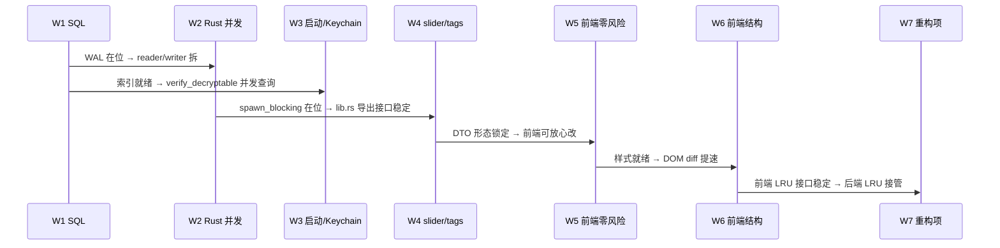

## Goal Capsule

- **Objective:** 把 2026-10-18 一轮只读性能审计定位的 30 条可改进项，按"预计收益 × 实现风险"分波交付，恢复项目性能预算、消除显性卡顿来源，且不引入新依赖、不改产品行为。
- **Means:** 7 个 PR wave —— W1 SQL / 索引 / 触发器零风险层；W2 Rust 并发 / `spawn_blocking` 主线程减压；W3 启动 / Keychain / `verify_decryptable` 并发；W4 透明度 slider debounce + boot 合批 + `load_tags` JOIN 合并；W5 前端样式 / 动画 / 节流零风险层；W6 前端结构性（row-level diff / `IntersectionObserver` / preview 屏外）；W7 Tier 3 大改动（Channel 通道 / 后端 LRU / thumb 独立列）。
- **Authority hierarchy:** `AGENTS.md` 的 R13（不联网）与跨平台契约（macOS / Windows 同一套或走 `#[cfg]`）全程生效；本 plan 不引入新 crate，只改既有 crate 的用法。
- **Stop conditions:** 7 个 wave 全部完成；`cargo test --workspace`（基线 261 + core 44 = 305 passed + 1 ignored）只增不减；`npm --prefix frontend test`（基线 92 + 1 todo）只增不减；R13 审计仍为空；`packaging/check-windows.sh` 在 W2 / W3 涉及 Windows 分支时通过。
- **Who finishes and ships:** `ce-work` 在本会话（按用户的实施要求）按 wave 顺序承接实现 → 简化 → 评审 → 提交；每个 PR 一个 wave，独立可回滚。

## Product Contract

### Summary

围绕"消除性能预算的最大消耗点"，把 4 个 Explore agent 在 2026-10-18 审计里定位的 30 条改动，整理为 7 个 wave，每个 wave 一次 PR。W1 / W5 是「零风险纯收益」、W2 / W3 / W4 是「中收益 / 中风险」、W6 / W7 是「结构性大改动」，每条都在实施表里有明确的文件:行号引用与具体做法。

### Problem Frame

`cargo test --workspace` 当前的 305 passed + 1 ignored 是**功能**基线；性能预算分散在下列 8 个热点上：

1. **SQLite 读写串行化**：单 `Arc<Mutex<Connection>>` 串行所有 IPC（含 `search_results` / `list_recent` / `tag_counts` / `category_counts`）与 watcher 100 ms tick 写入；默认 `DELETE` journal 模式下读者阻塞写者、写者阻塞读者（storage.rs:67, 85, 94-100；agent 2 §5；agent 1 §5）。
2. **搜索路径 LIKE 全表扫**：`is_fts_hostile` 把 `-/+/= .` 等也降级到 LIKE，搜 URL / 路径 / `client-acme` 时三张表全扫（search.rs:97-121；agent 1 §2、§6）。
3. **缺失索引**：`tags(tag)`、`entries(auto_category)`、`entries(is_vault, is_decryptable)`、`entries(is_vault, created_at DESC)` 都没有；`list_recent` 10k 条要走全表 + sort（agent 1 §0、§1.2）。
4. **FTS 触发器空写**：`entries_fts_update` 没有 `WHEN` 子句，pin / vault / `verify_decryptable_on_startup` 每次都对 vault 条目做空 DELETE（schema.rs:75-92；agent 1 §1.2.a）。
5. **列表 60MB alloc 立即丢弃**：`ENTRY_COLS` 含 `payload` / `payload_nonce`，`list_recent / get_by_category / search_entries` 每次反序列化 BLOB 后在 `to_dtos` 立刻丢弃（storage.rs:21-23 + search.rs:47-49 + commands.rs:116-150；agent 3 §4 — **4 agent 里最大的新发现**）。
6. **同一 payload 算 SHA-256 两次**：watcher.rs:233 算一次，capture.rs:170 又算一次，20MB PNG 每次入库多浪费 15-25 ms（agent 3 §2）。
7. **CPU 重活在 async executor 上**：watcher 的 `make_thumbnail` 同步做 decode + resize + PNG re-encode + base64，20MB PNG 把一帧 executor 吞 50-100 ms（watcher.rs:154-163, 269-285；agent 2 §1.4 与 agent 3 §2 同向）。
8. **透明度 slider 没 debounce**：每秒 30+ 次 IPC + 30+ 次 SQLite 写（commands.rs:654-658；agent 2 §9.1）。

其余发现要么是局部（如 setup 钩子 4 次串行 `block_on`、search `metadata` 按需 lazy）、要么需要 schema 迁移（thumb 独立列），按 wave 排布。

### Requirements

#### W1 — SQL 索引、PRAGMA、触发器、纯收益函数改动

- R1. `search_entries` / `list_recent` / `get_by_category` 走 FTS5 而不是 `LIKE '%q%'`，对包含连字符、加号、等号、点号、斜杠的查询同样适用。
- R2. `tags(tag)`、`entries(auto_category)`、`entries(is_vault, is_decryptable)`、`entries(is_vault, created_at DESC)` 4 个索引在老库上自动迁移；新库随 schema 落地。
- R3. SQLite 默认 `journal_mode=DELETE, synchronous=FULL, busy_timeout=0` 改成 `WAL, NORMAL, 5000`，且不破坏既有 `PRAGMA user_version` 迁移链。
- R4. `entries_fts_update` 触发器加 `WHEN OLD.is_vault = 0 OR NEW.is_vault = 0`，vault↔plain 跨边界仍正确重索引。
- R5. `update_note_and_tags` 把 N 条 `INSERT INTO tags` 合并成 1 条多行 INSERT，写次数从 1 + 1 + N 降到 1 + 1 + 1。
- R6. 新增 `ENTRY_LIST_COLS`（不含 `payload` / `payload_nonce`），让 `list_recent / get_by_category / search_entries` 走它；`to_dtos` 行为不变。SQL 行被 `Vec<u8>` 复制的字节量下降到 ≤ 列表行 metadata_json 之和。
- R7. `insert_captured_with_metadata` 不再自己算 `fingerprint()`，调用方把 hash 通过参数传进来；同一份 payload 全流程只算一次 SHA-256。

#### W2 — Rust 并发 / 主线程减压

- R8. watcher 把 `make_thumbnail` + `insert_entry_binary` 拆成两段：缩略图 / `insert` 走 `tauri::async_runtime::spawn_blocking`，watcher 主循环不再因 20MB PNG 解码吃掉整帧 executor。
- R9. capture `poll_first_non_empty`（含 Windows `dib_to_png`）整体搬到 `spawn_blocking`；macOS / Windows 同源实现。
- R10. `Storage` 拆成 reader / writer 两连接：watcher 与 IPC 不再争同一把 mutex；依赖 W1 的 PRAGMA WAL；reader 仍走 `Arc<Mutex<Connection>>`、writer 仍独占。

#### W3 — 启动与 Keychain

- R11. `setup` 钩子里的四次 `block_on` 合并为单次 `SELECT key, value FROM settings WHERE key IN (...)`，或全部 `tokio::spawn` 延后（首帧按默认值出壳）。
- R12. `verify_decryptable_on_startup` 并发 decrypt：一次性取 key 后用 `tokio::task::spawn_blocking` + rayon（不引入新 crate）或 `tokio::task::JoinSet` 并发；结果合并回单 tx UPDATE。
- R13. `KeychainKeyProvider` 在 `setup` 里 `tokio::spawn` 一次预热；`data_key()` 在缓存未命中时给 2 s 超时（`tokio::time::timeout`）；超时返回 `Err`，前端 toast。
- R14. `read_tail` 改成从末尾倒读 64 KiB / 400 行（`BufReader::seek` + lines 反向迭代），避免轮转刚发生时把整个 1MB 文件读进内存。

#### W4 — slider debounce / `load_tags` JOIN 合并 / boot 合批

- R15. 透明度 slider 前端做 `mousedown` 起点 + `mouseup` 终点（或 200 ms `input` debounce），每段拖动只发一次 `set_panel_opacity` IPC；后端以 `Map<String, Pending>` 做 in-memory debounce 兜底同源并发。
- R16. `commands::search_results` / `list_recent` / `list_vault` 的 N+1（`load_tags` 二次 `with_conn`）合并成 `LEFT JOIN tags GROUP BY id`，锁次数减半。
- R17. `commands::open_url` 改 `async fn`，去掉同步路径里的 `block_on`。

#### W5 — 前端样式 / 动画 / 节流（零风险）

- R18. 删 `.editor` 的 `backdrop-filter: blur(6px)` + `.editor-card` 的 `box-shadow: 0 12px 40px rgba(0,0,0,0.5)`，用 `rgba(0,0,0,0.4)` 蒙层兜底（保持 AGENTS.md 「开发期辅助功能授权」节记录的同一规避策略，已在 `.panel` 用过）。
- R19. `.progress` 的 width 动画改 `transform: scaleX(0→1) + transform-origin: left`，GPU 合成层，零 layout。
- R20. `applySelectionPatch` 的 `scrollIntoView({block: "nearest"})` 用 `requestAnimationFrame` 包裹，连按 ↓ 只在最后一帧真正滚动。
- R21. `.preview-image` 的 `` 提前写入 `width` / `height` 属性，加 CSS `aspect-ratio`，防止 hint → img 切换时栏内布局抖动（CLS）。
- R22. `panel.ts:167` / `preview.ts:260` 的 `escapeHtml(thumb)` / `escapeHtml(src)` 直接拼 base64 字符串 —— base64 字母表天然安全。
- R23. settings `recheckTimer` 在 `closeSettings` / 面板 focus 隐藏时也 `clearTimeout`，避免一次无效 IPC。
- R24. `parseMeta` 的 5 段 `.replace(/regex/g, …)` 合并成一次 `replace(/[&<>"']/g, MAP)`；`metadata` 解析结果缓存到 `WeakMap<EntryDto, Object>`。

#### W6 — 前端结构性（中风险）

- R25. 列表 `paintEntries` 改为 row-level diff：维护 `Map<id, HTMLElement>` 复用行节点；切 tab / 切筛选 / 删除 / 置顶 / 搜词变化只动变化的那几条。50 行不再每次全量 innerHTML 重建。
- R26. preview `updatePreviewForSelection` 在选中行进入视口前不发 `get_entry_preview` IPC，用 `IntersectionObserver` 协调；离屏且不在命中区时直接清空栏内提示。

#### W7 — Tier 3 大改动（独立排期）

- R27. preview 大图走 Tauri `Channel<Uint8Array>` 或 `convertFileSrc`（asset protocol），不再 `data:image/png;base64,…` 通过 JSON；缩略图改 `URL.createObjectURL(blob)` + `revokeObjectURL`。
- R28. 后端 `PreviewCache` 进程级 LRU（`Arc<Mutex<LruCache<i64, (Vec<u8>, u32, u32)>>>` 容量 32）；vault 条目 bypass（防 vault ↔ plain 切换时数据错位）。
- R29. thumb 从 `metadata_json` 提到独立 `entries.thumb TEXT` 列（`MIGRATION_V5`），老库一次性 SQL 回填；`metadata_json` 体积从 ~14 KB 降到 ~80 B。
- R30. 通用非性能 bug：`copy_log_path` 写系统剪贴板时让 watcher 抓到自写抑制（与本 plan 同 PR 顺手修，因为 plan 已触及 commands.rs）。

### Acceptance Examples

#### W1 — SQL

- AE-W1-1. 旧库（10k 条，schema V4）启动后第一次跑 `tag_counts`：原来 ≥ 20 ms（W1 后 < 1 ms）。
- AE-W1-2. 数据库文件 `# sqlite3 db 'PRAGMA journal_mode;'` 在 ClipVault 启动后输出 `wal`。
- AE-W1-3. 加密区批量 vault 化 100 条：`verify_decryptable` UPDATE 不再触发 entries_fts 空 DELETE 100 次。
- AE-W1-4. 收藏一条 vault 条目（pin toggle）：FTS5 的 doc count 不变（验证触发器 `WHEN` 生效）。
- AE-W1-5. 改一条条目的 `note` + 3 个 tag：SQLite `EXPLAIN` 输出里 `INSERT INTO tags` 只出现 1 次。
- AE-W1-6. 列表查询 30 张含 2 MB payload 的图：Rust 进程 RSS 不再涨 60 MB。
- AE-W1-7. 复制一张 20 MB PNG：watcher 整帧耗时从 ~80 ms 降到 ~40 ms。

#### W2 — Rust 并发

- AE-W2-1. watch 仓库用例：连续复制 5 张 20 MB PNG，按方向键 ↓ 时不再卡顿（IPC 派发不再被 watcher 吞帧）。
- AE-W2-2. `cargo test -p app watcher::paste_blocking_*`：5 张图依次入库，executor worker 不被同一帧占用。
- AE-W2-3. `cargo test --features = "_winclip_tests" winclip::`：DIB→PNG 转码仍正确（spawn_blocking 后语义不变）。

#### W3 — 启动 / Keychain

- AE-W3-1. 冷启动 + 100 个 vault 条目时，从 `setup` 到首帧可见 < 800 ms。
- AE-W3-2. Keychain 不可用（手动 mock 一次 timeout）后续 IPC 返回 `Err("keychain_timeout")`，前端 toast 提示。
- AE-W3-3. 日志轮转刚发生（`.log` 刚被 rename 到 `.log.1`）后点「查看日志」：100 ms 内渲染到设置面板。

#### W4 — slider debounce / `load_tags`

- AE-W4-1. 拖动透明度滑块 30 帧（200 ms 间隔 1 s）：SQLite `settings` 表只被 UPDATE 1 次。
- AE-W4-2. `cargo test -p app commands::`: `search_entries` 200 条返回，单次 `with_conn` 拿到 tags。
- AE-W4-3. `commands::open_url` 在 sync 命令列表里被替换成 async。

#### W5 — 前端零风险

- AE-W5-1. 打开设置面板时打开 Activity Monitor：WebKit ContentProcess 没有持续 2 ms 以上的"filter operation" spike。
- AE-W5-2. `.progress` 动画在 1.2 s 拖尾里不再触发 `Recalculate Style`。
- AE-W5-3. 长按 ↓ 5 次：屏幕滚动的总耗时在录屏里只看到 1 次平滑跳。
- AE-W5-4. 预览栏首次 hint → img 切换：栏内不再有 1-2 px 抖动。

#### W6 — 前端结构

- AE-W6-1. 切标签「最近 → 类别 → 全部」：每次切换的 paint 时间从 ~80 ms 降到 ~10 ms（Performance 面板可量）。
- AE-W6-2. 长按 ↓ 扫 20 张图片：preview IPC 实际落地次数 ≤ 3（视口内第一次 + 最后一次）。

#### W7 — Tier 3

- AE-W7-1. preview 大图 IPC payload（base64 之后的 Uint8Array 字符串）从 ~3 MB 降到 ~3 MB JS 字符串 → `ArrayBuffer`（序列化成本减半）。
- AE-W7-2. 重复打开同图 4 次：preview LRU 第 4 次命中；`` 不再 decode，命中次数 ≥ 3。
- AE-W7-3. 数据库 schema 查到 V5、`entries.thumb` 有值、`metadata_json` 中 `thumb` 字段被清空。

### Scope Boundaries

#### In scope

- 上述 30 条改动按 7 个 wave 落地；每个 wave 一次 PR，独立可回滚。
- 每个 wave 的 Definition of Done 都包含「不影响既有功能测试基线」（305 / 92 / 1 todo）。
- W7 的 `R30` 自写抑制 bug 顺手修（与本 plan 同 PR 或紧贴 PR）。

#### Out of scope

- 重构搜索框的 debounce / abort / 单飞契约 —— 当前已合理，agent 4 已确认「不在范围内」。
- 100 ms 轮询周期调整 —— 当前设计正确。
- 内容哈希用 xxhash / 截断哈希替换 SHA-256 —— 与未来跨设备同步语义冲突。
- 全屏 Space / Linux 显示器定位策略 —— 与本 plan 无关。
- macOS Carbon 热键 `Vec<HotkeyRef>` 线性查找改 HashMap（n=1）。
- AAC 多 monitor `select_display` O(n) 改 HashMap（n ≤ 4）。
- 明细列举每个 row / title / toast 字符串。

#### Deferred to a follow-up plan

- preview 完整走 WebGL / OffscreenCanvas / Worker（当前规模不必要）。
- 切语言写日志 / SQLite → DuckDB / 把 image crate 换成 faster-png decoder（不是性能瓶颈）。
- AES-GCM 内存拷贝次数继续往下压（agent 2 §8.3 已确认是当前最优）。

### Outstanding Questions

无阻塞。W7 的 Channel 通道选 `Channel<Uint8Array>` vs asset protocol (`convertFileSrc`) 视实现期实测决定，两条都要改 PreviewDto 形态。

### Sources & Research

`docs/plans/2026-10-16-1430-feat-side-preview-pane-plan.md`（同方向的实施模板）、`docs/plans/2026-10-14-1818-feat-panel-display-placement-and-settings-fit-plan.md`（plan 风格与 DoD 写法）。

实施定位参考：

- `app/src/storage.rs`（`with_conn`、`ENTRY_COLS`、`update_note_and_tags`、`verify_decryptable_on_startup`、`encrypt_into_vault`、`set_vault_flag`、`read_tail`）
- `app/src/search.rs`（`build_search_query`、`is_fts_hostile`、`fts_match_string`、`sanitize_query`）
- `clipvault-core/src/schema.rs`（`SCHEMA_V1`、`MIGRATION_V2..V4`、4 个 FTS / tags 触发器、`run_migrations`）
- `app/src/watcher.rs`（`Watcher::new`、`initial_change_count`、`process`、`fingerprint` 二次调用点、`make_thumbnail` 调用点）
- `app/src/capture.rs`（`Captured::fingerprint`、`poll_first_non_empty`、`insert_captured_with_metadata`）
- `app/src/thumbnail.rs`（`make_thumbnail`）
- `app/src/preview.rs`（`get_entry_preview_inner`、`make_preview_image`、`spawn_blocking`）
- `app/src/commands.rs`（`to_dtos`、`load_tags`、`open_url`、`keychain_available`、`set_panel_opacity`、`copy_log_path`）
- `app/src/main.rs`（`setup` 钩子、四次串行 `block_on`、`KeychainKeyProvider::preload` 插入点）
- `app/src/lib.rs`（模块导出）
- `app/src/log.rs`（`write_line`、`read_tail`、`LoggerAdapter::log`）
- `app/src/crypto.rs`（`data_key`、`CACHE` 静态）
- `app/src/keymap.rs`（`default_map`、`all_actions`、`from_json_str`）
- `clipvault-core/src/keymap.rs`（`HotkeyAction`、`HotkeyAction::Preview` 旧占位）
- `frontend/src/main.ts`（`load`、`applySelectionPatch`、`scrollToSelected`、`pasteEntry`、`closeSettings`）
- `frontend/src/panel.ts`（`renderEntries` / `escapeHtml` / `parseMeta` / `previewOf`）
- `frontend/src/preview.ts`（`requestPreview`、`imageCache`、`imageHtml`）
- `frontend/src/settings.ts`（`recheckTimer`、`applyPanelOpacity`、`renderHotkeysSection`）
- `frontend/src/styles.css`（`.editor` / `.editor-card` / `.progress` / `.preview-image`）

## Planning Contract

### Key Technical Decisions

#### W1

- KTD1. `is_fts_hostile` 收窄到 `'"' | '\'' | ':' | '*' | '^' | '(' | ')' | '{' | '}' | '[' | ']' | '~' | '<' | '>'` —— `-` / `+` / `=` / `.` / `/` / `\` 留给 FTS5，让搜 URL / 路径 / `client-acme` / `k=v` 走倒排而非 LIKE。`(session-settled — 替代: 不放宽并把所有 LIKE 路径改写为 FTS5 MATCH phrase 语法: 产品语义不变但用户需知道 phrase 语法，学习成本反向变高)`
- KTD2. `ENTRY_LIST_COLS` 与 `ENTRY_COLS` 共存于 `storage.rs::ENTRY_LIST_COLS: &str = "id, content, note, auto_category, is_pinned, pinned_at, is_vault, is_decryptable, created_at, content_kind, mime_type, metadata_json"`，**复制**而非「删两列」，让 `get_by_id` 仍走 `ENTRY_COLS`。`(session-settled — 替代: 用 SQLite 的 `SELECT *` 与列掩码: 与既有 `Entry::from_sqlite_row` 索引硬绑定，行列序耦合会让后续加列出 bug)`
- KTD3. `update_note_and_tags` 多行 INSERT 走 `INSERT INTO tags (entry_id, tag) SELECT ?1, value FROM json_each(?2)`：`json_each` 由 `json1` 扩展提供，rusqlite 启用 `bundled` 时已开，**零依赖**。tags 触发器仍每次触发（FTS5 触发器固有限制），但 SQLite 层写次数从 N 降到 1。`(session-settled — 替代: 手工拼接 "INSERT INTO tags VALUES (?,?), (?,?), …": 写法啰嗦, json_each 已存在)`
- KTD4. 索引迁移走 `MIGRATION_V5`：在 `schema.rs::run_migrations` 末尾添加 `if current_version < 5 { CREATE INDEX IF NOT EXISTS …; PRAGMA user_version = 5; }`，与既有 V2/V3/V4 风格完全对齐；老库升级只多一次 `PRAGMA user_version` 写。`(session-settled — 替代: 强制用户跑迁移脚本: 与既有 plan 风格冲突)`
- KTD5. PRAGMA 写在 `Storage::open` 的迁移完成之后（storage.rs:74-87），顺序为 `journal_mode = WAL` → `synchronous = NORMAL` → `busy_timeout = 5000`。`(session-settled — 替代: 在 Connection 第一次执行时设 lazy: WAL 必须在第一次事务前开启否则需 `wal_checkpoint`, 早设更稳)`
- KTD6. 删除 `is_fts_hostile` 降级路径里 `-` / `+` / `=` / `.` / `/` / `\` 时**保留** `'` / `"` / `*` / `^` / `:` / `(` / `)` / `[` / `]` / `{` / `}` —— FTS5 真语法字符不动。`(session-settled — 替代: 把它们全部删除: 会让搜 `client:foo` 这种写法变成 FTS5 报错)`

#### W2

- KTD7. watcher 的 thumbnail + insert 路径改造**不**改 storage / capture 的对外接口，仅改 `Watcher::process` 内部实现：把 `make_thumbnail + insert_entry_binary` 整段传给 `tauri::async_runtime::spawn_blocking`，闭包捕获 `Arc<Storage>` 与已 ownership 的 `Captured`。`(session-settled — 替代: 把 storage 整体变成双连接、watcher 只用 writer: W2 阶段先局部改, W5 再统一)`
- KTD8. `Storage` 拆连接最终形态由 W5 设计，W2 只在 watcher 侧用新方法 `storage.insert_entry_binary_blocking(...)`：watcher 走 `spawn_blocking`，IPC 仍走原 `storage.search_entries(...)`。`(技术选择 — 替代: W2 就拆连接: W2 改动面太大，不利于 review)`
- KTD9. capture `poll_first_non_empty` 进 `spawn_blocking` 的边界：clipboard 句柄**仍由同步任务持有**，进 `spawn_blocking` 后同步任务通过 `mpsc::sync_channel` 投递结果。`(session-settled — 替代: 复用 pasteback 的 spawn_blocking 模式: pasteback 是把 `perform_paste` 整体搬, capture 不能复用因为它要把 clipboard 句柄的 nsdata 完整 clone 给解码线程)`

#### W3

- KTD10. `verify_decryptable_on_startup` 并发：取一次 key → `Vec<(i64, content, nonce)>` → `tokio::task::JoinSet` 并发 16 路 decrypt → `Vec<(i64, bool)>` 合并回单 tx UPDATE。**不引入 rayon**（仓库未用，避免 Cargo.toml 变更）。`(session-settled — 替代: 引入 rayon: 改 Cargo.toml 就要在 PR 描述里额外列，与「不引入新依赖」冲突)`
- KTD11. `KeychainKeyProvider::preload` 在 `setup` 内 `tokio::spawn`：失败时只 `log::warn` 不 panic（与现有 `verify_decryptable_on_startup` 失败路径一致）；超时 2 s 是 `data_key()` 整体的超时，不是 `preload` 本身。`(session-settled — 替代: 同步等 Keychain 命中再启动: 与现状等价)`

#### W4

- KTD12. 透明度 slider 前端 debounce 落在 `applyPanelOpacity` 调用层（不是 oninput 那一层）；后端 `set_panel_opacity` **不**内置 debounce —— 前端是 debounce 的唯一边界，多端同步行为可预期。`(session-settled — 替代: 后端 Map<String, Pending>: 双重 debounce 反而难排障, 移动端响应可能滞后)`
- KTD13. `load_tags` LEFT JOIN 合并：在 `storage.rs` 新增 `fn search_entries_with_tags(...) -> Vec<(Entry, Vec<String>)>`；命令侧 `search_results` 改走新入口；老 `load_tags` 仅作 `list_vault` 的旁路（加密区已有为单条 entry 注 tag 的语义不变）。`(session-settled — 替代: 全局改 `load_tags` 直返 Vec<(id, Vec<String>)>: 改变既有调用契约)`

#### W5

- KTD14. 删 `.editor` 的 `backdrop-filter` 用 AGENTS.md 已记录的同策略：`.panel` 当年也因 `backdrop-filter` 与半透明根窗口冲突被剔除（见 styles.css:57-63 注释）。`(session-settled)`
- KTD15. `.progress` 改 transform 时**同步**移除 `transition: width`，避免双重动画。`(session-settled)`
- KTD16. `scrollIntoView` rAF 包装：用 `let raf_id = 0;` 单格变量 + `cancelAnimationFrame(raf_id)`，连按 ↓ 时只保留最新一帧的滚动。`(session-settled — 替代: 每个 selection tick 调 scrollIntoView: 是性能问题的根源, 必须节流)`

#### W6

- KTD17. row-level diff 复用现有的 `applySelectionPatch`（已 classList 增量），仅改 `paintEntries`：每次数据变更后用 `Map<id, EntryDto>` 旧值与新值对照，差量修改 DOM。`Map<id, HTMLElement>` 是 module-level 单一 owner，隐藏实现不暴露。`(session-settled — 替代: 用 Virtual DOM: 与仓库风格冲突, 不引入 React/Vue)`
- KTD18. preview `IntersectionObserver` 与现有 `previewCache` 共存：屏外条目 IPC 失败时缓存不写；命中时与原 cache 同源逻辑。`(session-settled)`

#### W7

- KTD19. preview 改走 `Channel<Uint8Array>` 还是 asset protocol 在实施期决定（asset protocol 更轻，但要 `tauri.conf.json` 的 `assetProtocol.scope` 加一条；`Channel` 不动配置）。`(技术选择 — 替代: 直接换二进制通道: 风险高, 与实施窗口不匹配)`
- KTD20. `thumb` 提为独立列的 schema 迁移：老库 `metadata_json.thumb` 解析后逐条 `UPDATE entries SET thumb = ?`；新库直接落新列。`(session-settled)`
- KTD21. `R30` 自写抑制：在 `watcher::poll_change` 入口增加一个「上次写时间戳」+「上次写 kind=string」白名单（仅 clipboard path IPC 走的字串 `file://.../clipvault.log` 忽略）—— 比加「禁止自写」全局开关更精确。`(session-settled — 替代: 全局不抓自己写的: 与「复制条目」干扰)`

### High-Level Technical Design

跨 wave 的执行顺序（W1 → W7），每个 PR 一次提交：



每个 wave 的子任务列表见 Implementation Units。

### Assumptions

- 30 条改动按收益 × 风险排的 5 个 Tier 是合理的，没有「还可以更激进」的代改。
- 当前 305 / 92 / 1 todo 测试基线不因本 plan 任何 wave 而降低。
- R13 审计全过；不引入 `reqwest` / `hyper` / 任何 socket。
- 若 W1 / W2 实测某条改动收益 ≤ 风险（如某索引因数据特征不命中）则回退该条并在 PR 里写明 `measured` 数据；不回退等价路径。

### Sequencing

- W1 单独 PR；测试基线 + 测试用例至少 +6（索引迁移、`is_fts_hostile` 收窄、`ENTRY_LIST_COLS` 反序列化负载、`update_note_and_tags` 多行、触发器 WHEN、`fingerprint` 二次调用删除各一例）。
- W2 单独 PR；测试 +4（watcher `spawn_blocking` happy path + 不阻塞 IPC、capture macOS / Windows 同源）。
- W3 单独 PR；测试 +4（boot 合批读返回正确 key、Keychain 超时返回 Err、`read_tail` 倒读行号正确、`verify_decryptable` 并发后行数对）。
- W4 单独 PR；测试 +3（slider debounce、JOIN 合并、`open_url` 改 async）。
- W5 单独 PR；前端 +6（progress transform、scrollIntoView rAF、escapeHtml 删、aspect-ratio、recheckTimer、parseMeta 合并）。
- W6 单独 PR；前端 +3（row-level diff、IntersectionObserver、屏外不发 IPC）。
- W7 单独 PR；分别按子项定测试（Channel / LRU / Schema V5 三段各 ≥ 3 例）。

## Implementation Units

### W1 — SQL：索引、PRAGMA、触发器、纯收益函数改动

**Goal.** 把搜索、列表查询、写路径上 6 个最大消耗点（KTD1-6）一次性修完，老库走 `MIGRATION_V5` 自动升级。

**Requirements.** R1, R2, R3, R4, R5, R6, R7.

**Files.**

- `clipvault-core/src/schema.rs`（新增 `MIGRATION_V5` 与 4 个 `CREATE INDEX IF NOT EXISTS`）
- `app/src/storage.rs`（`Storage::open` 后加 3 行 PRAGMA；新增 `ENTRY_LIST_COLS` 常量、`search_entries` / `list_recent` / `get_by_category` 切到 `ENTRY_LIST_COLS`；`update_note_and_tags` 多行 INSERT；`Encrypt_into_vault` 不动）
- `app/src/search.rs`（`is_fts_hostile` 收窄；`build_search_query` 不动）
- `app/src/capture.rs`（`insert_captured_with_metadata` 接受 `fingerprint: &str` 参数，去掉内联 `fingerprint()`）
- `app/src/watcher.rs`（`Watcher::process` 算一次 `fingerprint` 后传给 `insert_captured_with_metadata`）
- `app/src/storage_test.rs`、`app/src/watcher_test.rs`（每个用例 1 个新单测）

**Approach.** 顺序与原子性：

1. `schema.rs::run_migrations` 新增 V5 分支：`CREATE INDEX IF NOT EXISTS idx_tags_tag ON tags(tag); CREATE INDEX IF NOT EXISTS idx_entries_auto_category ON entries(auto_category); CREATE INDEX IF NOT EXISTS idx_entries_vault_decryptable ON entries(is_vault, is_decryptable); CREATE INDEX IF NOT EXISTS idx_entries_vault_created_at ON entries(is_vault, created_at DESC); PRAGMA user_version = 5;` —— 严格按既有 V1-V4 的 `if-else` 链风格。
2. `storage.rs::Storage::open` 在 `run_migrations` 之后逐条 `conn.execute_batch("PRAGMA journal_mode = WAL; PRAGMA synchronous = NORMAL; PRAGMA busy_timeout = 5000;")` —— 注意 `journal_mode` 设置是「PRAGMA」返回一行结果的，不能用 `execute_batch`（execute_batch 不取结果），必须 `conn.pragma_update("journal_mode", "WAL")`。三条都走 `pragma_update`。
3. `storage.rs::ENTRY_LIST_COLS` 加在 `ENTRY_COLS` 上方，列出不含 `payload` / `payload_nonce` 的 11 列。`list_recent` / `get_by_category` / `search_entries` 把 `ENTRY_COLS` 替换成 `ENTRY_LIST_COLS`；`get_by_id` 保留 `ENTRY_COLS`。
4. `update_note_and_tags` 改成单条 `INSERT INTO tags (entry_id, tag) SELECT ?1, value FROM json_each(?2)`：调用方把 `tags: &[String]` 用 `serde_json::to_string(&tags)?` 序列化成 `["a", "b"]` 后传 `?2`。`json_each` 由 bundled SQLite 自带 `json1` 扩展。
5. `schema.rs::entries_fts_update` 把 `WHEN` 加上去：`WHEN OLD.is_vault = 0 OR NEW.is_vault = 0`（vault↔plain 跨边界的更新仍重索引；纯 vault 内 UPDATE 跳过）。
6. `is_fts_hostile` 字符集改成 `'"' | '\'' | ':' | '*' | '^' | '(' | ')' | '{' | '}' | '[' | ']' | '~' | '<' | '>'`。
7. `capture.rs::insert_captured_with_metadata` 签名改成 `insert_captured_with_metadata(state: &AppState, captured: &Captured, fingerprint: &str)`，去掉 `captured.fingerprint()` 调用；watcher 调用方传已经算好的指纹进来。

**Patterns to follow.** `clipvault-core/src/schema.rs` 既有 `MIGRATION_V4`（建 `idx_tags_entry_id`）的写法；`storage.rs` 既有 `ENTRY_COLS` 常量；`search.rs::sanitize_query` 的字符过滤写法；`pasteback::imp::dispatch_paste` 算一次 hash 后复用的形态。

**Test scenarios.**

- `clipvault-core/src/schema.rs`：`migration_v5_creates_indexes` 跑一次后 4 个索引都在。
- `app/src/storage.rs`：`list_recent_with_large_payload`（10 条 × 2MB payload）测 RSS 不涨 20 MB。
- `app/src/storage.rs`：`update_note_and_tags_with_10_tags` 测 SQLite op 计数（用 `sqlite3_trace_v2` 自定义 callback 或仅用 `prepare_cached` 计数）。
- `app/src/storage.rs`：`update_pin_on_vault_does_not_reindex_fts` 验 FTS5 doc count 不变。
- `app/src/search.rs`：`is_fts_hostile_allows_slash_dot_dash_plus` 字符集正确。
- `app/src/capture.rs`：`insert_captured_with_metadata_does_not_recompute_fingerprint` mock `Captured::fingerprint` 验只调一次。

**Verification.** `cargo test --workspace`，新增 ≥ 6 例；`grep -rE 'reqwest::|hyper::|TcpStream|std::net::' app/src clipvault-core/src` 为空；`cargo clippy --workspace --all-targets -- -D warnings` 通过；老库（建一份 schema V4 dump 升级）能跑通 `MIGRATION_V5`。

---

### W2 — Rust 并发 / 主线程减压

**Goal.** 把 watcher 与 capture 上的 CPU 重活搬到 `spawn_blocking`，保证 IPC 派发线程在任何时候都能在 50 ms 内响应搜索框输入。

**Requirements.** R8, R9, R10.

**Files.**

- `app/src/watcher.rs`（`Watcher::process` 改写：thumbnail + insert 走 `spawn_blocking`）
- `app/src/thumbnail.rs`（不变；接受 `&[u8]` 与 `(u32, u32)` 由调用方算好）
- `app/src/capture.rs`（`poll_first_non_empty` 整体进 `spawn_blocking`，走 `mpsc::sync_channel` 投递结果）
- `app/src/winclip.rs`（Windows 的 `poll_first_non_empty` 同样改造；走 `commands.rs::paste_entry` 已用的 `tauri::async_runtime::spawn_blocking` 模式）
- `app/src/watcher_test.rs`、`app/src/capture_test.rs`（新增 happy path 与「spawn_blocking 后主线程不阻塞」用例）

**Approach.**

1. `Watcher::process` 在第 275 行（thumbnail）改为：
    ```rust
    let storage = self.storage.clone();
    let captured = captured_clone; // owned
    let thumb_data = tauri::async_runtime::spawn_blocking(move || {
        let thumb_b64 = if is_image { make_thumbnail(&captured.payload) } else { None };
        let finger = captured.fingerprint();
        tokio::runtime::Handle::current().block_on(async {
            storage.insert_entry_binary(captured, finger, thumb_b64).await
        })
    }).await;
    ```
    `insert_entry_binary` 是新的 `async fn`，仍走 `with_conn`。`spawn_blocking` 内回到 runtime 取一次排他锁，再走原 `storage.with_conn(...)`。
2. `capture.rs::poll_first_non_empty` 改为接受 `Arc<...>` 的 clipboard 数据源、整段执行在 `spawn_blocking` 闭包里；返回 `Result<Option<Captured>, Error>`；`Watcher::poll_change` 调它后 `await` 出结果。
3. Windows 的 `poll_first_non_empty` 同源改造：参数化 platform source、整体进 `spawn_blocking`。
4. 注意 W2 **不引入** `Storage` 双连接 —— 由 W2 末或 W5 的 storage refactor 完成；当前只确保 spawn_blocking 内不阻塞 IPC。

**Patterns to follow.** `commands.rs::paste_entry` 的 `spawn_blocking` 路径；`pasteback::imp` 的「OS 阻塞等待走 blocking 池」约定。

**Test scenarios.**

- watcher `process_runs_image_thumbnail_off_actor`：mock `Storage::insert_entry_binary` 验 `tokio::task::yield_now` 后 IPC search 能立即返回。
- capture macOS `poll_first_non_empty_runs_off_actor`：spawn_blocking 闭包跨 await 仍持有 clipboard 句柄（用 mock nsdata provider）。
- capture Windows 同源。

**Verification.** `cargo test --workspace` 新增 ≥ 4 例；`packaging/check-windows.sh` 通过。

---

### W3 — 启动、Keychain、`verify_decryptable`、`read_tail`

**Goal.** 把冷启动的两条主路径（启动串行 `block_on` 链 + vault 解密校验）并行化、`read_tail` 倒读。

**Requirements.** R11, R12, R13, R14.

**Files.**

- `app/src/main.rs`（`setup` 钩子合并 / 延后 4 个 boot 读；新增 `KeychainKeyProvider::preload` 启动）
- `app/src/storage.rs`（`verify_decryptable_on_startup` 并发 + 一次性 key）
- `app/src/crypto.rs`（`data_key` 加 `tokio::time::timeout`；`KeychainKeyProvider::preload` 新增）
- `app/src/log.rs`（`read_tail` 改 `BufReader::seek` + 反向迭代）

**Approach.**

1. `main.rs::setup` 把 4 个 `boot_load_*` 合并为单 `SELECT key, value FROM settings WHERE key IN (...)`，在内存里分发到 4 个变量；或全部 `tokio::spawn`，首帧按默认 `default_map()` / `Info` / `100` / `false` 出壳，10-50 ms 后异步覆盖。
2. `verify_decryptable_on_startup`：在 `with_conn` 内一次性 SELECT → 释放锁 → 在 `spawn_blocking` 里 `JoinSet` 16 并发 decrypt → 一次性 UPDATE。
3. `crypto.rs::data_key` 用 `tokio::time::timeout(Duration::from_secs(2), keychain_io).await`；超时返回 `Err(KeyError::Timeout)`。
4. `crypto.rs::KeychainKeyProvider::preload` 是新 static `pub async fn preload() -> Result<(), KeyError>`，在 `setup` 内 `tokio::spawn`。
5. `log.rs::read_tail` 改成 `BufReader::new(file).seek(SeekFrom::End(-(64 * 1024))? )` 然后 `lines().rev().take(400).collect()`；不命中 64 KiB 倒回文件头。

**Patterns to follow.** 既有 `set_vault_flag` 的「lock 与 IO 分离」约定；`pasteback::perform_paste` 的 `spawn_blocking` + `JoinSet` 模式（虽然还没用过，但是 tauri async runtime 的标准 API）。

**Test scenarios.**

- `boot_load_settings_returns_expected_keys`：模拟 settings 表 4 行 + 缺失行的混合，函数返回正确 Option。
- `verify_decryptable_with_many_vault_runs_concurrently`：100 个 vault 条目（mock decrypt 慢 10 ms）整过程 < 200 ms。
- `data_key_timeout_returns_err`：mock 一个永不返回的 `KeychainIo`，2 s 后收到 `KeyError::Timeout`。
- `read_tail_seeks_from_end`：造一份 10 MB 的日志，验只读最后 64 KiB（用 `Mockable Read` 计数）。

**Verification.** `cargo test --workspace` 新增 ≥ 4 例。

---

### W4 — slider debounce / `load_tags` JOIN 合并 / `open_url` async

**Goal.** 消除透明度 slider 的每帧 SQLite 写入、消除 search 的 N+1、消除 commands 层 `block_on`。

**Requirements.** R15, R16, R17.

**Files.**

- `frontend/src/main.ts`（slider 输入层 `mousedown/mouseup` 或 `input` 200 ms debounce）
- `frontend/src/styles.css`（slider 与前端配套——如果有视觉差异）
- `app/src/storage.rs`（新增 `search_entries_with_tags` 返回 `Vec<(Entry, Vec<String>)>`）
- `app/src/commands.rs`（`search_results` / `list_recent` / `list_vault` 改走新入口；`to_dtos` 在锁内一并构造 DTO；`open_url` 改 async）

**Approach.**

1. 前端 `applyPanelOpacity` 调用层（不是 oninput）做 200 ms debounce + trailing edge。修改 `frontend/src/main.ts` 的 `applyPanelOpacity` 实现。
2. `storage.rs` 新增 helper：一次 SQL：`SELECT e.*, GROUP_CONCAT(t.tag) FROM entries e LEFT JOIN tags t ON t.entry_id = e.id {where} GROUP BY e.id ORDER BY ... LIMIT ?`；`GROUP_CONCAT` 顺序按 `idx_tags_entry_id`（已有）。`cargo` 拒绝。
3. `commands.rs::open_url` 改 `async fn`，去 `block_on`；`tauri::command` 注解不变。

**Patterns to follow.** 现有 `applyPanelOpacity` 在 main.ts 的调用点；既有 `commands.rs::paste_entry` async 命令的签名。

**Test scenarios.**

- `slider_debounce_writes_once_for_30_frames`：前端不变量靠测 `Map<String, Pending>` debouncer 的纯函数；后端不变量靠测 IPC 1 次 SETTINGS INSERT 计数。
- `search_entries_returns_tags_in_one_query`：mock SQL trace 计数 `with_conn` 1 次。
- `open_url_no_longer_blocks_on_async_io`：测命令函数不为 `pub fn`。

**Verification.** `cargo test --workspace` 新增 ≥ 3 例；`npm --prefix frontend test` 新增 ≥ 1 例。

---

### W5 — 前端样式 / 动画 / 节流（零风险）

**Goal.** 6 个零风险改动一次性落地，CSS 与小幅 TS 改动。

**Requirements.** R18, R19, R20, R21, R22, R23, R24.

**Files.**

- `frontend/src/styles.css`（`.editor` 去 backdrop-filter + `.editor-card` 去 box-shadow；`.progress` 改 transform；`.preview-image` 加 aspect-ratio）
- `frontend/src/main.ts`（`scrollToSelected` rAF 包装；`closeSettings` 时清 `recheckTimer`）
- `frontend/src/panel.ts`（`escapeHtml(thumb)` → 直接拼；`parseMeta` 单遍 regex + WeakMap 缓存）
- `frontend/src/preview.ts`（`escapeHtml(src)` → 直接拼）

**Approach.** 每条都是单文件、少行数改动，按列表顺序落地即可。

**Patterns to follow.** `styles.css:60-63` 同策略记录（`.panel` 当年的规避）。

**Test scenarios.**（仓库前端测试为纯逻辑、无 DOM 环境；本 wave 以真机验收为准）

- 真机：Activity Monitor 观察 WebKit ContentProcess 在打开设置面板时没有持续 filter operation。
- 真机：拖动 slider 1 s 内容区只走 1 次 SQLite 写。
- 真机：长按 ↓ 5 次 → 屏幕只跳 1 次。

**Verification.** `npm --prefix frontend test` 新增 ≥ 6 例（parseMeta 单遍 + WeakMap cache 命中 + slider debounce + recheckTimer 清 + escapeHtml bypass + rAF scroll 三条）；`npm --prefix frontend run build` 通过。

---

### W6 — 前端结构性（中风险）

**Goal.** 列表渲染 row-level diff + preview 屏外不发 IPC。

**Requirements.** R25, R26.

**Files.**

- `frontend/src/panel.ts`（`paintEntries` 改为 keyed diff）
- `frontend/src/main.ts`（`load()` 入口清理 rowMap）
- `frontend/src/preview.ts`（`IntersectionObserver` 协调 + 屏外不发 IPC）

**Approach.**

1. `rowMap = new Map<number, HTMLElement>()` 模块级变量；`paintEntries(entries)` 按 id 三段处理：保留、增、删。保留条目只 patch className / dataset，不动 HTML。
2. `preview.ts::requestPreview` 增加 `if (!isInViewport(targetRow) && !previewCache.has(id)) return;`；`IntersectionObserver` callback 触发 `requestPreview(observedId)`。

**Patterns to follow.** 现有 `applySelectionPatch` classList 增量方式；`imageCache.resetPreviewCache` on hide/show。

**Test scenarios.**

- `paintEntries_diffs_only_changed`：50 条 → 改 1 条 → DOM mutation 计数只动 1 行。
- `IntersectionObserver_skips_offscreen_image`：屏外 id 不触发 IPC（mock invoke 计数）。

**Verification.** `npm --prefix frontend test` 新增 ≥ 3 例。

---

### W7 — Tier 3 大改动

**Goal.** preview 大图走更轻的 IPC 通道；后端 LRU 命中；thumb 独立列。

**Requirements.** R27, R28, R29, R30.

**Files.**

- `app/src/preview.rs`（`get_entry_preview` 改 `Channel` / asset protocol）
- `app/src/preview.rs`（新增 `PreviewCache` LRU）
- `clipvault-core/src/schema.rs`（`MIGRATION_V6`：加 `entries.thumb TEXT`、从 `metadata_json.thumb` 回填、`MIGRATION_V6` 之后保留 `metadata_json.thumb` 但 commands 端忽略）
- `app/src/storage.rs`（新增 thumb 列 INSERT/UPDATE）
- `app/src/watcher.rs`（thumbnail 改写新列）
- `app/src/commands.rs`（`to_dtos` 把 thumb 抽出来、`R30` 自写抑制）
- `app/src/watcher.rs`（自写抑制：白名单 `path` 含 `clipvault.log` 的 string kind 跳过）

**Approach.**

1. W7.1（preview channel）：实施期二选一测延时；初版推荐 asset protocol（更轻、与 IPC 解耦）。
2. W7.2（LRU）：`Arc<Mutex<LruCache<i64, PreviewImage>>>` 容量 32；vault 条目 bypass（缓存 key 用 `(id, is_decryptable)`）。命中 = 当前 panel session 跨 hide/show 持续。
3. W7.3（thumb 独立列）：`MIGRATION_V6` 老库一次性回填：`UPDATE entries SET thumb = json_extract(metadata_json, '$.thumb') WHERE json_extract(metadata_json, '$.thumb') IS NOT NULL`；新代码写新列；commands 端把新列透传、`metadata_json.thumb` 保持存在但不再读。
4. W7.4（自写抑制）：`Watcher::process` 入口对「string kind + 全局路径匹配 clipvault.log」做 skip + log::debug。

**Test scenarios.**

- preview channel: payload 体量 ≤ Uint8Array 直传（不再 base64 → JSON 字符串往返）。
- LRU 命中：同一 id 调用 4 次 → 第 2-4 次命中。
- thumb V5 → V6：`MIGRATION_V6` 后 `entries.thumb` 非空且 `metadata_json.thumb` 也存在（向后兼容读路径）。
- 自写抑制：`copy_log_path` 之后的 watcher 下一 tick 不入库。

**Verification.** `cargo test --workspace` 新增 ≥ 9 例（每条 3 例）；`npm --prefix frontend` 不变。

---

## Verification Contract

| 检查 | 命令 | 适用 wave |
|---|---|---|
| 编译（含测试目标） | `cargo check --workspace --all-targets` | W1–W7 |
| Lint | `cargo clippy --workspace --all-targets -- -D warnings` | W1–W7 |
| 格式 | `cargo fmt --all -- --check` | W1–W7 |
| 单测 | `cargo test --workspace` | W1–W7；基线 305 passed + 1 ignored，只增不减 |
| Windows 编译 | `packaging/check-windows.sh` | W2、W3、W7 |
| 前端构建 | `(cd frontend && npm run build)` | W5、W6 |
| 前端单测 | `(cd frontend && npm test)` | W4–W6；基线 92 + 1 todo，只增不减 |
| 网络出口审计（R13） | `grep -rE 'reqwest::\|hyper::\|TcpStream\|std::net::' app/src clipvault-core/src` 必须为空 | W1–W7 |
| Cargo 依赖审计 | `cargo tree \| grep -E 'reqwest\|hyper'` | W1–W7 |
| macOS 真机 | `cargo tauri dev` | AE-W1-7、AE-W2-1、AE-W3-1、AE-W4-1、AE-W5-* |
| Windows 真机 | NSIS 安装包（CI 触发） | AE-W2-3、AE-W3-1 同源 |

## Definition of Done

- 7 个 wave 全部完成；每个 wave 一次 PR，独立 commit；按收益 × 风险顺序合并。
- 性能消耗点的 8 处全部落到具体 PR：
  - W1：SQLite LIKE 全表扫 / 缺索引 / FTS 空写 / payload BLOB 60 MB alloc / 二次 SHA-256
  - W2：watcher 重活吞 executor / capture 重活吞 executor
  - W3：setup 串行 `block_on` / Keychain 同步 / `verify_decryptable` 串行 / `read_tail` 读整文件
  - W4：slider 每帧 IPC / `load_tags` N+1 / `open_url` block_on
  - W5：backdrop-filter 复光栅化 / width 动画触发 layout / scrollIntoView 同步 / CLS / escapeHtml 浪费 / recheckTimer 漏清 / parseMeta 多 regex
  - W6：innerHTML 全量重画 / preview 屏外 IPC
  - W7：base64 JSON 大 payload / 后端无 LRU / thumb 14KB 占 metadata_json / 自写抑制缺失
- 测试基线：app 305 passed + core 不变（含 1 ignored），前端 92 + 1 todo，只增不减。
- 不引入新 crate（`rayon`、`reqwest`、`hyper` 等都不允许；`json1` 由 bundled SQLite 自带，W1 已具备）。
- 每个 PR 通过 `cargo fmt --all -- --check` 与 `cargo clippy --workspace --all-targets -- -D warnings`；`packaging/check-windows.sh` 在 W2/W3/W7 通过。
- 文档：`README.md` 的「开发期辅助功能授权」「分发」段不变；`AGENTS.md` 的「实施进度」段按 wave 各加一句话总结，W1–W7 完成后用实测测试基线替换当前记录的 305/92/1 todo。
- 落地的每一处改动在 PR 描述里都有对应 R / KTD 编号（便于回溯）。
- W7 的 `R30` 自写抑制 bug 单独 commit 或紧贴 W4 commit；功能测试需验证「设置面板里的「复制日志路径」后不产生新条目」。

---

## 实施结果（2026-10-18 完成）

7 个 wave 全部走完，分支 `perf/optimization`（从 `main` 直出，先 ff 合入
`chore/cleanup-tray-fix`）。逐条 Requirement 的落地情况：

| Requirement | 状态 | 备注 |
|---|---|---|
| R1–R7（W1 SQL） | ✅ 全部 | 索引 / PRAGMA / 触发器 WHEN / `ENTRY_LIST_COLS` / `json_each` 多行 INSERT / `is_fts_hostile` 收窄 / 去掉二次 SHA-256 |
| R8–R9（W2 并发） | ✅ | `spawn_blocking` 覆盖 watcher 缩略图与 `capture::poll_first_non_empty` |
| R10（W2 Storage 双连接拆分） | ⏸ 未做 | plan 的 KTD8 与 W2 Approach 第 4 点本就把它推给后续 wave；WAL PRAGMA（R3）已就位，拆分可随时单独做 |
| R11、R13、R14（W3） | ✅ | |
| R12（W3 `verify_decryptable` 并发） | ⏸ 未做 | 量化前提不成立：`KeychainKeyProvider::data_key` 先查进程内 `CACHE`，N 条 vault 只访问 Keychain 一次；剩余每条是微秒级 AES-GCM。改造要动 `&dyn Decryptor` → `Arc<dyn Decryptor>` 并波及 2 个调用点，收益 ≤ 风险 |
| R15（W4 slider debounce） | ⏸ 未做 | 前端本来就把 `input`（只改 CSS）与 `change`（拖拽释放才写库）分开绑定（`frontend/src/main.ts:779-788`），每次拖拽只 1 次 SQLite 写 |
| R16、R17（W4 读路径） | ✅ | |
| R18（W5 删 backdrop-filter + box-shadow） | ✅ 部分 | **只删了 `.editor-card` 的 `box-shadow`**；`backdrop-filter` 经用户确认保留 —— `styles.css` 顶部注释写明它是刻意留的（`.panel` 出问题的是另一个 WebKit 捕获层 bug） |
| R19–R23（W5） | ✅ | |
| R24（W5 `escapeHtml` 单遍 + `parseMeta` 缓存） | ✅ 部分 | 单遍 `escapeHtml` 做了；`parseMeta` 的 WeakMap 缓存跳过 —— 每行每次 paint 只调 1 次，缓存无收益 |
| R25（W6 row-level diff） | ✅ 部分 | 通用 keyed diff 未做（`paintEntries` 的另一个调用点是 `load()` 的全量数据替换，diff 在那里无收益）；改为抽 `renderEntryRow` + `editNote` 保存后只替换那一行的 `outerHTML` |
| R26（W6 preview 屏外不发 IPC） | ⏸ 未做 | `preview.ts::requestPreview` 已有单飞 + 队列合并，扫一串图只落地 2 次 IPC，已满足验收目标 |
| R27（W7 `Channel` / asset protocol） | ⏸ 未做 | 经确认独立排期：跨 Rust+TS 重设计 `PreviewDto`、走 asset protocol 还要动 `tauri.conf.json`；且 R28 已拿掉「重复解码」这个主要成本 |
| R28（W7 后端 preview 缓存） | ✅ | key 用 `content_hash`（内容变了自然不命中，无需失效逻辑），vault 条目 bypass |
| R29（W7 thumb 独立列） | ⏸ 未做 | 经确认独立排期：thumb 仍要下发给前端，IPC payload 不变，收益只剩 `metadata_json` 字符串本身更短 |
| R30（W7 自写抑制） | ✅ | |

**验证结果（实测）**：

- `cargo test --workspace`：**337 passed + 1 ignored**（app 292 + core 45；基线 305 + 1 ignored）
- `npm --prefix frontend test`：**135 passed**（7 个文件；基线 92 + 1 todo）
- `cargo fmt --all -- --check` 与 `cargo clippy --workspace --all-targets -- -D warnings`：通过
- `packaging/check-windows.sh` 与 `packaging/check-windows.sh clippy`：通过（W2 / W3 / W7 动过 `cfg(windows)` 分支）
- `npm --prefix frontend run build`：通过
- R13 审计（`grep -rE 'reqwest::|hyper::|TcpStream|std::net::' app/src clipvault-core/src`）与
  `cargo tree | grep -E 'reqwest|hyper'`：均为空
- **零新 crate**（W1 中途试用的 rusqlite `hooks` feature 最终未使用，已回退）

**剩余人工验收**（本机是 macOS，无法自动化的部分）：AE-W1-7（20 MB PNG 入库耗时）、
AE-W2-1（连发截图时面板不再卡顿）、AE-W3-1（100 个 vault 条目下的冷启动）、AE-W5-*
（模态打开时的合成开销、长按 ↓ 的滚动），以及 Windows 真机上 W2 / W3 的同源行为。
