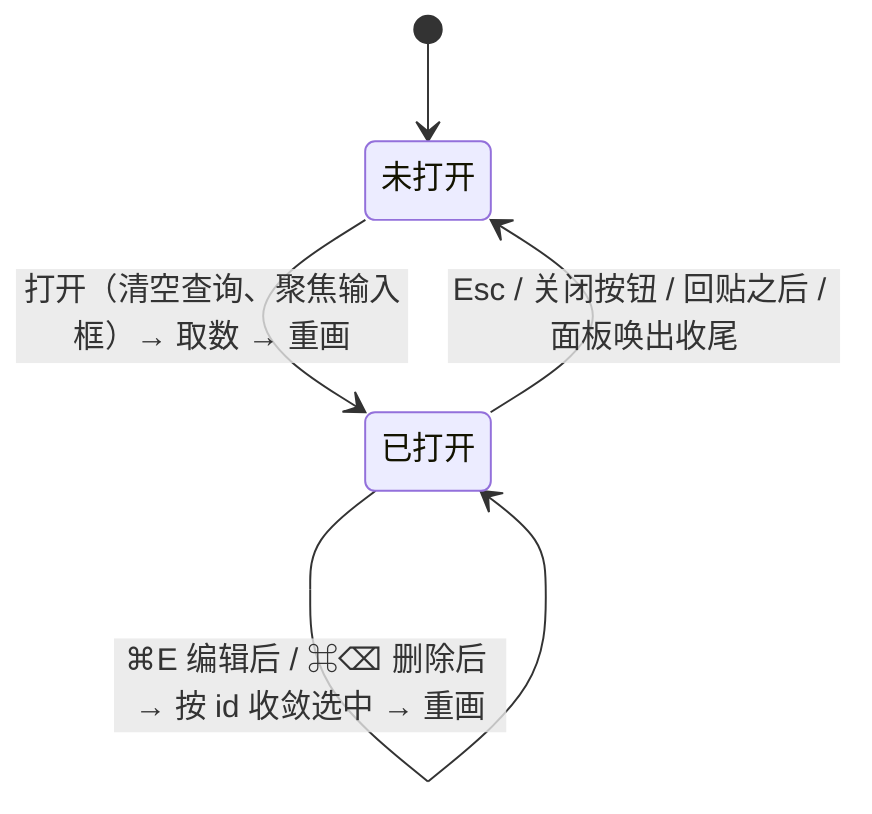
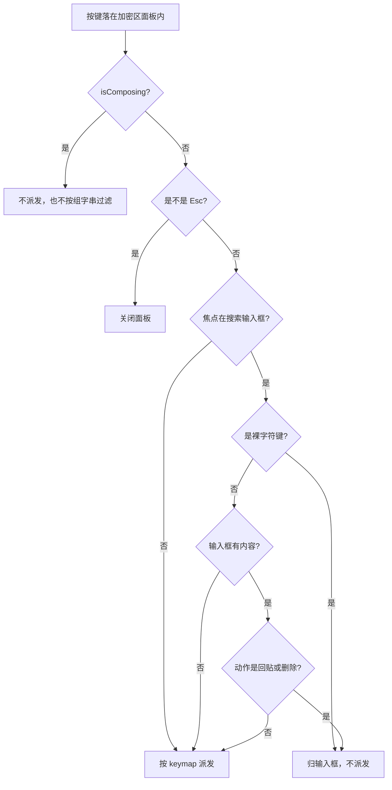

## Goal Capsule

- **Objective:** 加密区攒到几十条以后，用户能在加密区面板里按备注、标签、类别或时间直接定位某一条，不用逐行肉眼翻。
- **Means:** 加密区模态内加一个自带输入框，对已经加载到前端的条目数组做纯前端元数据过滤（KTD1、KTD2）。
- **Authority hierarchy:** AGENTS.md 的 R13（不联网）与 MVP plan U9（加密区条目永不进 FTS、普通搜索看不见）继续生效；本计划只在这两条之内加检索入口，不动它们的边界。
- **Stop conditions:** U1–U5 全部完成；`cargo fmt --all -- --check`、`cargo clippy --workspace --all-targets -- -D warnings`、`cargo test --workspace`、`npm --prefix frontend run build`、`npm --prefix frontend test` 全绿；AGENTS.md R13（网络出口）审计为空。
- **Who finishes and ships:** `ce-work` 在本会话内承接实现 → 验证 → 提交；PR 描述由它生成。

---

## Product Contract

### Summary

给加密区管理面板加一个搜索框：打开面板后可以直接打字，按备注、标签、类别、创建日期过滤加密区条目。过滤是纯前端的内存过滤 —— 不解密、不查数据库、不改索引。

### Problem Frame

加密区面板现在只能逐条看。条目按「不可解密优先 + 时间倒序」排成一张表，每行只显示类别 chip、标签 chip、加密状态、备注和相对时间，没有输入框。

加密区的价值恰恰在于「存了但看不见」，所以用户记得自己存过什么，却没有任何办法在这堆条目里把它找出来。主面板的搜索框对加密区条目完全无效：MVP plan U9 明确把加密区条目整体排除在 FTS 之外，普通搜索永远查不到它们。条目越多，这张表越像一堵墙。

### Requirements

#### 搜索输入

- R1. 加密区面板内提供一个搜索输入框，打开面板时它获得焦点。
- R2. 输入内容按空白拆成多个词，词与词之间是「与」的关系：每个词都要命中，这条才算命中。
- R3. 每个词对条目的元数据做大小写不敏感的子串匹配。
- R4. 参与匹配的元数据只有四项：备注、标签（任一标签命中即可）、类别、创建时间（按本地时区拼成的 `YYYY-MM-DD`）。

#### 结果呈现

- R5. 过滤结果就地替换列表渲染；没有命中时显示「没有匹配的条目」，与「加密区暂无条目」区分开。
- R6. 查询变化后选中项回到第一条；删除或改备注之后，选中索引按条目 id 收敛 —— 该条目仍在结果里就保持选中，否则夹紧到合法范围。
- R7. 标题下的计数在有查询时同时给出总数与命中数（「共 12 条 · 匹配 3 条」）；「无法解密」的条数与「清除不可解密条目」按钮按全量条目算，不随查询变化。
- R8. 每次打开面板，输入框从空查询开始；面板内的数据刷新（清除不可解密条目后的重画）不重置查询。

#### 键盘与焦点

- R9. 焦点在搜索输入框时，裸字符键（含空格）归输入框，不派发任何快捷键动作。
- R10. 焦点在搜索输入框且输入框有内容时，↩（回贴）与 ⌘⌫（删除）让位给原生输入行为，不触发对应动作。
- R11. Esc 无条件关闭面板，不因为输入框有内容而改成「先清空」。
- R12. 输入法组字期间（`KeyboardEvent.isComposing`）不派发任何快捷键动作，也不按未上屏的组字串过滤列表；组字结束后再过滤一次。
- R13. 焦点归当前最上层模态：加密区面板开着时，焦点始终在加密区搜索框（刚打开、取数完成前、编辑器关闭后都一样）；面板被唤出后的收尾流程不得把焦点从加密区搜索框拽回主搜索框。这条只管焦点归属，不改变「每次唤出先收起浮层」的既有行为。
- R14. 点选列表行后，焦点交回搜索输入框 —— 行不是可聚焦元素，不交回去的话用户的下一次按键会落进空处。

#### 边界

- R15. 不解密、不访问 Keychain、不改 schema 与 FTS 索引、不新增 IPC 命令；加密区条目仍然不出现在普通搜索里。
- R16. macOS 与 Windows 同一套实现。
- R17. 顺带把 `list_vault_entries` 切到既有的 `ENTRY_LIST_COLS` 列清单，不再把加密 payload BLOB 读进内存。

### Key Flows

- F1. 加密区定位与回贴
  - **Trigger:** 用户打开加密区面板（⌘⇧V 或托盘「加密区」）。
  - **Steps:** 面板打开、输入框获得焦点 → 用户逐字输入查询 → 列表就地过滤、计数更新、选中回到第一条 → ↑↓ 在命中项之间移动 → 输入框为空时按 ↩ 回贴选中项。
  - **Outcome:** 用户不滚动、不离开面板就能定位并回贴一条加密条目。
  - **Covers:** R1, R2, R3, R4, R5, R6, R7, R9, R10, R13.
- F2. 过滤态下的改备注与删除
  - **Trigger:** 用户对选中项按 ⌘E 改备注，或在输入框为空时按 ⌘⌫ 删除选中项。
  - **Steps:** 改完备注 → 备注不再命中当前查询 → 该行从过滤结果里消失；删除 → 该条目从全量列表与过滤结果里一起消失；两者之后选中索引按 id 收敛，都不会跳回第一条。
  - **Outcome:** 过滤态下的编辑与删除不会留下悬空选中或幽灵行。
  - **Covers:** R6, R7, R10.

### Acceptance Examples

- AE1. 按备注搜索。Given 加密区有三条条目，备注分别是「服务器密码」「WiFi」「信用卡」；When 打开面板输入「密码」；Then 只剩「服务器密码」一条，计数显示「共 3 条 · 匹配 1 条」。
- AE2. 多词是「与」。Given 同上三条；When 输入「服务器 密码」；Then 仍只命中「服务器密码」；When 输入「服务器 WiFi」；Then 命中 0 条，列表显示「没有匹配的条目」。
- AE3. 大小写与子串。Given 一条标签是 `Client-Acme` 的条目；When 输入 `acme`；Then 命中。
- AE4. 按日期搜索。Given 一条条目创建于本地 2026-10-16；When 输入 `2026-10-16`；Then 命中；When 输入 `10-16`；Then 也命中（`YYYY-MM-DD` 串本身就含 `MM-DD` 子串）。
- AE5. 打字时不误触。Given 焦点在输入框、框里已有「密」字；When 按 Space；Then 输入框变成「密 」，不回贴、不删除、不触发预览；When 按 ⌘⌫；Then 输入框按原生行为删字符，不删除条目。
- AE6. 空输入框时旧行为不变。Given 焦点在输入框、框为空；When 按 ↩；Then 回贴选中条目；When 按 ⌘⌫；Then 删除选中条目。
- AE7. Esc 无条件退出。Given 输入框里有查询；When 按 Esc；Then 面板关闭，不需要多按一次。
- AE8. 中文输入法。Given 用户正在输入法组字（`isComposing`）；When 按 Esc；Then 不关闭面板，交给输入法处理；When 组字期间列表不按拼音闪成「没有匹配的条目」，组字结束后再按最终文本过滤。
- AE9. 点选列表行后仍能继续打字。Given 用户在过滤结果里点了一条；When 继续在输入框里打字；Then 字进入输入框（点选后焦点已交回输入框），列表跟着过滤；此时按 ⌘⌫（框为空）仍删除选中条目。
- AE10. 改完备注选中不跳回第一条。Given 过滤结果里选中的是第 5 条；When 按 ⌘E 改完备注（改完仍命中查询）；Then 选中仍是这一条，不是第一条。

### Scope Boundaries

#### Deferred for later

- 搜索密文正文（先解密再匹配）：要么不解密（搜不到），要么把明文拉进内存，与「加密区只在回贴时解密」的不变式冲突。
- 搜索 `metadata_json` 里的字段（文件路径、图片尺寸、RGBA）：这些字段在面板里并不显示，搜到了就是「命中了看不见的东西」。
- 把加密区条目纳入 FTS 索引：与 MVP plan U9 的「不写 FTS」直接冲突。
- 查询语法（引号短语、正则、`-` 排除）：主面板的搜索也没有这套语法，两边保持一致即可。
- 加密区模态内的预览栏：属列表旁预览栏 plan 的后续 PR。

#### Outside this product's identity

- 云端同步、AI 摘要、跨设备检索：与 R13 的离线前提冲突。

### Outstanding Questions

非阻塞：输入框有内容时按 ↩ 目前什么都不做（让位给原生输入，而单行输入的原生行为即无动作），与主面板「边打字边按 ↩ 直接回贴」的约定不同。默认按本计划实现；若真机验收觉得别扭，改法是让 ↩ 在有查询时回贴过滤后的第一条。

### Sources & Research

- `frontend/src/main.ts`（`openVault` / `paintVaultList` / `refreshVaultHeader` / `clampVaultSelection` / `moveVaultSelection` / `currentVaultEntry` / `editVaultNote` / `deleteVaultEntry` / `closeVault`；`vaultEntries` / `vaultSelected` / `vaultSelectedEl` 状态；`resetPanelOnShow`；`setEditorCloseHandler`）
- `frontend/src/panel.ts`（`renderVaultList` 只渲染元数据；`formatTime` 的相对时间；`EntryDto` 定义）
- `frontend/src/keymap.ts`（`handleVaultKey` 的 Esc 逃生口与 action 分发；`matches`；`textFieldOwnsDeleteKey` / `textFieldOwnsSpace` 焦点门）
- `frontend/src/editor.ts`（`ev.isComposing` 早 return 的既有写法）
- `frontend/src/platform.ts`（`keys()` —— 平台相关的键位文案，引导语要用）
- `frontend/src/tray-entries.test.ts`（`resetPanelOnShow` 里「先清空后聚焦」的源码契约断言）
- `frontend/index.html`（`#vault` 面板结构；`#search` 主搜索框结构）
- `frontend/src/styles.css`（`.search-row` / `#search` / `.vault-card` / `.vault-sub` / `.vault-list` / `.vault-row`）
- `app/src/commands.rs`（`EntryDto` 字段；`entry_to_dto` 对加密区条目清空 `content`）
- `app/src/storage.rs`（`list_vault_entries` 现用 `ENTRY_COLS`；`ENTRY_LIST_COLS`；`move_to_vault`；包名是 `clipvault`，`-p app` 不匹配）
- `app/src/search.rs`（`build_search_query_impl` 里 `e.is_vault = 0` 的排除）
- `clipvault-core/src/schema.rs`（FTS 触发器对 `is_vault` 的排除）
- `docs/plans/2026-09-24-0931-feat-clipvault-mvp-plan.md`（U9：加密区条目完整排除 FTS，只能按元数据在加密区列表里逐条查看）

外部研究未运行：用户没有要求，本仓库的前端过滤、焦点门、模态状态机都有现成模式可循。

---

## Planning Contract

### Key Technical Decisions

- KTD1. 搜索是纯前端过滤，不走新的后端查询。`(session-settled: user-directed — chosen over 加一条 list_vault_search IPC: 加密区条目的备注 / 标签 / 类别 / 时间本来就随 listVault 整批下发到前端，再查一遍数据库是重复劳动)`
- KTD2. 匹配范围 = 备注 / 标签 / 类别 / 本地日期，不含正文、缩略图与 `metadata_json`。`(session-settled: user-directed — chosen over 元数据 + 解密后的正文: 密文正文不解密就搜不到，解密后驻留内存又与「加密区只在回贴时解密」冲突)` Governs R4, R15.
- KTD3. 匹配语义 = 空白拆词 + 词间「与」 + 大小写不敏感子串。`(session-settled: user-directed — chosen over 整串包含: 整串包含让「密 码」这种带空格的输入永远命中不了)`
- KTD4. 日期按本地时区拼成 `YYYY-MM-DD` 再做子串匹配，不用列表里显示的相对时间。`(session-settled: user-directed — chosen over 相对时间: 「3 分钟前」没法用键盘敲出来；YYYY-MM-DD 的子串同时覆盖 MM-DD 与年份)`
- KTD5. 焦点门分三档：焦点在输入框时裸字符键归输入框；焦点在输入框且有内容时 ↩ 与 ⌘⌫ 归输入框；Esc 无条件关闭面板。三档都以「焦点在输入框」为前提 —— 焦点不在输入框时（Tab 走开等）按键照常派发。`(session-settled: user-directed — chosen over Esc 先清空输入框: 面板必须永远关得掉；先清空会把「想退出」变成两次按键)` Governs R9, R10.
- KTD6. 组字期间既不派发动作，也不按未上屏的组字串过滤列表；组字结束后再过滤一次。`(session-settled: user-directed — chosen over 只挡 Esc: 中文输入法的候选词正在编辑时，任何动作派发都会打断组字；按拼音串过滤会让列表在选词前闪成「没有匹配的条目」)` Governs R12.
- KTD7. 过滤后的视图是**派生值**，不是第二份存储状态：全量数组是唯一的状态，视图由「全量数组 + 输入框当前查询」现算。选中收敛分两条路径 —— 查询变化时归零，数据变化时按条目 id 收敛（仍在结果里就保持选中，否则夹紧）。`(技术选择 — 替代: 存一份「上一次过滤结果」的缓存: 缓存要靠人工在每条改动路径上记得刷新，漏一处就留下与全量不一致的旧视图；派生值没有这种义务。派生视图每次调用都重算过滤，代价是每次按键一次线性扫描，见 KTD8)`
- KTD8. 过滤在 `input` 事件里同步执行，不做防抖。`(技术选择 — 替代: 沿用主搜索框的 100ms 防抖: 防抖是为了少发一次 IPC；这里是纯内存过滤，几百条是亚毫秒，防抖只会让列表晚一拍。代价是每次按键都要全量重画列表（重写 innerHTML），条目数很大时这段重绘才是瓶颈 —— 这也是 Assumptions 里把量级定在「数百条」的原因)`
- KTD9. 焦点归最上层模态：加密区面板开着时，焦点在加密区搜索框，不在主搜索框。`(技术选择 — 替代: 靠事件先后顺序: 托盘点「加密区」时，面板唤出的收尾与 openVault 的取数是两条异步链，先后顺序取决于平台事件循环，焦点被抢走会让用户敲的字落到主搜索框)`
- KTD10. `list_vault_entries` 改用既有的 `ENTRY_LIST_COLS`。`(技术选择 — 替代: 为加密区单开一套列清单: 性能优化 W1 已经把列表侧的列清单抽出来了，加密区列表只是漏改了一处)`
- KTD11. 「打开面板」与「刷新数据」是两条路径：打开时清空查询并聚焦，刷新时保留当前查询与选中。`(技术选择 — 替代: 把两件事都塞进 openVault: 「清除不可解密条目」按钮靠 openVault 重画，若打开时清查询，点了清除就会把用户的过滤词无声抹掉；取数完成前的空窗期还会让焦点停在被遮住的主搜索框上)`
- KTD12. 过滤与选中收敛的状态转移放在纯函数模块里，`main.ts` 只留 DOM 与 IPC 接线。`(技术选择 — 替代: 状态留在 main.ts 里: 前端测试跑在没有 DOM 的 vitest 环境里，main.ts 顶部就执行 document.querySelector、无法被测试导入；把转移抽成纯函数才能在不引入 jsdom 的前提下钉住它们)`

### High-Level Technical Design





### Assumptions

- 加密区条目数量在数百条量级：整批下发加内存过滤成立。量级再上一个数量级（数千条）时，要重新评估是否改走后端分页。
- `created_at` 是秒级 Unix 时间戳；本地日期用 `new Date(created_at * 1000)` 的本地取值拼装，不用 `toISOString()`（后者是 UTC，跨时区时会差一天）。
- 加密区条目的备注、标签、类别在库里是明文（被加密的只有 `content` 与 `payload`），不可解密（`is_decryptable = false`）的条目同样带这些元数据，因此照样能被搜到。
- 前端测试跑在 node 环境、没有 jsdom，`main.ts` 无法被测试导入 —— 需要被断言的状态转移必须放在纯函数模块里（KTD12）。

### Sequencing

U1（纯函数模块 + 单测）→ U2（模态输入框、过滤接线、计数）→ U3（键盘与焦点）→ U4（后端列清单清理）→ U5（文档与验收）。U4 与 U1–U3 无耦合，可独立成一次提交。

---

## Implementation Units

### U1. 加密区搜索的纯函数模块

- **Goal:** 新建 `frontend/src/vault-search.ts`，把「条目 + 查询」变成命中判断、本地日期串、计数文案、空态文案，以及过滤与选中收敛的状态转移 —— 全部是纯函数，供 `main.ts` 接线与测试共用。
- **Requirements:** R2, R3, R4, R5, R6, R7.
- **Files:**
  - `frontend/src/vault-search.ts`（新建）
  - `frontend/src/vault-search.test.ts`（新建）
- **Approach:**
  1. `localDateString(unixSecs: number): string` —— 用 `new Date(unixSecs * 1000)` 的本地 `getFullYear` / `getMonth` / `getDate` 拼 `YYYY-MM-DD`。
  2. `vaultHaystack(e: EntryDto): string` —— 把备注、每个标签、类别、本地日期拼成一个小写字符串；字段之间用分隔符隔开，避免「备注尾 + 标签头」跨字段误命中。
  3. `matchesVaultQuery(e: EntryDto, query: string): boolean` —— 查询按空白拆词；查询为空（全空白）时全部命中；每个词都要是 haystack 的子串。
  4. `filterVaultEntries(entries: EntryDto[], query: string): EntryDto[]` —— 返回命中项，顺序与输入一致。
  5. `applyVaultQuery(entries, query): { view: EntryDto[]; selected: number }` —— 查询变化这条路径：过滤后选中归零。
  6. `reapplyVaultFilter(entries, query, selectedId): { view: EntryDto[]; selected: number }` —— 数据变化这条路径：过滤后，若 `selectedId` 仍在 view 里就选中它，否则把索引夹紧到合法范围。
  7. `removeVaultEntry(entries, id): EntryDto[]` 与 `replaceVaultEntry(entries, updated): EntryDto[]` —— 按 id 摘行 / 换行，返回新数组（全量数组是唯一状态，不就地改）。
  8. `vaultHeaderText(total, undecryptable, matched, hasQuery): string` —— 只产出计数行（「共 12 条[ · 3 条无法解密][ · 匹配 2 条]」）；`total === 0` 返回空串。总数为 0 时那句带平台键位的引导语留在 `main.ts` 的 `refreshVaultHeader` 里，不进这个纯函数（引导语要用 `keys("⌘L")`，是平台相关的）。
  9. `vaultEmptyStateText(hasQuery: boolean): string` —— 「没有匹配的条目」与「加密区暂无条目」二选一。
  10. `EntryDto` 从 `./panel` 导入（类型已在那里导出），不重复定义。
- **Patterns to follow:** `frontend/src/panel.ts` 的纯函数风格（无 DOM、无 IPC）；`frontend/src/platform.ts` 的小模块形状。
- **Test scenarios:**
  - 空查询 → 全部命中。
  - 单词命中备注 / 标签 / 类别 / 日期各一例。
  - 词间「与」：两词都命中才命中；一个不命中则不命中。
  - 大小写不敏感：`Client-Acme` 被 `acme` 命中。
  - 子串：`2026-10-16` 被 `10-16` 与 `2026` 命中。
  - 跨字段不误命中：备注「ab」加标签「c」不该被 `abc` 命中。
  - `localDateString` 用固定时间戳加本地取值断言，不写死 UTC 串。
  - `applyVaultQuery`：查询变化后选中归零。
  - `reapplyVaultFilter`：改完备注后条目仍在 view 里 → 选中保持该条；该条已不在 view 里 → 索引夹紧（不越界、不跳回第一条，除非 view 只有更少的条目）。
  - `removeVaultEntry` / `replaceVaultEntry`：按 id 摘行与换行，其余条目不动。
  - `vaultHeaderText` 的三种形态：无查询 / 有查询 / 总数为 0（返回空串）。
  - `vaultEmptyStateText` 的两种形态。
- **Verification:** `npm --prefix frontend test` 全绿；新增用例 ≥ 12。

### U2. 面板输入框、过滤接线与计数

- **Goal:** 加密区面板顶部出现搜索输入框；输入即时过滤列表并更新计数；命中为空时显示「没有匹配的条目」；加载失败时保留错误文案。
- **Requirements:** R1, R2, R5, R6, R7, R8, R12, R14.
- **Files:**
  - `frontend/index.html`（`#vault` 面板内加 `.vault-search-row` 与 `<input id="vault-search">`）
  - `frontend/src/styles.css`（`.vault-search-row` / `#vault-search` 样式）
  - `frontend/src/main.ts`（新增 `vaultSearchEl` 与 `vaultLoadError`；接线 `applyVaultQuery` / `reapplyVaultFilter`；`paintVaultList` / `refreshVaultHeader` / `currentVaultEntry` / `moveVaultSelection` / `clampVaultSelection` / `editVaultNote` / `deleteVaultEntry` 改走纯函数；列表点击后把焦点交回输入框）
  - `frontend/src/vault-search.test.ts`（U1 已建；本单元的接线契约用例追加在这里）
- **Approach:**
  1. HTML：在 `#vault` 的 `.editor-head` 之下插一行 `<div class="vault-search-row"><input id="vault-search" type="text" placeholder="搜索备注、标签、类别、日期…" autocomplete="off" autocorrect="off" autocapitalize="off" spellcheck="false" /></div>`，位置对齐主面板「标题栏下就是搜索行」的层次。
  2. CSS：照 `#search` 的写法（透明底、无边框、`color: var(--text)`），字号取 14px（模态比主面板窄）；占位符用 `--muted`。
  3. 状态：全量数组 `vaultEntries` 是唯一的状态，**不存第二份视图数组** —— 视图一律由 `filterVaultEntries(vaultEntries, vaultSearchEl.value)` 现算（KTD7）。
  4. 输入事件：绑到 `#vault-search` 的 `input`，走 `applyVaultQuery`（U1 的纯函数）拿 `{ view, selected }`，落到 `vaultSelected` 后重画。事件是 `isComposing` 为真时跳过过滤；另在 `compositionend` 上再跑一次（KTD6）。同步执行，不防抖（KTD8）。
  5. 数据变化（改备注 / 删除）：走 `reapplyVaultFilter(vaultEntries, query, 选中条目 id)`，按 id 收敛，不归零（R6）。删除另用 `removeVaultEntry` 从全量数组摘行。
  6. `paintVaultList()`：渲染视图；视图为空且有查询时写「没有匹配的条目」，否则交给 `renderVaultList`（它自己写「加密区暂无条目」）。重画后把列表滚动位置复位到顶部 —— 选中已回到第一条，列表却停在底部会让人以为没生效。写法沿用 `openVault` 里加载失败那条路径的 `vaultListEl.innerHTML = …`。
  7. 加载失败：新增 `vaultLoadError` 标记 —— 取数失败的 catch 里置位并写错误文案，成功后清除；`paintVaultList` 在它存在时保留错误文案，不改写成空态，否则用户敲一个字就会把「加载加密区失败」变成「加密区暂无条目」。
  8. `refreshVaultHeader()`：总数与「无法解密」条数按 `vaultEntries` 算；计数行走纯函数 `vaultHeaderText`；总数为 0 时沿用现有的引导语（那句带 `keys("⌘L")`，是平台相关的，留在 main.ts 里）。
  9. 打开与刷新分开（KTD11）：真正打开面板时先显示模态、**同步清空 `vaultSearchEl.value` 并聚焦 `#vault-search`**，再去 `await listVault()` 取数（取数空窗期焦点已经在输入框上）；「清除不可解密条目」按钮走刷新路径，保留当前查询与选中。
  10. 列表点击：`vaultListEl` 的点击处理里选中该行后，把焦点交回 `#vault-search`（R14）—— 行不是可聚焦元素，不交回去的话用户接下来的按键会落进空处。
- **Patterns to follow:** `main.ts` 里主搜索框「`selected = 0` 后 `load()`」的接线；`openVault` 加载失败的 `innerHTML` 写法；`panel.ts::renderVaultList` 的 `data-index` 约定；`panel-show.test.ts` 用 `?raw` 读源码做接线断言的做法。
- **Test scenarios:**
  - 纯函数：`applyVaultQuery` / `reapplyVaultFilter` / `removeVaultEntry` 的行为（U1 已覆盖，本单元只做接线断言）。
  - 接线契约（`?raw` 读 `main.ts`）：`#vault-search` 的 `input` 与 `compositionend` 监听都在；`input` 监听里有 `isComposing` 闸门；`paintVaultList` 渲染的是派生视图而不是某份缓存数组；打开面板的路径里查询清零与聚焦发生在 `await listVault()` 之前；「清除不可解密条目」走的刷新路径不重置查询。
- **Verification:** `npm --prefix frontend test` 全绿；本单元新增用例 ≥ 5。

### U3. 键盘与焦点

- **Goal:** 加密区面板内的按键按焦点门分派：裸字符键归输入框、有内容时 ↩ 与 ⌘⌫ 让位、Esc 无条件关闭、组字期间不派发也不过滤；焦点不被面板唤出的收尾流程抢走。
- **Requirements:** R9, R10, R11, R12, R13, R14.
- **Files:**
  - `frontend/src/keymap.ts`（`handleVaultKey`：加 `isComposing` 早 return、裸字符键判定、输入框有内容时的 ↩ / ⌘⌫ 让位）
  - `frontend/src/keymap.test.ts`（新增用例）
  - `frontend/src/main.ts`（`focusActiveSurface()`；`resetPanelOnShow` / `closeVault` / 编辑器关闭回调改走它）
  - `frontend/src/tray-entries.test.ts`（既有断言改指 `focusActiveSurface()` —— 它断言 `resetPanelOnShow` 里 `searchEl.value=""` 排在 `searchEl.focus()` 之前，替换成 `focusActiveSurface()` 后 `indexOf` 会返回 -1，这条必红）
- **Approach:**
  1. `handleVaultKey` 的顺序：`isComposing` 直接 return false（IME 优先，Esc 也交给 IME）；`key === "Escape"` 走现有的无条件关闭；其余按 keymap 分派，但先过焦点门。
  2. 焦点门三档（判据写成一个局部纯函数，便于单测）：
     - 焦点在 `#vault-search` 且按键是裸字符（`ev.key.length === 1` 且无 meta / ctrl / alt）→ 不派发，空格与任何被重绑到字母的动作都归输入框。
     - 焦点在 `#vault-search` 且输入框有内容，且动作是 `paste` 或 `delete_entry` → 不派发，原生输入优先。
     - 其余照旧派发（↑↓ 移动选中、⌘E 改备注、⌘⇧V 收起等）。
  3. `main.ts` 的焦点：抽一个 `focusActiveSurface()` —— 加密区面板开着时聚焦 `#vault-search`，否则聚焦主 `#search`；`resetPanelOnShow`（fresh 分支）、`closeVault`、以及编辑器关闭回调（`setEditorCloseHandler`）都改走它 —— 编辑器关闭后焦点要回到当前最上层模态的输入框，否则改完备注继续打字就没反应了。
  4. `handleVaultKey` 现有的 Esc 分支保持在 `isComposing` 闸门**之后**、其余 keymap 派发之前 —— 它仍是「无条件逃生口」（不受重绑影响），只是不再排在组字判断之前：组字期间的 Esc 交给输入法（AE8）。
- **Patterns to follow:** `editor.ts` 的 `ev.isComposing` 早 return；`main.ts` 现有两处焦点门（`textFieldOwnsDeleteKey` / `textFieldOwnsSpace`）；`keymap.test.ts` 里 `handleVaultKey` 的 `ev()` 假事件与 `vaultCtx()` 调用记录器。
- **Test scenarios:**
  - 组字中按 Esc → 不派发任何动作。
  - 焦点在输入框、输入框有内容、按 Space → 不派发。
  - 焦点在输入框、输入框有内容、按 ⌘⌫ → 不派发删除。
  - 焦点在输入框、输入框为空、按 ↩ → 派发回贴；按 ⌘⌫ → 派发删除。
  - 焦点不在输入框时旧行为不变：↩ 回贴、⌘⌫ 删除、⌘E 改备注、↑↓ 移动。
  - 输入框有内容时按 Esc → 仍然关闭面板。
  - 接线契约（`?raw` 读 `main.ts`）：`resetPanelOnShow` 走 `focusActiveSurface()`，不再直接 `searchEl.focus()`；编辑器关闭回调也走 `focusActiveSurface()`。
- **Verification:** `npm --prefix frontend test` 全绿（含 `tray-entries.test.ts` 的既有断言已同步改）；`keymap.test.ts` 新增用例 ≥ 7。

### U4. 加密区列表不再拉取密文 payload

- **Goal:** `list_vault_entries` 用 `ENTRY_LIST_COLS`，加密区条目列表不再把加密 payload BLOB 读进内存。
- **Requirements:** R15, R17.
- **Files:**
  - `app/src/storage.rs`（`list_vault_entries` 的 SELECT 换成 `ENTRY_LIST_COLS`；新增用例）
- **Approach:**
  1. 把 `list_vault_entries` 的 `SELECT {ENTRY_COLS}` 换成 `SELECT {ENTRY_LIST_COLS}` —— 两份列清单的列名与顺序完全一致，`Entry::from_sqlite_row` 的索引绑定不受影响；`payload` 与 `payload_nonce` 在 SELECT 层就是 `NULL AS`。
  2. 新增用例，照 `list_recent_does_not_fetch_payload_blob` 的形状：直接插一行 `is_vault = 1` 且带真实 payload BLOB 的条目（沿用 `delete_entry_handles_vault_row_without_touching_others_fts` 里直接落库的手法），断言 `list_vault_entries` 返回的 `payload` 与 `payload_nonce` 恒为 `None`。
  3. 不改 `get_by_id` —— 回贴与预览仍要拿密文。
- **Patterns to follow:** `storage.rs` 里 `list_recent` 的 `ENTRY_LIST_COLS` 用法与那条 W1 用例的写法。
- **Test scenarios:**
  - 一行带 payload 的加密区条目 → `list_vault_entries` 返回的 `payload` 与 `payload_nonce` 为 `None`。
  - 同一次调用仍能拿到 `note` / `auto_category` / `created_at` / `is_decryptable` —— 列表要的元数据一个不少。
- **Verification:** `cargo test -p clipvault storage::` 全绿（workspace 里 `app/` 目录的包名是 `clipvault`，`-p app` 不匹配任何包）；新增用例 ≥ 1。

### U5. 文档与验收

- **Goal:** 把加密区搜索写进 README 与 AGENTS.md 的实施进度；把验收例子落成真机步骤。
- **Requirements:** ——（文档收尾单元，配套 U1–U4 已实现的 R）
- **Files:**
  - `README.md`（加密区一节补一句：面板内可按备注 / 标签 / 类别 / 日期过滤，不解密正文）
  - `AGENTS.md`（「实施进度」段加本计划条目与新的测试基线）
- **Approach:** 只写用户能观察到的行为，不写实现细节；基线数字等 `npm --prefix frontend test` 与 `cargo test --workspace` 的实测结果出来后再填。
- **Test scenarios:** 无（纯文档）。
- **Verification:** `git diff --stat` 只含预期文件。

---

## Verification Contract

### Repo-Level Gates

| 命令 | 适用范围 | 通过信号 |
|---|---|---|
| `cargo fmt --all -- --check` | 全仓 | 无输出、退出码 0 |
| `cargo check --workspace --all-targets` | 全仓 | 编译通过 |
| `cargo clippy --workspace --all-targets -- -D warnings` | 全仓 | 无 warning |
| `cargo test --workspace` | 后端 | 全绿，含 U4 新增用例 |
| `npm --prefix frontend run build` | 前端 | tsc 与 vite 构建通过 |
| `npm --prefix frontend test` | 前端 | 全绿，含 `vault-search.test.ts` 与 `keymap.test.ts` 的新增用例 |

AGENTS.md R13（网络出口）审计，下面两条都必须无输出：

```bash
cargo tree | grep -E 'reqwest|hyper'
grep -rE 'reqwest::|hyper::|TcpStream|std::net::' app/src clipvault-core/src
```

既有基线（后端 357 passed + 0 ignored、前端 160 例）保持全绿；本计划新增前端 ≥ 24 例、后端 ≥ 1 例。

### Behavioral Skill Evaluation

- macOS 真机：⌥⌘V 唤出面板 → ⌘⇧V 打开加密区 → 输入「密」→ 列表只剩命中项，计数变成「共 N 条 · 匹配 1 条」→ ↑↓ 移动 → 清空输入框后按 ↩ 回贴 → 有查询时按 Esc 直接关闭。
- macOS 真机：输入框里打字时按 Space 不应触发任何动作（不弹预览栏、不回贴）；按 ⌘⌫ 不应删除条目。
- macOS 真机：中文输入法组字时按 Esc 不应关闭面板；组字过程中列表不应按拼音闪成「没有匹配的条目」。
- macOS 真机：点一条列表行后继续打字，字应进入加密区搜索框。
- Windows 真机：U1–U3 全在前端（两端同一份代码），CI 的 windows job 覆盖编译；U4 改的是平台无关的 Rust 代码。真机复跑上面四条即可。

---

## Definition of Done

### Global

- U1–U5 全部完成，且 AGENTS.md 的「实施进度」段补上本计划的一句话总结。
- 没有引入任何新依赖：前端只用了已有的 vitest，后端没有新 crate。
- AGENTS.md R13（网络出口）审计为空：`cargo tree | grep -E 'reqwest|hyper'` 与 `grep -rE 'reqwest::|hyper::|TcpStream|std::net::' app/src clipvault-core/src` 均无输出。
- 加密区条目仍然不出现在普通搜索 —— `app/src/search.rs` 的 `e.is_vault = 0` 未被改动。
- 「Deferred for later」里的条目没有被顺手实现。

### Per-Unit

- U1 至少 12 个新单测 + `vault-search.ts` 的十个纯函数。
- U2 至少 5 个新接线契约用例（`?raw` 读 `main.ts`）。
- U3 `keymap.test.ts` 至少 7 个新用例 + `focusActiveSurface` 接线 + `tray-entries.test.ts` 的既有断言同步改掉。
- U4 至少 1 个新单测钉住 `list_vault_entries` 不取 payload。
- U5 README 与 AGENTS.md 更新到位，基线数字用实测值。

### Long-Run Cleanup

- 若实施期为了调试临时给面板加了第二个输入框或临时的焦点 hack，收尾时必须清掉，只保留 U2 / U3 描述的那一套。
- 全量数组是唯一的状态：不允许再存一份「上一次过滤结果」的缓存数组，也不允许在过滤之外维护第三份派生状态（KTD7）。
